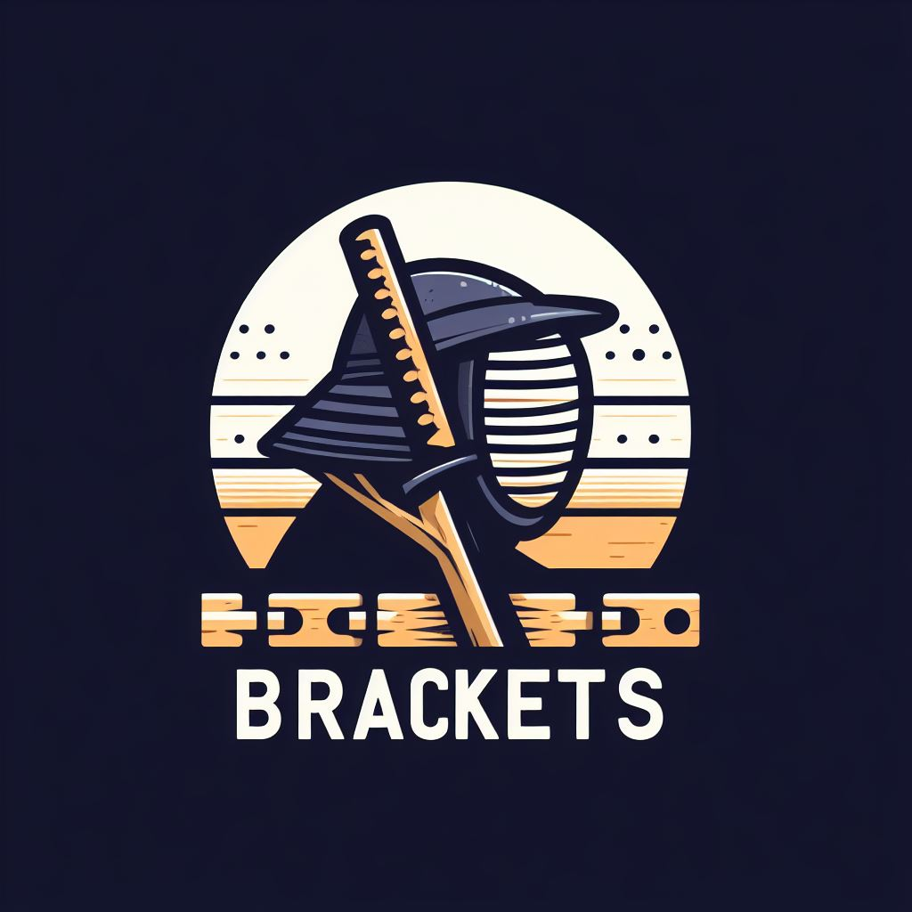
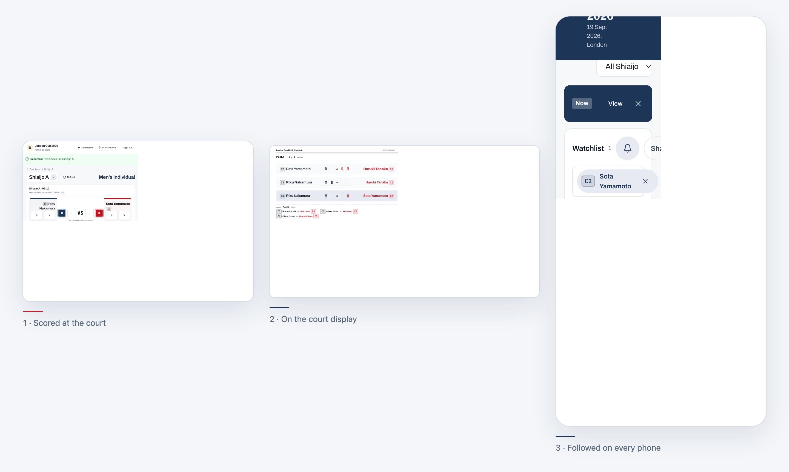

<!-- BEGIN __DO_NOT_INCLUDE__ -->
<p align="center"></p>
<!-- END __DO_NOT_INCLUDE__ -->
<h1 align="center">bracket-creator</h1>

<h3 align="center">Your tournament, live on every screen</h3>

<p align="center">Score each bout at the court on a laptop or tablet. The court display and every phone in the hall show the score as it is entered. Made for kendo and naginata tournaments; engi pairs also suit iaido and jodo.</p>

<p align="center">
  <a href="https://gitrgoliveira.github.io/bracket-creator/">
    
  </a>
</p>

<p align="center"><b>Free and open source.</b> Read the <a href="https://gitrgoliveira.github.io/bracket-creator/">documentation</a> to run your first tournament.</p>

<p align="center">
  <a href="https://github.com/gitrgoliveira/bracket-creator/releases" rel="nofollow"></a>
  <a href="https://github.com/gitrgoliveira/bracket-creator/blob/main/LICENSE" rel="nofollow"></a>
  <a href="https://codecov.io/gh/gitrgoliveira/bracket-creator" rel="nofollow"></a>
  <a href="https://github.com/gitrgoliveira/bracket-creator/actions/workflows/codeql.yaml" rel="nofollow"></a>
</p>

## Run it

[Install](#install) bracket-creator first. The Docker image starts the tournament app by itself, already open to the hall network. With a binary install, start it on the laptop at the desk:

```bash
bracket-creator mobile-app --folder ./tournament-data --bind 0.0.0.0
```

Open [http://localhost:8080](http://localhost:8080) on that laptop. On the courts, the court displays and the phones in the hall, open `http://<laptop address>:8080`, for example `http://192.168.1.10:8080`. `--bind 0.0.0.0` is what lets those devices reach the app; without it only the laptop can. The operating system may ask whether to allow incoming connections: allow them. Refer to [Operating modes](https://gitrgoliveira.github.io/bracket-creator/user-guide/organisers/operating-modes/) for what opening the app to the hall network means for the admin password.

What the tournament app does:

* **Admin console** (password-protected): competitions, participants, seeding, draws, scheduling, and scoring.
* **Public viewer and court displays**: real-time schedule, standings, and brackets for spectators, plus big-screen court displays and a transparent overlay for streaming.
* **All formats**: Knockout, Pools + Knockout, League, and Swiss, for individuals and teams (including kachinuki), plus naginata and Engi-kyogi (kata) competitions.
* **Excel export**: download the results as a workbook at any point during the event.
* **Backup and restore**: download a backup of the tournament or one competition, restore it with a preview first, and undo a restore. The server also keeps a daily copy when the data changed.

Start with these guides on the documentation site:

* [Your first tournament](https://gitrgoliveira.github.io/bracket-creator/user-guide/start-here/first-tournament/)
* [Choosing your setup](https://gitrgoliveira.github.io/bracket-creator/user-guide/start-here/choosing-your-setup/)
* [Run a tournament on the day](https://gitrgoliveira.github.io/bracket-creator/user-guide/organisers/run-tournament/)
* [Backup and restore](https://gitrgoliveira.github.io/bracket-creator/user-guide/organisers/backup-and-restore/)
* [Host the tournament app](https://gitrgoliveira.github.io/bracket-creator/user-guide/install/hosting/)
* [mobile-app command reference](https://gitrgoliveira.github.io/bracket-creator/user-guide/commands/mobile-app/)

The kendo tournament guidelines this application is based on are in [running_a_kendo_tournament.md](running_a_kendo_tournament.md). Naginata and Engi-kyogi specifics are covered in the [Naginata competitions guide](https://gitrgoliveira.github.io/bracket-creator/user-guide/organisers/naginata/).

## Other ways to work

No laptop at the courts? The same binary still covers the day.

**Printed Excel brackets.** Give it a CSV of participants and it produces print-ready Excel workbooks with pool draws, match schedules and elimination trees. Refer to [create-pools](https://gitrgoliveira.github.io/bracket-creator/user-guide/commands/create-pools/), [create-knockout](https://gitrgoliveira.github.io/bracket-creator/user-guide/commands/create-knockout/), the [input format](https://gitrgoliveira.github.io/bracket-creator/user-guide/organisers/input-format/) and the [tournament formats](https://gitrgoliveira.github.io/bracket-creator/user-guide/organisers/formats/).

```bash
# Pools of at least 5 with 3 winners per pool
bracket-creator create-pools -z -p 5 -w 3 -f players.csv -o pools.xlsx

# Straight knockout for teams of 5
bracket-creator create-knockout -t 5 -f teams.csv -o knockout.xlsx
```

**A shared Google Sheet.** Upload the workbook to Google Drive and fill results in from any device, so every shiai-jo works from the same document. Refer to [Keep courts in sync](https://gitrgoliveira.github.io/bracket-creator/user-guide/start-here/first-tournament/#keep-courts-in-sync).

**Paper only.** Print the sheets and run the day with pens: the workbooks are laid out for A4 and A3, and the [print command](https://gitrgoliveira.github.io/bracket-creator/user-guide/commands/print/) turns them into PDFs. Refer to [If you print your brackets instead](https://gitrgoliveira.github.io/bracket-creator/user-guide/start-here/first-tournament/#if-you-print-your-brackets-instead).

`bracket-creator serve` starts the Legacy Web UI, a browser form for the same Excel generators, kept for compatibility. Refer to the [Legacy Web UI guide](https://gitrgoliveira.github.io/bracket-creator/user-guide/organisers/web-ui/).

## Install

**Docker is the recommended way to run bracket-creator on every platform.** Homebrew is the other main option, shown below. Linux packages (`.deb`, `.rpm`, `.apk`), pre-compiled binaries, other methods, and upgrade notes are covered in the [install guide](https://gitrgoliveira.github.io/bracket-creator/user-guide/install/install/).

<details>
  <summary><b>Docker</b> (recommended)</summary>

Pull and run the tournament app image; tournament state lives in the mounted folder:

```bash
mkdir -p tournament-data
docker run -p 8080:8080 -v "$PWD/tournament-data:/tournament-data" \
  ghcr.io/gitrgoliveira/bracket-creator-mobile:latest
```

On Linux, also make the folder writable by the container's non-root user before the first run: `sudo chown 65534 tournament-data`. (Docker Desktop on macOS/Windows handles this automatically.)

Then open [http://localhost:8080](http://localhost:8080).

Three image variants are published: `bracket-creator-mobile` (tournament app), `bracket-creator-mobile-pdf` (tournament app plus LibreOffice for PDF export), and `bracket-creator` (the legacy Excel-generator web UI). Refer to the [hosting guide](https://gitrgoliveira.github.io/bracket-creator/user-guide/install/hosting/) for deployment details.

</details>

<details>
  <summary><b>Homebrew</b></summary>

```bash
brew tap gitrgoliveira/tap
brew trust gitrgoliveira/tap
brew install bracket-creator
```

`brew trust` marks the tap as trusted, which Homebrew requires before installing from a third-party tap. Update later with `brew upgrade bracket-creator`. The formula (in the [gitrgoliveira/homebrew-tap](https://github.com/gitrgoliveira/homebrew-tap) repository) builds from source, so it needs a C toolchain (the Xcode Command Line Tools on macOS or `build-essential` on Linux) and network access for Go module downloads.

The single binary bundles every subcommand, including `bracket-creator serve` (web UI) and `bracket-creator mobile-app` (tournament app).

</details>

## Contribute to this repository

This project adheres to the Contributor Covenant [code of conduct](https://github.com/gitrgoliveira/bracket-creator/blob/main/.github/CODE_OF_CONDUCT.md). By participating, you are expected to uphold this code. We appreciate your contribution. Please refer to our [contributing](https://github.com/gitrgoliveira/bracket-creator/blob/main/.github/CONTRIBUTING.md) guidelines for further information.

## License

Copyright © 2023–2026 Ricardo Oliveira &lt;oliveira.rg [at] gmail.com&gt;

This is an independent project created and maintained by Ricardo Oliveira in a
personal capacity: in his own time and on his own equipment. It is not
affiliated with, endorsed by, or owned by any employer, and Ricardo Oliveira is
the sole copyright holder.

This Source Code Form is subject to the terms of the Mozilla Public License,
v. 2.0. If a copy of the MPL was not distributed with this file, You can obtain
one at <https://mozilla.org/MPL/2.0/>. The full license text is in
[LICENSE](LICENSE).
