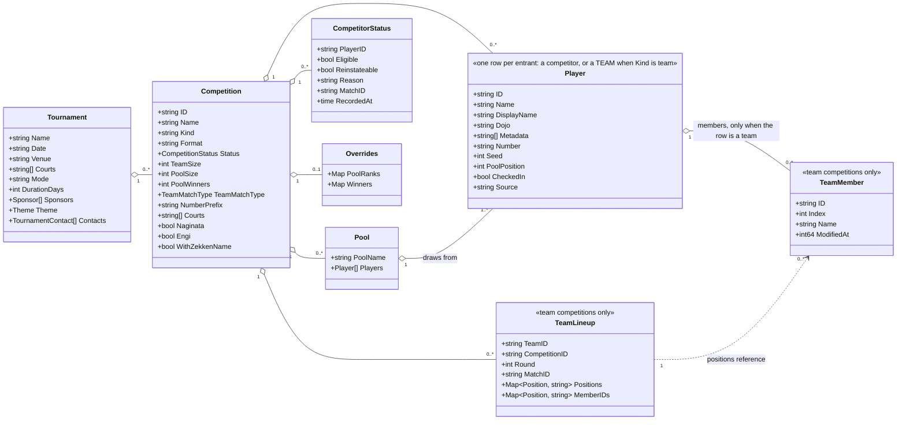
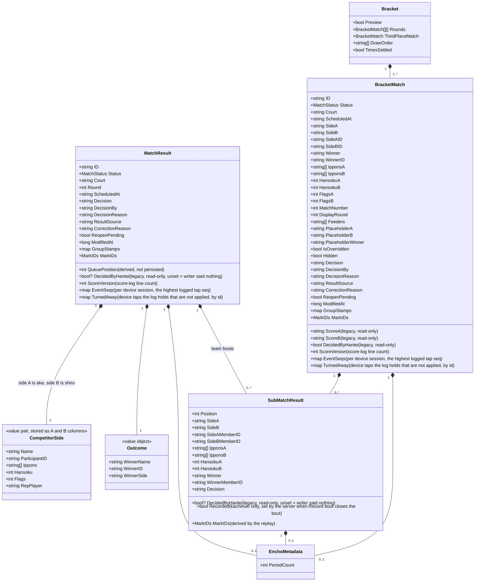
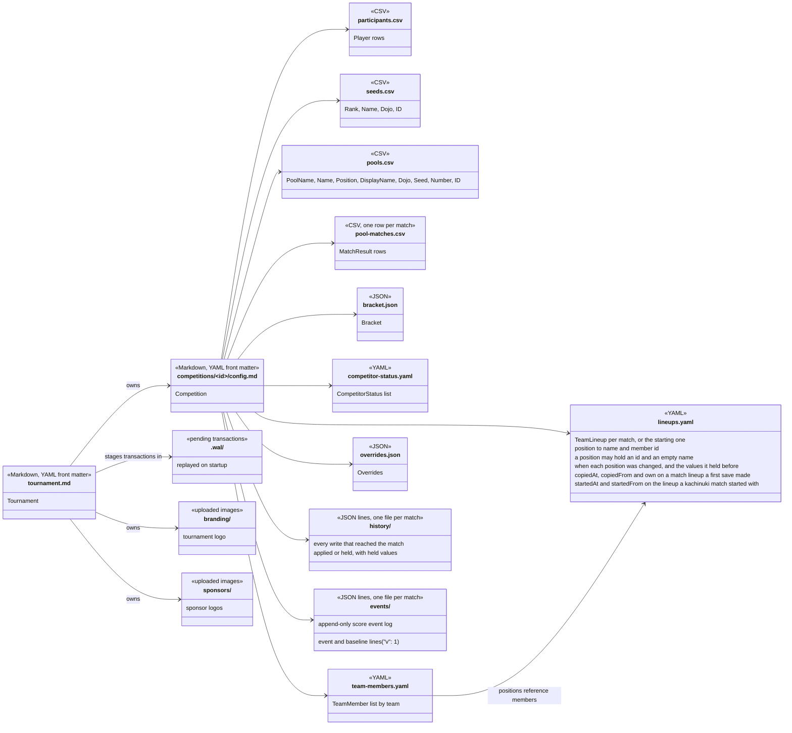
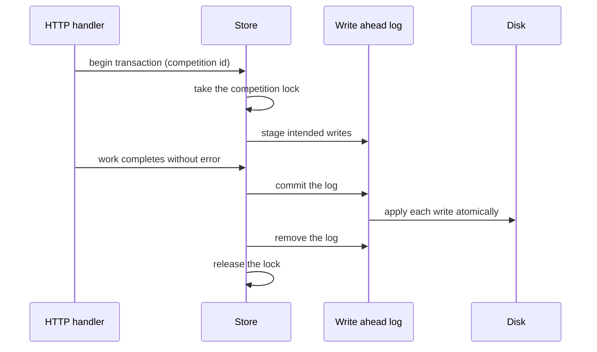

# Data model

The tournament app keeps all tournament state in plain files under a single data folder. There is
no database. This page describes the entities, how they relate, and how they are laid out on
disk.

> Related: [Software architecture](software-architecture.md) · [Network architecture](network-architecture.md) · [Infrastructure architecture](infrastructure-architecture.md)

## 1. Why files

The format is chosen for the room the software runs in, not for query power. A tournament
runs for a day in a sports hall, often on a laptop behind a flaky network. The person
responsible for the results is a volunteer with a spreadsheet, not a database administrator.

Inspectability, repairability and diffability matter more here than normalisation:

* **Inspectable.** An organiser can open the results in Excel or a text editor mid event.
* **Repairable.** An organiser can correct a wrong cell by hand, and the app picks it up on reload.
* **Diffable.** The whole tournament state can be committed to version control or copied to
  a USB stick as a backup. Two copies can then be compared line by line.
  One exception: `tournament.md` holds the admin password in plain text, so strip or
  change it before sharing a copy. A `tournament.md` that carries an `admin_password` field
  may hold another password in plain text there. The app ignores that field and drops it the
  next time it writes the file; remove it by hand before sharing a copy that still has it.
  Refer to
  [Upgrading from an earlier release](../user-guide/organisers/operating-modes.md#upgrading-from-an-earlier-release).

The trade this makes is described honestly in [section 6](#6-how-the-model-maps-onto-rows).

## 2. Tournament and competition structure

A tournament owns competitions; a competition owns everything else. The competition is the
consistency boundary: every write is serialised per competition, and no write spans two.

One rule does span them, and it comes from the venue rather than from the data. Competitions
run at the same time on a shared set of courts, so a court may hold only one running match in
the whole tournament. Starting a match therefore checks every other competition first. That
check and the write it guards run under one tournament-wide lock, so two operators in
different competitions cannot both claim the same court.

The competition box lists the settings that shape the model, not every field it holds. Scheduling, display and format-specific settings are left out because nothing else on this
page depends on them.

`Kind` separates individual from team competitions; `Format` selects knockout, pools plus
knockout, league or Swiss. `TeamMatchType` selects fixed order or kachinuki for team
competitions. A competition in the `team` kind treats each `Player` entry as a team. The people on that team are its members, stored in `team-members.yaml` under the team's participant
id.

That one setting decides which records exist at all. An individual competition has no
`team-members.yaml` and no `lineups.yaml`: its entrants are people, and a match pairs two of them
directly. A team competition has both, and its entrants are teams, so the person who fights
a given bout is named one level further down. The positions a round has are the five FIK
names, senpo, jiho, chuken, fukusho and taisho, when the team size is five, and numbers for
any other size. Everything else, the pools, the eligibility records and
the ranking overrides, is the same for either kind, and reads a `Player` row without caring
which of the two it is.

Each team member carries a stable id, minted once when the member is added and never
reused, and a display index. The id is what a lineup position and a bout row record, so a
member can be renamed without any record losing track of who fought. A team's member list is
seeded with one member per position the competition's team size defines, plus two reserve
positions, so a
team has its shape before anyone is named. No member is ever removed, so an index is never freed and no
renumbering question arises. Instead, an organiser can clear a name, which empties that position but keeps its id and index. That is possible only until the competition starts. After that, a name can still be corrected, which is what renaming is for: a bout row holds the member's
id, so a bout already fought names the same person whatever the name is changed to. Adding a
member stays available at any time, including after the start, because a team fields
replacements mid tournament.

Each member also records when it was last added, named, renamed or cleared (`ModifiedAt`,
server time, 0 until the first such write). One member's stamps only grow, so a page that
holds two copies of a member, one from a list it read and one from a write it made, keeps the
newer one whatever order they arrived in, and a list read before a rename can never put the
old name back.

The label an organiser reads is the team's competitor number followed by the member index,
for example `T10.1`. That label is composed when it is shown and never stored, because a
competitor number can change and the identity underneath it cannot. It is derived the same
way on both sides: the public surfaces receive a team's members on the viewer payload and
compose the label themselves, rather than reading a stored string.

Two rules govern member names. Within one team the names must be unique: a name is how an
organiser picks a member, and the winner-stays-on format has to tell two teammates apart.
Members of different teams may share a name freely. The member list is not a starting line-up, so
it may hold more members than the competition's team size: the extra entries are the
replacements an organiser can field, and the team size only fixes how many positions a
round has.

A lineup is stored for a match or as a team's starting lineup (its round-0 entry), and the
lineup a team fields in a match is not stored: it is worked out when read, because a team
carries the lineup of its previous match unless one is entered for the match. The lineup in
force at a match is the match's own, else the latest one the team had before it: one saved for
an earlier match of the team, or its starting lineup, which comes before every match.
Matches are ordered by pool-match number first, then by knockout round and position, with the
3rd-place match last. A lineup saved for a match counts as an earlier lineup only while that
match is in the current draw and the team is seated in it by participant id. A team is its
participant id and nothing else: a lineup is the team's only when it is stored under that id,
a lineup stored under a team name is not the team's, and a side with no id has none.
Discarding a draw removes the lineups saved for its matches, because a draw generated again
reuses the match ids, and keeps the starting lineups. One rule in the engine owns this, and
the kachinuki roster, the Kachinuki Detail export and the public `lineup-in-force` read all
ask it.

A lineup save names the positions it changed, and the server writes only those, under the
competition's lock, onto the lineup stored for that match or that starting lineup. A save also
says when each position it changes was changed on the device (`changedAt`, in the server's
clock), and the lineup keeps that time per position (`stamps`); a save from an older release
sends none, and its changes are given the server's time as they land, so they are ordered by
their arrival. Such a release may also save a whole lineup without naming its changes: that is
taken as a change of every position at its arrival, the positions it leaves out emptied, so it
reaches no match lineup made before it arrived. Every lineup comes out the same whatever order
its saves and removals arrive in:

- A position holds its latest change by that time. A change made earlier that arrives later
  does not replace it; it is kept in the position's `history` (the values a position held, each
  with its time). The history keeps every change, however many, so a lineup that carries a
  position never loses the value it carries, and a first save of a match lineup that arrives
  after many later changes still reads the position as it stood at its own time. A position the
  lineup carried from never held at that time is empty there.
- The first save of a match's own lineup takes the positions it does not name from what the
  match carried when that change was made: the lineup in force there at that time, an earlier
  match's own lineup counting only once it was made, each position as it stood then. The record
  keeps that time (`copiedAt`, moved back if an earlier change of the match arrives later), the
  lineup it carried from (`copiedFrom`: an earlier match's id, or empty for the starting lineup)
  and the positions its own saves changed (`own`). After every lineup save the carried positions
  of the team's match lineups are worked out again, in match order, so a change made before that
  time reaches them whenever it arrives, and one made after it never does.

Two devices that change different positions of one lineup both keep their change, a save sent
later from a device that was offline included.

Taking a lineup away ("Use the previous match's lineup", or removing a starting lineup) is a
change like any other, ordered by when it was made (`removedAt`, sent by the device; a removal
from an older release carries none and is ordered as it lands). The lineup stops being in force
at that time, but what it held before then is kept as a record, marked with that time, beside
any lineup saved for the match afterwards, so a match lineup that carried positions from it
while it was in force keeps them, whatever arrives before or after the removal. Each change is
kept in one record only: a change made before the removal belongs to the lineup it took away,
even one that arrives after it, and a change made after it is the match's own lineup again,
even one that arrived before it. A removal that found nothing to take away is still kept, as
its time alone, so a change made before it that arrives later is taken away by it. Discarding a
draw removes these records with the draw's lineups.

When a kachinuki match starts, the lineup in force there for each team is kept as that match's
own lineup record, marked with the time of the write that started it (`startedAt`) and the lineup
it was taken from (`startedFrom`: an earlier match's id, or empty for the starting lineup). It is
taken only by the write that moves the match out of the queue, inside that write's transaction,
so a write refused, or any write after the start, never takes one; when the team had no lineup
it is empty. It is the lineup in force at the start's time, read the same way as a first save's
carried positions: a change made before the start reaches it whenever the save arrives, a change
made after the start never does, even one that arrived before it, and so does a change to an
earlier match's own lineup, made before the start, that the match would have carried at its
start. That record is the match's alone: a later match never carries it, so it goes on carrying
the starting lineup or an earlier match's own lineup exactly as before. A match sent back to the
queue still holding the bouts it was fought on has started: starting it again takes no record.
An organiser's save of the match's own lineup makes the record the organiser's own lineup,
its other positions still carried from the start, and taking it away ("Use the previous match's lineup") on a match that has
started keeps the lineup in force at that moment as the match's own in its place, a snapshot
that later edits of the starting lineup do not change. If the store cannot keep the record, the
write that started the match fails. The first bout of the match is fought by the first fighter
of that record, or of the organiser's lineup that replaced it.

Releases up to v2.1.1 also saved a lineup for a round, and read the lineup a team fielded at
a match as the match's own, else the round lineup with the highest round at or below the
match's round, else the highest round, so a lineup saved for one match applied to that match
alone. Such lineups are converted into this form rather than read under that rule. A lineup
stored under a team's name is stored under the team's id when exactly one team has that name.
A legacy team is one with a lineup for round 1 or later, or one that, when the app first
settles the competition, holds a lineup saved for a match of the current draw that seats it
by participant id. `config.md` records that list at the first settlement
(`round_lineups_legacy`), so a lineup saved for a match afterwards never makes a team legacy.
A legacy team is given, at every match it is seated in by participant id, a lineup of its own
equal to the one v2.1.1 showed there, or an empty one where v2.1.1 showed none (no round
lineup and no lineup for that match), since carrying would show an earlier match's instead. A
match it is seated in later is given its lineup by the write that seats it: inside that
write's transaction when it runs in one, otherwise straight after it. `config.md` lists, under
each team's id, the matches already given one (`round_lineups_given`), so a lineup removed
from one of them is not given again. Discarding the draw, or generating a new one, clears that
list, since the next draw reuses the match ids, and drops from the legacy list every team with
no round lineup, whose converted match lineups went with the draw. A legacy team with round
lineups and no starting lineup gets the one v2.1.1 showed before its first saved round, its
highest round's. The round lineups stay, never read, until the competition is completed; then
the next write of the draw, or the next start of the app, removes them and `config.md` records
`round_lineups_converted`, which is set as soon as no legacy team waits. A new competition
starts with it set.

## 3. The match and result model

This is the detailed part of the model, because the rules it encodes are detailed. A match
carries its pairing, its score, how it was decided, when and where it is played, and an
audit trail for corrections. Every match belongs to exactly one competition: pool, league and
Swiss matches are rows in that competition's results file, and knockout matches are nodes in
its bracket, so nothing in this section exists outside a competition.

The diagram makes three points that a raw field list would hide.

**`CompetitorSide` is a value object that the storage flattens.** The name is this page's
own, chosen for clarity: no such type exists in the code. Everything a competitor brings
to a match (name, participant id, struck points, outstanding fouls, flags, and the
representative player for a team tie breaker) exists twice, once per side. In the object
model those are `SideA`/`SideB`, `IpponsA`/`IpponsB`, `HansokuA`/`HansokuB` and so on. They
are one concept with two instances, not twelve independent attributes. Side A is aka and
side B is shiro. The draw fixes that pairing, and it is not a display order: every surface
draws shiro on the left.

**A pool bout's id carries its number in the playing order.** A pool or league bout is
`<pool name>-<n>`, and the draw gives `n` after it has put the pool's bouts in the order they
are played (a league is reordered so nobody fights twice in a row), so `Pool A-0` is the
first bout played. Every surface names a bout by this number: the court console's "Match 1
of 6", the server's messages, the scores list and the printed workbook. Moving a bout in a
court's queue changes when it is played, not its number. A draw made by an earlier release
may hold a league whose ids were given before the reorder; its bouts keep their numbers, and
every surface shows the same one.

**A team match is an aggregate.** `SubMatchResult` is a full bout in its own right: its own
pairing, score, decision, overtime and judges' decision. A five person team encounter holds
five of them, plus an optional representative bout at position `-1`. Ranking figures such as
individual victories and points won are DERIVED from these by one function. They are
never entered by hand and never a second source of truth: every read serves them alongside the bouts, every
save of an elimination match recomputes them, and every surface that shows them takes what
the server computed rather than re-deriving its own.

**Sides carry both a name and an id, and the id is the one that identifies.** Both are
kept because a rename must not orphan a recorded result: the name is what a person reads
on the sheet, the id is what the app resolves by. Where a record has an id field, it is
read by id alone; a name is consulted only for a row old enough to predate the field,
which the app repairs when it loads it.

That applies one level further down as well. A team bout carries its two fighters' TEAM
MEMBER ids beside their names, and the winner's id beside the winner's name. Without them
a bout between two people who happen to share a display name could not be attributed at
all, because the name identifies neither of them, and competitors are allowed to share
one. The representative bout is the one row whose sides are the TEAM names: it keeps them
and carries the two representatives' member ids beside them, the members picked for each
side. Each side's id is a change of its own, ordered apart from the other side's and from
the bout's score and result: a point struck on the representative bout never alters who was
picked, a pick never alters the score, and a pick for one side never alters the other side's
pick. So two captains picking at the same moment both land, and so do two boards doing one
each. The winner's member id
stays with the bout, and after a merge it always names one of the two picked members (or is
empty): when a pick changes under it, it is worked out again from the side that won. A pick
is a member of the team seated on its side, so when a knockout match is given another team on
a side (a winner corrected upstream, a slot taken back to its placeholder, a qualifier
repainted), that side's pick is cleared and dated at that moment, later than the pick had
been. The write that made the old pick, replayed from a queue, is then kept in the match's
history instead of seating the old team's member on the new team. A side whose team does not
change (the same winner stored again, or the team only renamed) keeps its pick. A side taken
back to its placeholder loses its pick, even when the match that feeds it is finished again
with the same winner: the pick is picked again.

Those are two different namespaces, and the field names keep them apart on purpose. A
match side carries a PARTICIPANT id, which names a competitor or a whole team; a bout side
carries a TEAM MEMBER id, which names one person inside a team. They sit one level apart
and are never interchangeable.

The cost of the pattern is this model's sharpest edge. A name
and its id are stored as two fields, or in a lineup's case as two maps keyed by the same
position, so nothing in the storage forces a writer to set both. A record with a name and
no id is therefore representable, and does occur: rows written before the id existed, and
rows whose name could not be resolved to exactly one person. The app treats such a row as
unrepaired rather than as a fault, repairs what it can when it loads the file, and falls
back to the name for that row alone. Making the pair a single value instead of two fields
would remove the state entirely, at the cost of rewriting every stored file, which is why
it has not been done.

**A knockout slot remembers the draw.** A bracket match repeats the scheduling and audit
fields a pool match carries, so a knockout match is scheduled, corrected and reopened the same
way. Two things are its own. For a knockout fed by pools it keeps what the draw wrote in each
slot before any pool finished, which is how a qualifier reaches the slot the draw gave it
without the draw being recomputed. For a knockout drawn without pools the bracket keeps the
order the competitors were drawn in, which is what their competitor numbers count; a
competition with pools numbers its entrants at the pool draw instead, so it stores no second
order.

### Match status and decision

`Status` moves `scheduled` to `running` to `completed`. A completed match is never sent back
to the queue by a score write; corrections are made through the score editor, which writes a
new completed result with a `CorrectionReason`.

`Decision` records how a match ended when it was not simply fought to a score: a draw, a
withdrawal, a no show, a representative bout, or exhaustion in a kachinuki encounter. A
judges' decision (hantei) is recorded separately, as the `Ht` entry in the winner's ippon
list: the mark occupies a point slot on the score sheet but never counts as a point, and
the winner it sits beside is the winner the referees chose from a level scoreline. The
`DecidedByHantei` fields in the diagrams are legacy read-only channels: a file that
carries the old flag loads through a conversion that moves it into the mark, and nothing
writes them. The bracket `ScoreA`/`ScoreB` strings are the same kind of channel: a file
that rendered each side's scoreline as one string loads through a conversion into the
ippon arrays, and every match record holds its score the same way.

## 4. On disk layout

Each competition is a folder. The tournament root holds the shared settings and the uploaded
images.

Markdown, CSV, and JSON or YAML each earn their place:

| Format | Used for | Why |
| --- | --- | --- |
| Markdown with YAML front matter | tournament and competition settings | Human readable and editable, and the body can hold notes |
| CSV | participants, seeds, pools, pool and league matches | Opens in a spreadsheet; one row per record diffs cleanly |
| JSON and YAML | bracket, eligibility, lineups, overrides | Tree shaped data that does not fit a row |
| JSON lines (JSONL) | match history and per-match score event logs | Append-only audit trail and event sourcing stream; one line per write or event |

A competitor list must exist before a seed can be set: a seed ranks a participant, so a rank
with nobody to attach it to is refused, not stored. Clearing a seeding is exempt, since that
is how an operator removes one, and there is nothing to attach either way.

The seed list stores the participant's own id alongside the name and dojo, and once a row
carries that id it is the one thing a seed is matched to its participant by. The name and dojo
are kept for two other jobs. They are what an older reader that has never heard of the id
column still matches by. They are also the fallback for a row the id column has not reached
yet, matched by name and dojo together, because two competitors may share a name across
dojos and a file that stored only the name could not say which of them the rank belonged to.
A row without a dojo still matches by name alone when that name is unique in the roster, and
a file without the dojo or the id column is completed from the roster on first load.

## 5. Write guarantees

**Every file write is atomic.** The bytes go to a temporary file in the same directory, are
flushed to disk, and are then renamed over the target, with the directory entry flushed too.
A power cut never leaves a half written results file: a reader sees either the previous
version or the new one.

**Writes to one competition are serialised.** Each competition has its own lock. A score
write takes it for the whole read, modify and write cycle, and reads from disk rather than
from cache while holding it, so two writes to the same competition cannot interleave.

**Multi file changes are transactional.** Some actions touch several files at once, for
example recording a withdrawal writes the match result, the competitor eligibility record
and the updated bracket. Similarly, match writes, their append-only score event logs in
`events/<matchId>.jsonl`, and their audit trail in `history/<matchId>.jsonl` are staged in the
same transaction as the match result (in `pool-matches.csv` or `bracket.json`). Those run as a
transaction: the intended writes are collected, committed to a write ahead log, and only then
applied. If the process stops midway the log is replayed at the next startup, so the group
either lands completely or not at all.
One write sits outside this: a participant edit lands by atomic rename rather than through the
log, so it is crash safe on its own but is not rolled back if the rest of the group fails.

**Concurrent writes are merged, never dropped.** A match result is split into groups of
fields that change together: the scoreline, the verdict (status, winner, decision and the
notes that describe it), the overtime, the engi flags, the representative players, each side's
fighter picked for a representative bout (one group per side), and each bout of a team match on
its own. A write names the groups it changes, and each group records
the time of the last change applied to it. A change applies only when it was made no earlier
than the stored change to the same group, so two operators changing different things (one
records the overtime while another enters a point, or two bouts of a team match are scored on
two boards) both land, whatever order their writes arrive in. A group a write does not change
is never overwritten. When two writes change the same group, the one made later stays, and
the other is not discarded: it is kept in the match's history with its values. The times
compared are when each change was made, never when it arrived, so a court coming back from
an outage cannot overwrite a newer change recorded elsewhere, and its own changes to things
nobody touched since still land. A write all of whose changes are outranked is reported as
not applied (the operator sees an explicit notice naming that it was kept in the history),
and one applied in part says which groups were held. A write that does not name its groups
counts as changing every group it carries.

**A finished match is closed.** Changes are compared in the order they were made, never the
order they arrived. Once a finish or a decision (kiken, fusenpai, fusensho, a judges'
decision, a representative bout verdict or a drawn result) is recorded, any tap or scoring
write made after it is not applied. It is kept in the match's history with the reason "the
match was already finished", and the device is told that the match is finished and that the
way to change it is Correct. The finished result stays as it was recorded: nothing is
reopened and no winner is worked out again. This holds whichever change arrives first. A tap
that reaches the server before a finish made earlier is applied at that moment, and is moved
out of the match into the history when the finish arrives, so both orders end in the same
match and the same kept change. One exception: a competitor's tap on the public score sheet of
a self-run event, sent to a finished match, is refused outright with the message that the result
has already been reported. It leaves no log entry and no history line.

A tap made before the finish that the finish's writer had not seen does not join the
finished result either: the finish governs every scoring group at its stamp, the ones it names
and the ones it does not, so the scoreline the finish stands on stays and the tap is kept in the
history, whichever arrives first. A tap the writer had seen is already part of the finish, so
nothing is lost or counted twice. What the writer had seen is the basis its write sent; a
finish from a release that sent none is taken to have seen every tap made before it. A decision's points are worked out from the changes made before it rather than
copied from the value it carries: the side that did not withdraw takes the circles, and the
points the withdrawing competitor had already struck stay. A fixed-order team match closed by a
match level kiken, fusenpai or fusensho keeps the bouts that a device which had not seen the
decision scored; the decision credits only the bouts still without a result. A kachinuki match,
and a team match closed by a finish, stay closed whole.

**The first recorded result stands.** Two devices can finish the same match. In the order the
changes were made, a later finish or decision from a device that did not see the result in
force is a rival and is not applied, in the same way as a tap: it is kept in the history with
the match closed reason, whichever of the two arrived first. A result is no rival when its
writer saw the one in force, as a correction does (it names a reason). A reopen, a send back
to the queue and an organiser's override of a winner are never rivals. The same applies to a
knockout match whose next match has been played or has started: a rival that would replace
the stored result is not applied, and the history says that the next round was already
fought, or has already started.

A finish that would leave a knockout match without a winner is refused as invalid, and the
match keeps the result it had. The operator resolves the tie first: in a team match with a
representative bout, or with overtime on the final kachinuki bout; in an individual match with
overtime (encho) or a judges' decision (hantei). An engi finish whose flag total is not 1, 3
or 5 is refused too; it is a wrong flag count, so the whole panel's flags are entered.

An out of order running write from the same device session (an older save arriving after a
newer one) is not applied, and is kept whole in the history as an older revision of that board.

A deliberate correction is subject to the same rule, which matters most when it was made
without a connection. Correcting the result you are looking at works normally. Correcting
a result that has since been changed by someone else does not overwrite them: the
correction's outranked parts are held and reported, exactly as any other out of date write
would be. That is the point, because a correction saved during an outage can reach the server
hours later, long after the match has moved on, and the operator who wrote it has no way of
knowing what happened in between.

**Every write and every tap is kept in the match's history.** Each match has an append only
history file in the competition's `history/` folder, one line per write that reached it and one
per tap: when the change was made, when the server received it, which endpoint it came through
(a tap's is `event`), the groups it changed and, for each, whether it was applied or held, with
the held values. A tap's line also holds the tap and what became of it (applied, recorded in a
finish that had seen it, capped, turned away because the match was finished, and so on). A tap
whose fate changes later, because a finish made before it arrives afterwards, gets a second line
saying so. A held group that says exactly what is already stored (for example "no overtime"
over a match with none) is no loss, so it is recorded as unchanged and its value is not kept.
When a rule held changes rather than their times, the line also says why: an older revision
of the same running board, the match was already finished, an engi result whose flags and
winner are kept together, a representative bout that was removed, or a next round that was
already fought or has already started. The history is written in the same
transaction as the match, so the two land together or not at all, and a write refused
outright (an invalid payload, the wrong competitors) leaves no line. Reopening, requeueing,
overriding a winner and the other server actions that change a result write their own line.
The history goes with its competition, and with a discarded draw, since a draw generated again
reuses the match ids.

**Score events use per-match event sourcing.** Each match has an append only score event log
stored at `competitions/<id>/events/<matchId>.jsonl`. The log consists of JSON lines, each
stamped with format version `"v": 1`, containing either an event line (a scoring tap such as
an ippon, foul, encho, or flag) or a baseline line (the state left by a non-tap write such as
a finish, decision, correction, or migration). The pattern is explicitly per-match event sourcing
(the match is rebuilt by replaying its log in timestamp order) with a client-side transactional
outbox. No message broker is used: offline tablets hold the queue; order comes from when a tap
was made, not when it arrived; the app is one binary that keeps its data in files.

A tap is one event with its own id, the device's session and a sequence number within it, and
the time it was made. The device sends taps in batches to the match's score events endpoint,
and the server answers every batch with one outcome per tap, even for a tap it did not apply,
so a device never has to retry a tap that no retry can fix. Sending a tap again with the same
id is harmless: the server recognises it and logs it once. Taps from different devices
interleave in the order they were made, so a tablet that was offline for a while adds its
taps where they belong. The sequence numbers let the server tell a device which of its taps it
never received. A whole write (a finish, a decision, a correction, a reopen, a send back to the
queue) enters the same log as a baseline line, stamped with the time it was made, so a tap and a
whole write are ordered against each other by the same rule.

The server adds events of its own to the same log, under the session `server` and with no
sequence number: the fighters of a kachinuki encounter's first bout, which are the first fighters
of the match's lineup and which no device sends. That lineup is the match's own (an organiser's,
or the one it started with), or, while the match has not started, the lineup in force there; a
match that started with no lineup of its own (one started before this rule) keeps the names its
first bout has, sent back to the queue or not. The server adds
them only where the first bout holds other names: when a write makes or changes that bout, and
when a lineup or team member changes. They are ordered against the taps like any tap and never
turn one away; they name who fought, never a score, so they reach a finished encounter too
without moving its result. No device may send events under the session `server`: the request is
refused. A point entered on a kachinuki bout after it was removed, from a device that had not
seen the removal, does not make the bout again, since it would have no fighters; it is kept in
the match's history. Picking the bout's fighters adds it again.

Three figures are derived by the replay and stored beside the match so that a reader does not
have to replay the log: the id of each mark (a removal names its mark by id, so two devices
removing two different marks both land), the number of log lines the stored match was derived
from (`ScoreVersion`, which only grows, so a screen can tell which of two copies of a running
match is older without comparing clocks), and for each device session the highest tap number
the log holds (`EventSeqs`). A fourth list names every tap of a device that the log holds and
the server does not apply now, with its outcome (`TurnedAway`): a tap the server first applied
can be turned away when a finish that never saw it arrives after it, and the device that made it
reads that from the next copy of the match it receives and tells its operator. The list keeps
each device session's latest, at most 128 of a session and 512 on the match; when the sessions
together hold more, each keeps the same share, the largest that fits, so a device with fewer
taps listed keeps all of its own and no device's taps are pushed out by another's.

The score event log is the source of truth for match scoring, while the match result stored in
`pool-matches.csv` or `bracket.json` acts as a materialized cache derived by the replay. This
differs from the match history in `history/`: the score log records the raw events and baselines
that construct the score, whereas the match history keeps one line for every write and every
tap that reached the match, recording whether each change was applied or held, the door it came through, and the
reason when one was held. Both the score log append and the history entry are written in the same
transaction as the match through the write ahead log, ensuring they land together. A log line
with an unknown format version is refused on load naming the file and line, because the log is the
truth and an unrecognized line is never skipped or guessed at.

The merge needs the time of each stored change to compare against, so it only works where
those times are saved. They are saved for every match, in both files (`GroupStamps` in the
results file at column index 29, followed by `MarkIDs` at index 30, `ScoreVersion` at index 31,
`EventSeqs` at index 32 and `TurnedAway` at index 33, and in the bracket file), which is what makes the rule the same wherever a match happens to be
in the competition. A match saved before the per group times existed has only
one time for the whole result, and every group reads as changed then, so it is compared exactly
as before. A running save from a client that does not send a time counts as unstamped and
always applies: the merge discriminates only when both sides carry a stamp, so it can never
silently hold a legitimate change. A result the server orders itself (a finish or correction
that arrives without a time, and every change a server action builds, such as a quick score)
takes the server's time instead, never older than the stored result, so it still applies and
a save made before it but arriving later is ordered against it rather than overwriting it.

The comparison only holds if the two clocks agree, so a timestamp that is far enough in the
future to be impossible is refused and reported rather than trusted or quietly discarded.
Both of the alternatives lose work. Trusting it lets that one write beat every later result
until real time catches up with the stamp, which freezes the match for the whole of that
window. Discarding it makes the write count as unstamped, and an unstamped write always
applies, so the device with the wrong clock overwrites a newer result recorded elsewhere and
nobody is told. A few seconds ahead is ordinary and is accepted, since a device learns the
server time over the network and a little drift is normal. Beyond that the device is told
its clock is wrong and nothing is written. The app resyncs its clock, re-stamps the queued write
once and sends it again by itself. Sending it again is safe precisely because the refused write
never landed. A tap is checked the same way, tap by tap within a batch: one
stamped too far ahead is not logged, and the device stamps it again and sends it under the same id.

The check is applied when the write arrives, not when it was stamped, so a write held in
the outbox escapes it in proportion to how long it waited. A device whose clock is ahead by
less than the time its write spent queued delivers a stamp that has already fallen into the
server's past. There it is honoured like any other, and it can still beat a result recorded
moments later on another court. What the check catches is a clock wrong by more than the
queue age plus the few seconds of tolerance, which is the case that would otherwise freeze
the match or overwrite a newer result with nobody told.

When a queued write is refused for a wrong clock, the app learns the server time again and
rebuilds the stamp before retrying it once. It does this two ways and keeps whichever answer is
older. The first way reads the moment the result was entered and adds the freshly learned
offset, which is right so long as the device clock has not moved in between. The second way
measures how long the result has been waiting on a steadily ticking timer that a clock
correction cannot move, and subtracts that from the current server time, which is right even if
the clock was corrected but can understate the wait if the device slept.

Keeping the older answer is a deliberate safety choice rather than a coin toss. Too old, and
this result can only lose a comparison it might have won, which costs the operator a re-entry
they are already being told about. Too new, and a result entered before the outage could quietly
beat one recorded during it, which is the silent overwrite the whole check exists to prevent.
Where the two answers disagree, the recoverable mistake is the one to make.

One case is still not recovered, and it is worth stating plainly. The steady timer is measured
from the moment the page was opened, so it means nothing to a page that has since been reloaded
or to a second tab. If the clock is corrected across a reload, the rebuilt stamp is wrong again,
the result is refused a second time, and it is then dropped rather than retried forever. That is
accepted, and it is loud: the operator is told that nothing was recorded and that this device's
clock needs fixing, so the result can be entered again from a device whose clock is right.
Dropping it is the lesser harm, because an entry that can never carry a correct stamp would
otherwise hold up every write queued behind it.

### When a file is wrong

Section 1 promises that a wrong cell is repairable by hand, but not what happens when a hand
edit is itself wrong. Two things can be wrong, and they behave differently: a single cell that
will not parse, and a whole file that will not parse.

**A wrong cell degrades, and the file keeps loading.** A malformed cell falls back to its
documented default and never fails the row it lives in or the load the row belongs to. A team
match's sub-bout cell that will not parse as JSON loads as an empty encounter rather than
aborting the read. A seed row missing its rank or name, or too short to hold them, is skipped
rather than guessed. A number that will not parse is left at the column's documented default,
and a negative count is clamped to zero. One bad cell cannot stop a tournament. Two cases go
further and discard data outright, because there is nothing safe to default to: a legacy
judges'-decision flag with no attributable winner is dropped rather than guessed onto a side,
and a hand-edited bracket file carrying both a legacy score string and the current ippon
arrays keeps the arrays and clears the string.

**A degraded cell is kept, not overwritten.** The results file is rewritten in full every time
any match in it is scored. A cell that read as empty would otherwise be written back as
empty, so the bytes needed to repair it would be gone within seconds of the next bout. A
sub-bout cell that will not parse is therefore held exactly as it was read and written back
unchanged for as long as the encounter stays empty. Re-entering the encounter in the app
replaces it, which is the other way to repair it. While it is unrepaired the operator console
marks the match and the pool standings it feeds, because an encounter that loads as empty
contributes no individual victories and no points, and those are the figures a pool tied on
wins is separated on.

**A wrong file fails the load, and nothing is written to it.** When the damage is structural,
a bracket file that is not valid JSON or a results file whose rows no longer parse as CSV,
there is no row left to degrade. The load fails and every write to that file is refused, so
the competition stops rather than continuing from a half-read record. The file is left exactly
as it was: refusing the write is what makes a repair possible. The app reports which file
failed, the line and column, and what the parser found there, so the fault can be found in the
editor already open.

Repairing the file and reloading is always the option that loses nothing. When that is not
possible, what else can be done about an unreadable bracket file depends on where the draw it
held was written down, which is decided by the competition's format. In every case the file
itself is renamed aside rather than deleted, keeping the name it had with `.corrupt-` and a
timestamp appended, so it stays in the competition's folder for a later repair by hand.

**Pools then knockout.** The knockout can be reset. The draw survives in the pool file, so the
tree is built again from it and every finished pool has its qualifiers seeded back in. That
trade is real, and the console states it. The knockout results are not recorded anywhere else
and have to be re-entered from the score sheets. The rebuilt pairings should be checked
against the printed bracket, because the tree is laid out by the current draw algorithm, and the
one that produced the original died with the file.

**League and Swiss.** Nothing is rebuilt, because neither format draws a knockout bracket at
all. A bracket file in one of these competitions is left over and unused, so moving it aside is
the whole repair and no result is affected.

**Direct elimination.** There is no reset. The bracket file is the only record of who was drawn
against whom, so rebuilding would produce a different set of pairings rather than restore the
original, and it would then disagree with the bracket already printed. The app refuses it and
says why. The same refusal covers a competition whose format is missing or unrecognised, which
a hand edit to the config file can produce: those are drawn as direct elimination, so the file
is the only record of their draw too.

Anyone repairing a file mid tournament should read all of this as: fix the cell, reload, and
check the record, rather than trusting that a malformed edit would have been rejected.

## 6. How the model maps onto rows

The results file is row oriented, and a match is not flat. The mapping between the two is
mechanical: every persisted fact has exactly one representation, and the file holds the
same facts as the structs, encoded for a spreadsheet rather than for a parser. Nesting,
delimited lists, and a mark folded into the score: reading `pool-matches.csv` alone turns
up three encodings worth knowing.

**A team match nests.** The sub bouts are stored as a JSON document inside a single CSV
cell. That keeps the file to one row per match, at the cost of the richest data in a team
competition not being readable as columns.

**Lists sit inside cells.** A side's struck points are joined with `|` in one field, so a
two point match reads `M|K` rather than occupying two columns.

**The judges' decision rides in the score.** A match won on referee decision has no column
of its own. The mark occupies a point slot in the winner's score field, which is exactly how
it is drawn on a paper score sheet, and it stays there when the file is read. The mark is
part of the recorded score, but everything that counts points knows to skip it, so it can
never inflate a result.

Appending columns and leaving some fields unwritten are the two consequences that follow:

* Column position is the contract. New fields are appended, and a file written by an older
  version stays readable because the reader leaves each missing trailing column at its
  documented default, empty for most (including `MarkIDs` at column index 30, `ScoreVersion`
  at index 31, `EventSeqs` at index 32 and `TurnedAway` at index 33, defaulting to empty, 0,
  empty and empty) and `-1` for the round number, which means unknown.
* Some fields are useful only in flight and are not written at all. Transient client revision
  markers used to discard out of order writes within a single session are one example, as are
  a write's own id, what its writer had in view, the groups it names and the endpoint it came
  through, which judge the write and are then kept only in the score log and the history. By
  contrast, the log-derived `ScoreVersion` is persisted in `pool-matches.csv` and `bracket.json` so readers
  can order running match updates against incoming events. A match's queue position is
  another in-flight field. It is derived from court, status and scheduled time each time a match
  list is served, so the queue shrinks as matches finish. Persisting it would let a stale copy
  disagree with the schedule it was drawn from, so it is
  excluded from `pool-matches.csv` by name, on top of carrying a tag that already keeps it out
  of the YAML-marshalled forms.

If the storage were rebuilt around queries rather than around people reading it, the shape
would differ: a match side table would replace the paired columns, and sub bouts would be
rows rather than an embedded document. That would trade away the inspect and repair
properties in [section 1](#1-why-files), so the storage stays shaped for people.

## 7. How the layout is enforced

A single defined column order and a round trip guard on every file hold the layout to its
contract:

* **The results file's layout is defined once.** The header, the row writer and the reader
  all derive from a single ordered column list, so the three cannot disagree. A golden test
  pins the exact bytes. The ordered list, never Go struct order, is the on disk contract.

    Only the results file is built this way, because only it earns the machinery: it is by
    far the widest, and it is the one that grows a column whenever the rules do. Of the
    others, two could not use a positional column list at all: the roster file's layout
    varies by row, and the seed file is read by column name rather than position. A third
    derives a column from row order rather than from a field (pools.csv). The round trip
    guard that follows protects each of them.
* **Every CSV file has a round trip guard.** Each guard sweeps the persisted struct's
  fields and fails when a field neither survives a save and reload nor appears in an
  allow list with the reason it is legitimately transient. The files persisted by
  marshalling a whole structure are immune by construction, and a companion test pins the
  property that makes them immune.
