# Infrastructure architecture

How bracket-creator is built, packaged, deployed, and persisted. The whole product is a
**single self-contained Go binary** (web assets embedded) that runs behind a TLS proxy, with tournament state on a plain disk. You can deploy it from a laptop to a free-tier cloud VM.

> Related: [Software architecture](software-architecture.md) · [Network architecture](network-architecture.md)

## 1. Build & packaging pipeline

### Building the binary

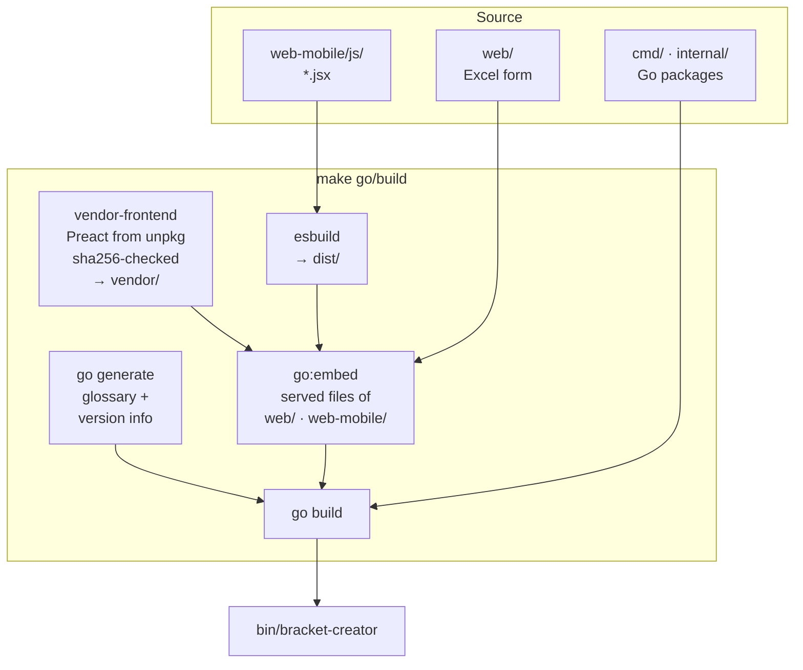

- `make go/build` runs three preparation steps before `go build`:
    - **vendor-frontend** downloads Preact and preact-router at pinned versions from unpkg and
      checks each file against a pinned sha256. On a mismatch it deletes the downloads and fails
      the build, so a changed upstream file can never be embedded.
    - **esbuild** compiles the JSX sources into `web-mobile/dist/` on every build.
    - **go generate** writes the glossary data the frontend reads and the version, commit, and
      build-date files the `version` command reports.
- `dist/` and `vendor/` are build outputs, gitignored except their `keep` placeholders and the
  self-hosted fonts under `vendor/fonts/`, which are tracked.
- `go:embed` then bakes only the served files into the binary (the JSX sources and dev tooling
  stay out). **One artifact, no runtime asset directory**: the binary serves everything from its
  embedded file system.

### Publishing images and releases

Container images are built on every push to `main` and on every release tag:

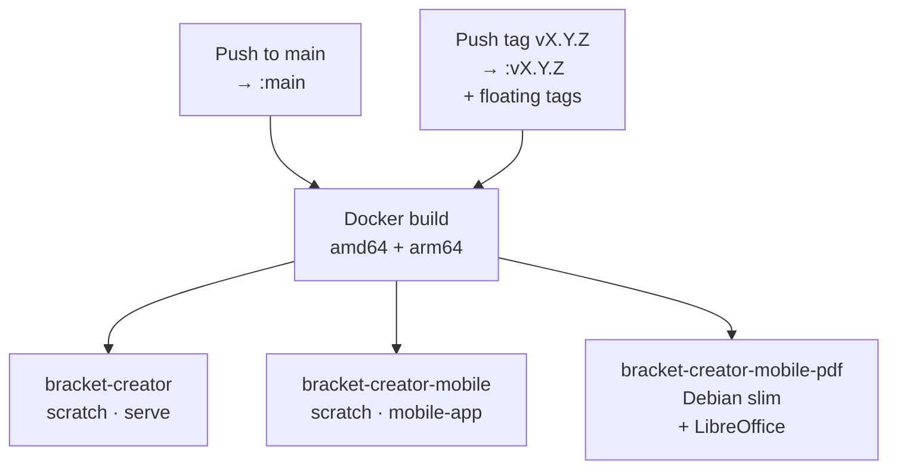

The same release tag also runs GoReleaser and the jobs that follow it:

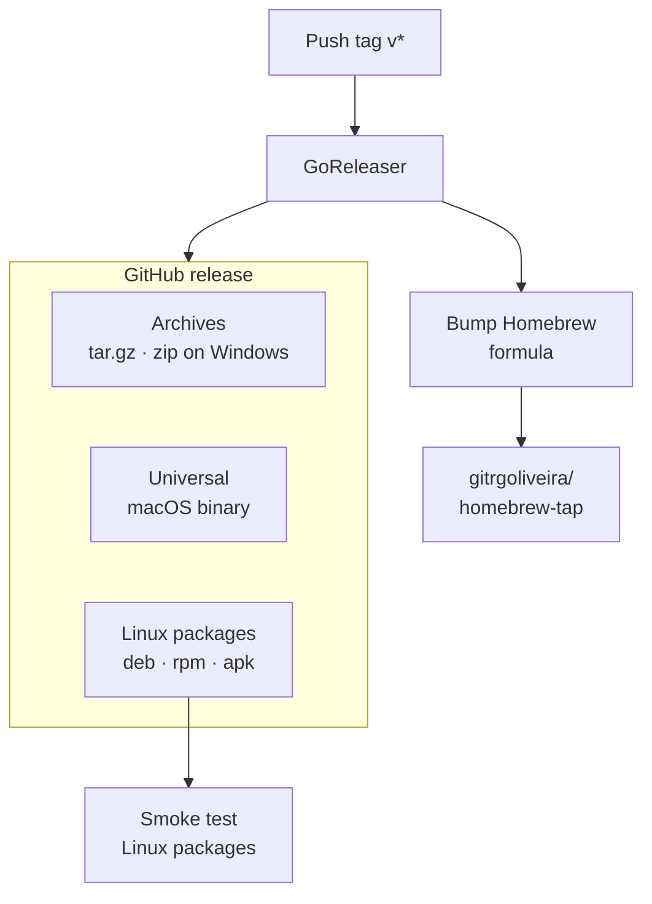

CI publishes **three images** to GHCR, each built for amd64 and arm64:

| Image | Base | Runs | Size |
|---|---|---|---|
| `bracket-creator` | `scratch` | `serve` (the Excel form web server) | about 20 MB |
| `bracket-creator-mobile` | `scratch` | `mobile-app` (the lean default for the tournament app) | about 20 MB |
| `bracket-creator-mobile-pdf` | Debian slim + LibreOffice | `mobile-app`, with `print` PDF export | about 500 MB larger |

- Only the opt-in `-mobile-pdf` image can export PDFs; the lean images have no print support.
  Every image runs as a non-root user (uid 65534) and binds `0.0.0.0` inside the container.
- **Image tags.** A push to `main` publishes `:main`. A release tag `vX.Y.Z` publishes `:vX.Y.Z`,
  and moves the floating tags `:vX.Y`, `:vX` and `:latest` only when it is the newest stable
  release in that line (a prerelease moves none of them).
- **Releases.** The same tag runs GoReleaser, which repeats the build preparation (go generate,
  vendor-frontend, esbuild) and adds shell completions and man pages. It publishes archives for
  Linux, macOS, and Windows (zip on Windows), one universal macOS binary in place of the two
  per-architecture ones, and deb, rpm, and apk packages.
- Two jobs follow the release: **Smoke test Linux packages** installs the amd64 deb, rpm, and apk
  and runs the binary, and **Bump Homebrew formula** points the formula in the
  `gitrgoliveira/homebrew-tap` repository at the new tag's source archive (the formula builds
  from source).

## 2. Runtime composition (container + proxy + disk)

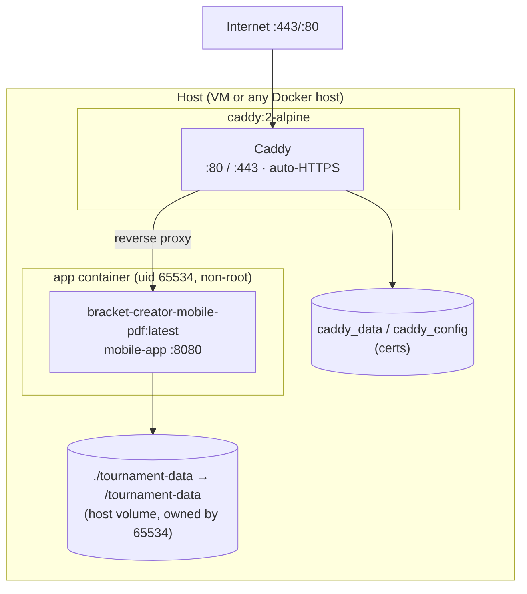

- The Compose file (`deploy/docker/docker-compose.yaml`) runs `ghcr.io/gitrgoliveira/bracket-creator-mobile-pdf:latest` by default; change its `image:` line to `bracket-creator-mobile` for the lean image without PDF export.
- App runs as **non-root (uid 65534)**. The data volume must be owned by that uid, or the app refuses to start: at startup it tries a write in the data folder, the transaction log (`.wal/`), every competition folder, its match history, its score event logs (`events/`), and, when present, the `branding/`, `sponsors/`, `backups/` and `.restore/` folders, and names every one it cannot write to. App port 8080 is `expose`d to the proxy only, never published to the host.
- `restart: unless-stopped` (compose) / auto-restart (cloud) brings the app back after reboots.

## 3. Deployment options

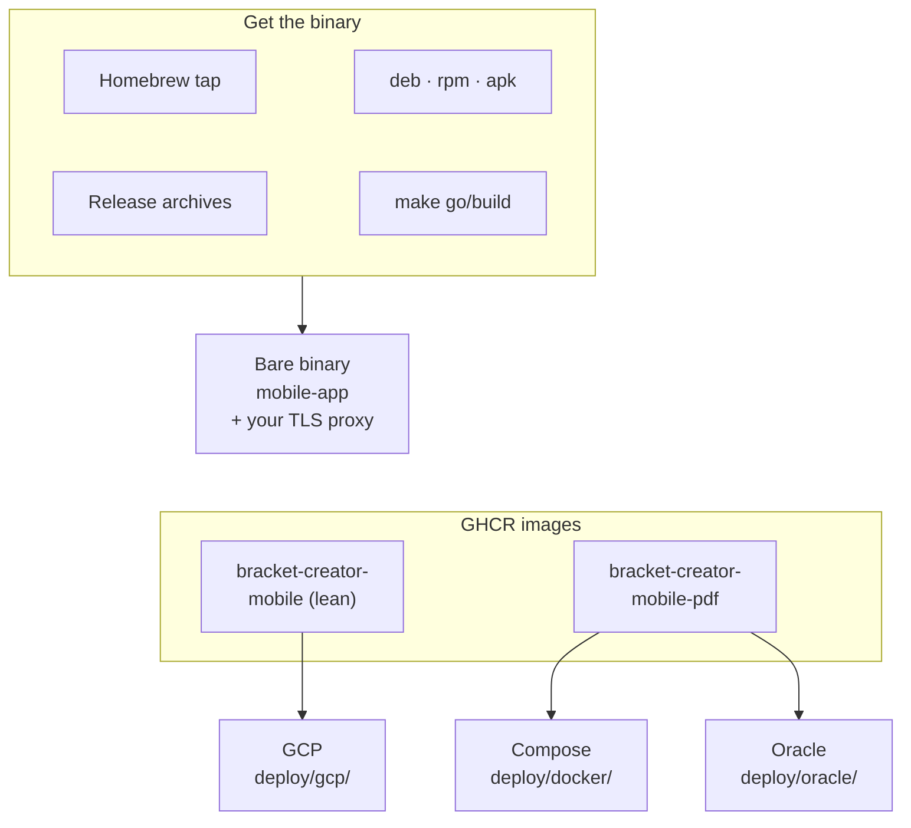

| Target | What it is | Best for |
|---|---|---|
| **Bare binary** | run the binary, bring your own TLS proxy | local / dev / custom hosts |
| **Docker Compose** (`deploy/docker/`) | `app` + `caddy` services, host volume for data | self-managed VMs / on-prem |
| **GCP Always Free** (`deploy/gcp/`) | Terraform; `e2-micro` + firewall + persistent disk + Caddy auto-HTTPS | club / regional events (~≤50–300 viewers) |
| **Oracle Always Free** (`deploy/oracle/`) | Terraform; Ampere A1 (arm64, 12 GB RAM), 10 TB/month egress | large events (1000+ viewers) |

- **Getting the binary.** Install it from the Homebrew tap (`gitrgoliveira/tap`, built from
  source), from the deb, rpm, or apk package, or from a release archive, or build it with
  `make go/build`.
- **Bare binary binding.** `mobile-app` listens on `localhost:8080` by default, which suits a
  TLS proxy on the same host. A proxy on another host, or devices on the venue LAN reaching the
  app directly, need `--bind 0.0.0.0` (or `BIND_ADDRESS`).
- **Which image each target runs.** Compose and Oracle default to `bracket-creator-mobile-pdf:latest`
  (Oracle's 12 GB of RAM leaves room for LibreOffice); GCP defaults to the lean
  `bracket-creator-mobile:latest`, which matters on a 1 GB `e2-micro`. The Terraform modules take
  the image as `image_ref`, and the Compose file names it on its `image:` line. Oracle's Ampere
  instance is arm64, which the multi-arch images cover.

### Cloud topology (GCP Always-Free example)

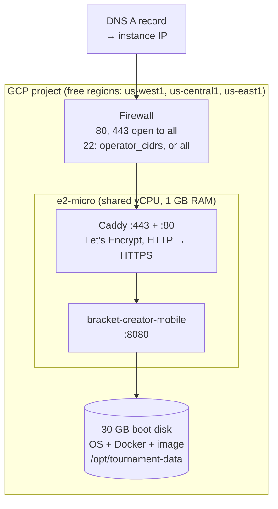

The firewall opens 80 and 443 to everyone, because viewers come from anywhere and Let's Encrypt's
HTTP challenge needs port 80. SSH (22) is limited to `operator_cidrs` when you set it, and open to
all otherwise. Caddy answers on port 80 for the certificate challenge and redirects every other
request to HTTPS.

Terraform provisions the instance, network, and firewall, then installs Docker, prepares the
data dir, writes the app + Caddy config, and starts the app. Reachable over HTTPS within minutes
of `terraform apply`. `terraform destroy` removes everything (run it after the event).

### Venue connectivity: a four-court event

The cloud and host setup is only half the picture. On the venue floor, every operator console,
display screen, and spectator phone is a **browser** reaching that one app over the network.
A typical four-court (shiai-jo A–D) layout:

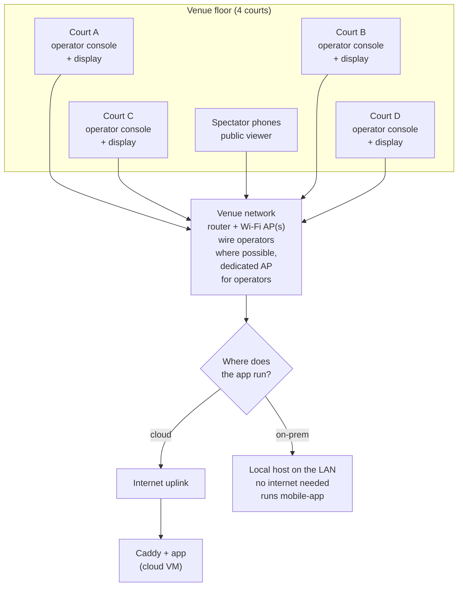

| Device | What it runs | Notes |
|---|---|---|
| Operator console (1 per court) | admin scoring SPA | tablet/desktop surface; authenticates with the admin password; scores its own shiai-jo |
| Display screen (1 per court, optional) | public display / scoreboard view | a browser at a display URL; read-only, no auth. **Preferred: drive it from the operator console's own machine** via an HDMI cable to a TV or monitor, so the board survives a Wi-Fi outage (refer to [Keep the court scoreboard alive on the same machine](#keep-the-court-scoreboard-alive-on-the-same-machine-hdmi)). A standalone smart-TV browser or separate mini-PC also works but loses that offline path |
| Spectator phones | public viewer (mobile-first) | can be on cellular; they don't need venue Wi-Fi when the app is cloud-hosted |

**Per-client load.** Every console, display, and phone holds **one SSE stream** plus its REST
calls. A four-court event is roughly 4 operators + 4 displays + N spectators of concurrent SSE
clients, comfortably within `SSE_MAX_CLIENTS`. Every real-time update still fans out to all of them
(refer to [Capacity & scaling](#5-capacity-scaling)).

**Two venue patterns:**

- **Cloud-hosted** (the cloud-hosted topology): venue devices reach the cloud app over the venue's internet
  uplink; spectators can use cellular and skip venue Wi-Fi entirely. Needs a working uplink for
  the operators and displays.
- **On-prem / local**: run the single `mobile-app` binary on a laptop or mini-PC **on the venue
  LAN**. Operators and displays hit it locally, so **scoring keeps working with no internet at
  all**. Put a local TLS proxy in front for secure-context features, or serve plain HTTP on the LAN.

**The network is the real fix.** Client resilience (offline write queue, SSE resync, silence
watchdog) keeps the app usable across blips. For a smooth event, **wire the operator consoles** where you can. Put operators on a **dedicated AP** separate from spectator guest Wi-Fi. Prefer the **on-prem** pattern when the venue's internet is unreliable. **Drive each court's display from the operator's own machine over HDMI** so the scoreboard keeps moving even when the network does not (next section).

### Keep the court scoreboard alive on the same machine (HDMI)

Each court's display screen can be rendered two ways, and the choice decides whether the
scoreboard freezes during a Wi-Fi outage:

- **Same machine as the operator console (recommended).** Connect a TV or monitor to the
  operator's laptop or mini-PC with an **HDMI cable**, extend the desktop, and open the court's
  display URL in a second browser window on that same machine. The operator console and the display board are then two tabs in the same browser on the same computer. They share a private same-origin channel, so every score the operator records reaches the board **directly, on the machine, with no network hop**. If the venue Wi-Fi drops mid-match, that court's
  scoreboard keeps updating from the operator's entries for as long as the scoring tab stays
  open. The board shows a small amber dot while it is running on this local feed (refer to
  [the scoreboard status dot](../user-guide/spectators/following.md#scoreboards-and-court-displays)).
- **Separate device (a smart-TV browser, or the display on its own mini-PC).** Simpler cabling. The board only ever updates over the network, so a Wi-Fi outage freezes it until the link returns (the board then shows a red dot).

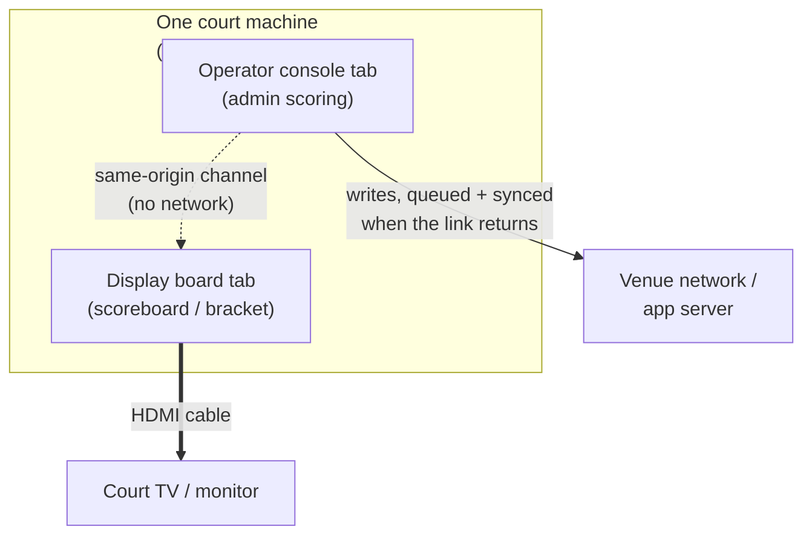

This local hub needs no internet, no secure context, and no extra software. It works in every topology (cloud-hosted, on-prem, or bare-IP HTTP). It **complements** the network fixes in [Venue connectivity](#venue-connectivity-a-four-court-event) rather than replacing them. The operator's scoring taps and writes are still held in the browser's outbox and synced to the server once the link returns, so the authoritative record stays correct. It is per machine
and per court. Reloading the **display** tab during an outage is fine. It cold-starts from the operator tab's snapshot over the same channel, as long as an operator tab is still open on that
machine to answer (it only stays blank if none is). The genuine gap is reloading the **operator**
tab itself mid-outage, since it holds the court's working data while offline and would have
nothing to fetch from the down server.

## 4. Persistence model

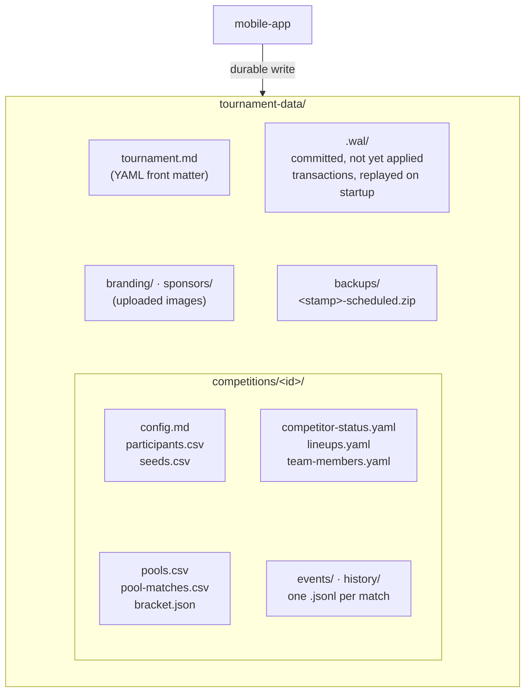

The diagram shows the main files; [On disk layout](data-model.md#4-on-disk-layout) in the data
model lists every file and what its columns mean.

- **Files, not a database.** State is human-readable Markdown + CSV on disk, and each match keeps an
  append-only log of its scoring taps and its writes (JSON lines) beside its audit history. Every write made
  inside a transaction is made durable through a write-ahead log replayed on startup. The disk survives reboots and stop/start.
- **Backups.** The app takes a daily copy of the whole tournament into `tournament-data/backups/` when the data changed, and another at a normal shutdown if anything changed since the newest daily copy. The admin console also downloads a backup on demand. Those copies sit on the same disk, so keep a downloaded archive or a disk snapshot off the VM as well. A plain copy of `tournament-data/` taken while the server runs can catch a multi-file write half done; stop the server first. Refer to [Backup and restore](../user-guide/organisers/backup-and-restore.md).
- **Disk sizing is not about data volume.** Tournament state is tiny (KB–MB). The cloud disks
  (30 GB on GCP, 50 GB on Oracle) are the free-tier **boot-disk** allowances (they hold the OS,
  Docker, and the app image, with `tournament-data/` alongside). The module uses the free
  cap rather than provisioning a separate data disk.

## 5. Capacity & scaling

Real-time updates fan out to every viewer, so **egress is the limit**, not CPU/RAM.

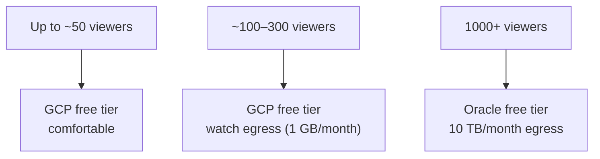

Set a **billing budget alert** (for example, $1) on cloud deployments so you're warned if usage ever
exceeds the free allowance. `SSE_MAX_CLIENTS` bounds fan-out cost (default 5000; ~4–10 KB
resident per client).

## 6. Configuration (environment variables)

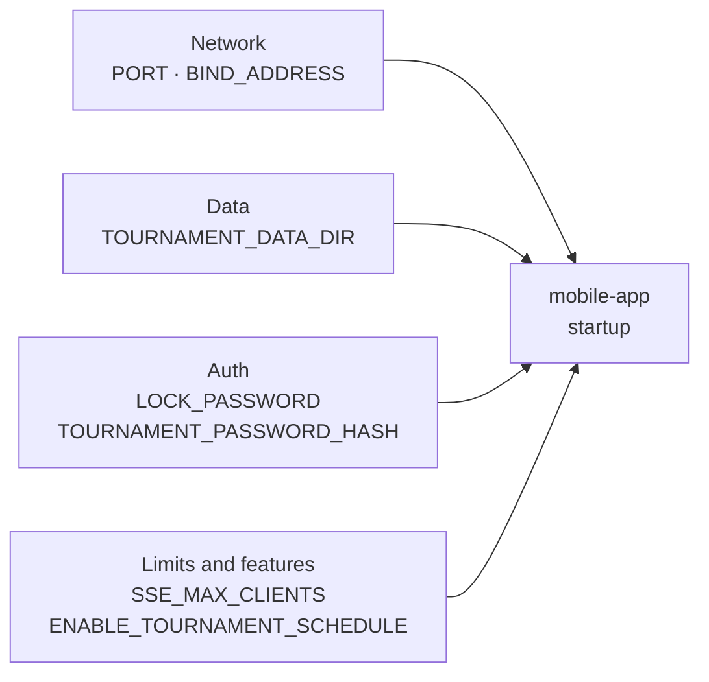

Each variable has a command-line flag where the table lists one; a flag given on the command
line wins over its variable.

| Variable | Flag | Default | Purpose |
|---|---|---|---|
| `TOURNAMENT_DATA_DIR` | `-f/--folder` | `.` | where state is stored; `make run-mobile` passes `./tournament-data`, and the container images and Compose file use `/tournament-data` inside the container |
| `PORT` | `-p/--port` | 8080 | listen port |
| `BIND_ADDRESS` | `-b/--bind` | localhost | listen address |
| `LOCK_PASSWORD` | `--lock-password` | false | enable locked (bcrypt) auth; disables reset endpoint |
| `TOURNAMENT_PASSWORD_HASH` | (none) | (none) | bcrypt hash for locked mode (root-owned, never in the image) |
| `SSE_MAX_CLIENTS` | (none) | 5000 | SSE subscriber cap |
| `ENABLE_TOURNAMENT_SCHEDULE` | (none) | off | feature flag for the schedule UI |

Generate the bcrypt hash with `bracket-creator hash-password`. In cloud deployments the secrets
are written to a protected, root-owned file on the instance, never baked into the container image.

## 7. Operational properties

- **Stateless app, stateful disk**: the container can be recreated freely. Only the data volume
  matters. Auto-restart + a persistent disk = self-healing after reboots.
- **Zero-dependency runtime**: no DB, no cache, no message broker. Only the binary, a TLS proxy,
  and a disk.
- **Graceful shutdown** (30 s): lets in-flight writes finish and SSE streams close cleanly before
  a container restart, then takes the closing backup copy if the data changed since the newest
  daily copy.
- **Teardown is one command** (`terraform destroy`), so no stray paid resources linger.
