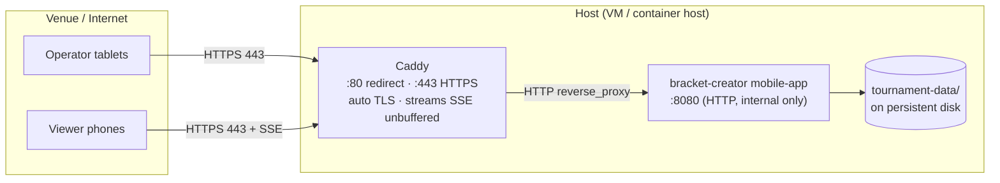
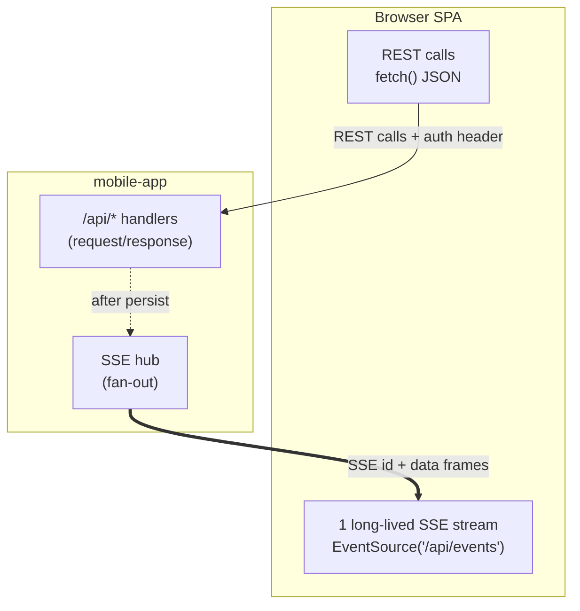
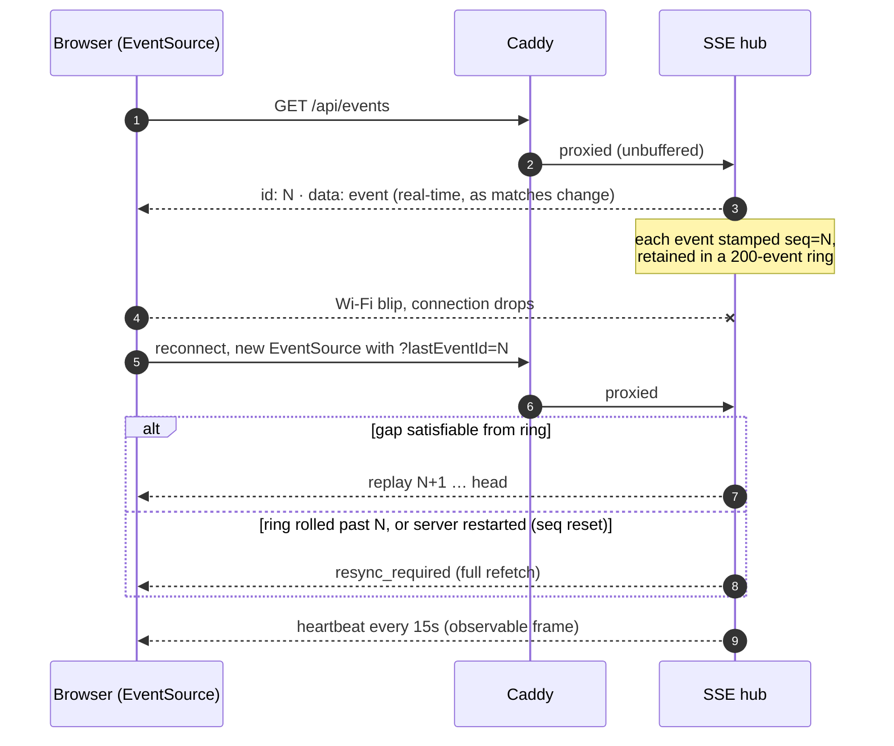
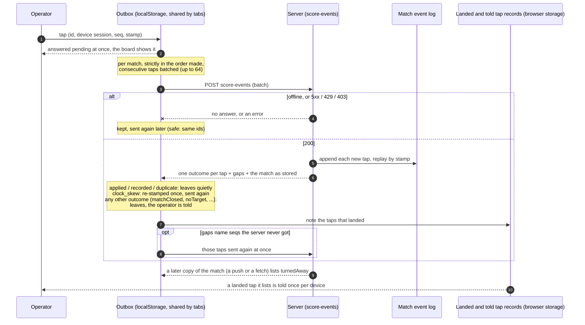
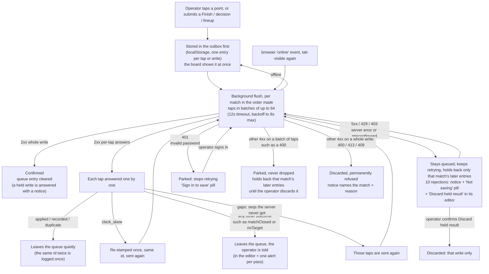
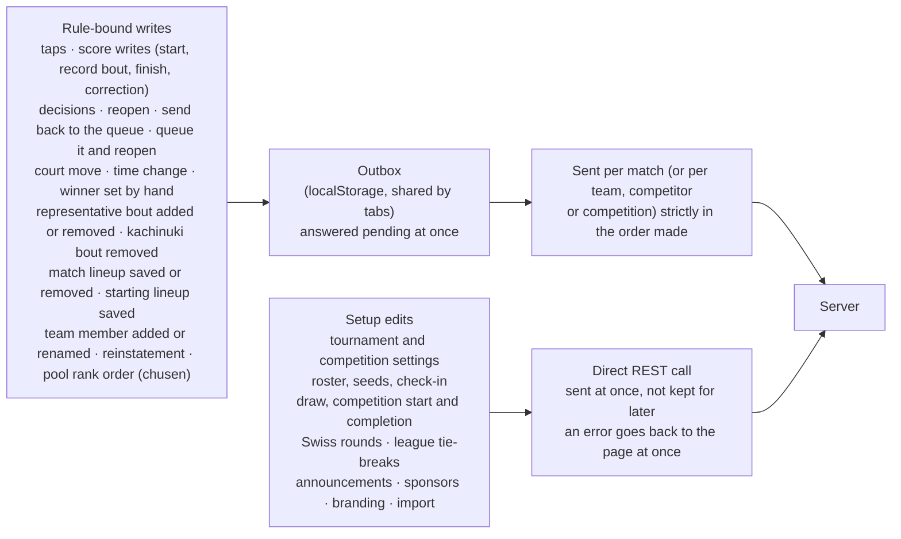
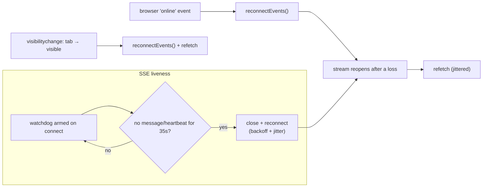
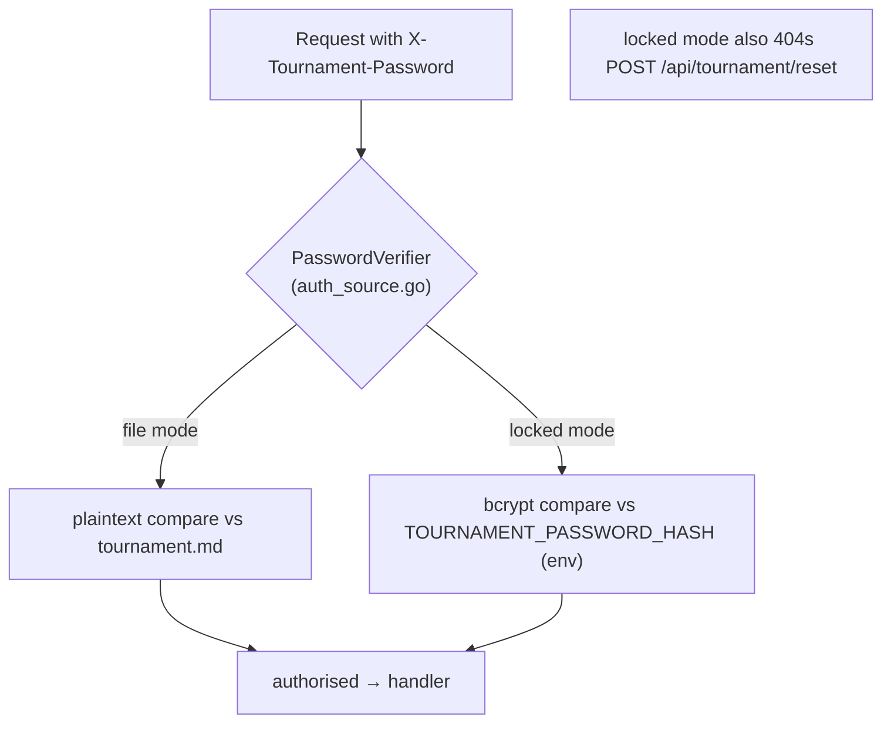

# Network architecture

How traffic flows between browsers and the tournament app: HTTPS termination at a reverse
proxy, plain HTTP to the app, real-time updates over Server-Sent Events (SSE), and the
client-side resilience that keeps it working on flaky venue Wi-Fi.

> Related: [Software architecture](software-architecture.md) · [Infrastructure architecture](infrastructure-architecture.md)

## 1. Edge topology

The app speaks **plain HTTP**. A TLS-terminating reverse proxy (**Caddy**, automatic
Let's Encrypt) sits in front and streams SSE through unbuffered.

| Port | Where | Purpose |
|---|---|---|
| 443 | Caddy (public) | HTTPS for REST + SSE |
| 80 | Caddy (public) | ACME challenge; redirect to 443 |
| 8080 | app (internal) | plain HTTP; **never published directly** (Caddy proxies it) |
| 22 | host (optional) | SSH (restrict to your IP) |

> **Proxy must stream, not buffer.** SSE is a long-lived response. The Caddyfiles deliberately avoid `flush_interval` and response-buffering directives, because those would break the real-time event stream.
> (In production HTTPS comes from the proxy, so browser secure-context features work even though
> the app itself serves plain HTTP.)

## 2. Protocols on the wire

Two channels share the one HTTPS origin:

- **REST**: score, decision, and lineup writes, config, and participants. Every scoring tap (a
  point, a foul, an overtime period, an engi flag, a team bout's tie or fusensho, a fighter named
  for a bout, a representative pick, the representative bout's judges' decision) is an event sent
  to `POST /api/competitions/{id}/matches/{mid}/score-events`, in a batch of at most 64 from one
  device session. The server appends each event to the match's event log, replays the log in the
  order the taps were made, and answers 200 with one outcome per event, except a malformed batch (400).
  The answer also lists the `gaps` (the sequence numbers of that session's taps the server never
  received) and carries the match as stored, whose `eventSeqs` (per device session, the highest
  tap number the log holds) and `turnedAway` (each device tap the log holds that the server does
  not apply now, with its outcome) every later copy of the match carries too. Finishes,
  decisions, starts, reopens, sends back to the queue and corrections are whole writes, such as
  `PUT /api/competitions/{id}/matches/{mid}/score`; they also enter the match's log, and every
  device stamps them with the time they were made. Only the rule-bound writes (the taps, the
  whole writes of a match, lineups, team members, reinstatements and pool rank orders) go
  through the device's outbox (§4); setup edits, such as tournament and competition settings,
  the roster, check-in, the draw and announcements, are direct calls that are not kept for
  later. Auth is
  handled through the `X-Tournament-Password` header (two modes, §5; self-run mode allows
  unauthenticated scoring). Every response carries the `X-App-Build` header naming the git
  commit of the server build (or `unknown`), allowing clients to detect when a new server build
  is running.
- **SSE**: one stream per client carrying `match_updated`, `competition_started`,
  `competition_completed`, `competitor_status_updated`, `participants_updated`,
  `tournament_updated`, `schedule_updated`, `lineup_updated`, `draw_generated`, `draw_discarded`,
  `swiss_round_generated`, `announcement`, `password_reset` and `bracket_quarantined`, plus the
  resilience control events `resync_required` and `heartbeat`. Every real event is stamped with a
  monotonic `seq` written as the SSE `id:` line, so the browser's `Last-Event-ID` advances
  automatically. A tap does not push by itself: the server replays the match and pushes the
  resulting `match_updated`. For a running match these pushes are held to at most four a second,
  with a final push carrying the newest state; any other push goes at once.

## 3. Real-time delivery & reconnect (SSE hub)

- **Replay ring**: `DefaultHistorySize` (200) recent events. The last id the client saw replays
  the gap. The client reconnects by opening a new `EventSource`, which sends no `Last-Event-ID`
  header, so it sends that id as the `lastEventId` query parameter (the header wins if both
  arrive).
- **`resync_required`**: emitted when a gap-free replay is impossible (ring eviction or a
  server restart that reset `seq`). The client resets its `lastSeq` and full-refetches. Emitted
  **without** an `id:` line when head seq is 0 so it can't force `Last-Event-ID` to "0".
- **Observable heartbeat**: a real `{"type":"heartbeat","nowMs":<unix ms>}` frame (no `id:`)
  every 15s, so the client can tell "quiet" from "dead". `nowMs` is the server clock at send time. It is a tripwire for a client whose own clock has drifted, not a source to set the clock from. A one-way push carries no round trip to correct against, so a delayed frame would drag the client's clock backwards. A client that sees a large divergence relearns the
  offset from the time endpoint instead.
- **Per-client buffered channel**; a stalled client that can't drain is dropped (non-blocking
  send). Subscriber cap `SSE_MAX_CLIENTS` (default 5000).

## 4. Client resilience on flaky Wi-Fi

The client treats the link as unreliable by default. The following flows show how.

Two patterns carry scoring. On the server each match is **event sourced**: the match's score
log holds the taps and the whole writes made to it, and the match shown to everyone is rebuilt by
replaying that log in the order the changes were made. On the device a **transactional outbox**
holds every tap and every write: it is stored in the browser before anything is sent, so a score
is never only in the memory of a page. The outbox sends a match's entries in the order they were
made, until the server confirms each, and the confirmation is idempotent, because a tap carries
its own id and a repeated id is recognised and logged once.

There is deliberately **no message broker** between them. The queue that matters is on the
tablet, because the tablet is the part that goes offline; a broker in the venue or the cloud
would hold nothing the tablet does not already hold. The order that matters is when each tap was
made, which the replay restores from the tap's own stamp, so a queue that preserved arrival
order would add nothing. And the app is one binary that keeps its data in files, so a broker
would be a second system to install, secure and keep running at a tournament for no gain.

Only a confirmed write ever empties the queue. A write that cannot be confirmed is never
dropped in silence: it is either kept and retried, parked until the operator can fix the
cause, or, when the server refuses it outright, removed with a visible notice naming the
reason, or discarded by the operator from the match's score editor after a confirm, when
the server keeps refusing it. A write is never removed for its age: however long it waited,
it is sent, and the server orders it by when it was made. Entries of one match are sent
strictly in the order they were made, so one that does not land holds back that match's later
entries and no other match's.

The cycle for one match's taps:

Not every write is an outbox entry. The rule-bound writes, the ones the server orders and judges
against what the match or the team already holds, are; setup edits are direct calls:

The Participants page saves the whole competitor list in one call (a typed seed, a row moved, a
shuffle, seeds cleared or read from a file, a pasted list applied), while registration desks
check competitors in and add them at the same time. Two rules keep each desk's change:

- **A list save never writes a check-in.** Every competitor keeps the check-in the server holds
  for them, whatever the list says. Only the check-in calls check a competitor in or out.
- **A list save names the list it was built from** (`rosterVersion`, which every answer carrying
  the list includes). When another desk has added, removed, renamed, moved or seeded a
  competitor since, the server refuses the save with 409 `roster_changed`, writes nothing, and
  answers with the list as it stands. The page shows that list at once, applies the
  operator's change to it again (the seed, the move, the shuffle) and sends it straight away,
  so both desks' changes land. A pasted list is the one exception: it would replace a list the
  operator never saw, so the page saves nothing, says the list changed on another device and
  keeps the pasted list in the box for one tap to apply it again. A check-in does not count as a
  change of the list.

Key client mechanisms (all in `web-mobile/js/api_client.jsx` + consumers):

| Concern | Mechanism |
|---|---|
| Half-open / stalled sockets | 12s write timeouts, 35s SSE silence watchdog (armed at connect, not only `onopen`) |
| Reconnect storms | exponential backoff + jitter (vs. a fixed delay) |
| Lost writes | durable outbox persisted to `localStorage`, retried until it lands, with no age limit; survives tab refresh. Every tap and every rule-bound write (setup edits are direct calls) is stored in the outbox in the moment it is made, before anything is sent, so the browser never holds a score only in memory. Each entry belongs to a match, and a flush pass sends each match's entries strictly in the order they were made (their stamp, then the order they were stored). One that does not land (offline, a 5xx that keeps coming back, a sign-in it waits for, or an entry it must follow) ends that match's turn for the pass and holds back that match's later entries, so a write made after another on the same device never reaches the server first. Other matches go on. Consecutive taps of one device session go as one batch of at most 64. A tap is idempotent by its event id: sent twice, it is logged once and answered as a duplicate, so a lost answer is harmless. A court move, a time change, a lineup save, a match lineup's removal, a reinstatement, a pool rank order and a team member's rename or cleared name are taken in the order they arrive, so each carries a write id, and the server answers a late duplicate as recorded without applying it again. A lineup save's positions are still ordered by when each was changed (`changedAt`), and a match lineup's removal by when it was made (`removedAt`), so a late copy of an earlier save never puts an older value back. A later running update never takes the place of a queued Finish or decision, and a decision and a score for the same match are both kept; a tap never folds into anything. Only a score write folds into the score write queued just before it, when that one has not been sent (a running update into a running update, a Finish into either, as when the editor re-sends a held Finish), naming every group either changed. A lineup save is the other write that folds: it joins a queued save of the same lineup, which then names every position either changed, with the later value where both changed one. A refusal on replay is always reported, never taken as success. Every tab of the app shares the stored outbox. A tab saving its queue merges into it: it adds its own writes, keeps the newer copy where two tabs hold the same entry, and removes only the writes it settled. Each tab also takes up the writes another tab stores, so a write queued in a tab that then closes is still sent by a tab left open. A write two tabs hold can be sent by both, which is harmless, because the server orders writes by their stamps and recognises a repeated id (refer to **Order of writes** in this table) |
| Order of writes | nothing a device sends is thrown away, and changes are put in the order they were made (the write's or the tap's own stamp), never the order they arrive. A device stamps a write with its estimate of the server's time, and never earlier than the match it was made against: two devices' estimates can differ by up to the 5 s the server accepts, so a change made a moment after a write stamped by a device running ahead would otherwise read as older than the write it changed. A tap is stamped with the same rule, against the match as it was when the operator tapped, so a change another device makes afterwards never moves it. The stamp is therefore the later of the device's time and the stamp of the match as the operator saw it plus 1 ms, never more than 4 s past the device's time. Taps are replayed by their stamps on the server, and a whole write names the groups of the match it changes (`changed`: `points`, `result`, `encho`, `flags`, `rep`, each side's representative pick, `repPickA` and `repPickB`, or one bout row, `bout:<position>`). The score editor works this out by comparing what it sends with the match it was showing. The server applies each named group only if the write is not older than the last change applied to that group, and never touches a group the write does not name, so two devices changing different things both land whatever order they arrive in. A named group a newer change outranks is not applied: its value is kept in the match's history (`GET /api/competitions/:id/matches/:mid/history`), which the score editors show under **History**. A write applied in part answers with `heldGroups`; one none of which applied answers `{"applied": false, "reason": "superseded"}` with the same list, and the editor says "Not applied" rather than "Not saved". Once a finish or a decision is recorded, a tap or a scoring write made after it is not applied either: the finish stands, the change is kept in the history, and the answer adds `heldReason: "match_closed"` (a tap's outcome is `matchClosed`), on which the editor tells the operator that the match is finished and to tap Correct. Arrival order does not change the outcome. A tap that reached the server before a finish made earlier is applied at first; when the finish arrives, the tap is moved to the history (an entry of its own, at its own time) and the finish is answered applied, naming it in `displacedGroups` with `heldReason: "match_closed"` and no `heldGroups`; the editor says "Saved" and what was moved, and a held finish replayed this way raises one information alert. The first recorded result stands: a later finish or decision from a device that did not see the result in force is held in the same way, whichever arrived first, and so is one that would replace a knockout result after the next match was played or started (`heldReason` `downstream_knockout_played` or `downstream_knockout_running`). A representative pick made after its representative bout was removed is moved to the history the same way when the removal arrives, and that answer names it in `displacedGroups` with no `heldReason`. Where the outbox folds a queued running update into a later one, the later one names every group either changed. The same holds for the writes that are not score sheets: an older save the same device had already followed with a newer one (an out-of-order delivery after a reconnect) is kept whole in the history as an "older revision of this board"; a winner set by hand that a newer result outranks is kept in the history with the winner it named, and answered like a held score; an engi result is ordered by when it was saved, its flags and the winner they decide kept together. A queued decision or finish whose first send landed but whose answer was lost is answered as recorded when it is sent again: the same write under the same stamp changes nothing, so it is not asked for a correction reason and nothing is written to the match; the match's history gains a line saying the write arrived and changed nothing |
| Edits not yet sent | a score editor holds nothing back on a running match. Every tap (a point, a foul, an overtime period, a flag, a bout's tie or fusensho, a fighter named for a bout, a representative pick, the representative bout's judges' decision) goes into the outbox the moment it is made, in the order it was made, and the board shows it at once, as the server's match with the device's pending taps on top. There is no autosave and no save delay, and nothing to lose by closing the editor, moving to another match, hiding the tab or reloading the page. A tap carries the time it was made, not the time it is sent, so it never outranks a result another device recorded after it. The exceptions are a few entries that are not taps: on a running match a Mark draw, a hantei pick and a removed withdrawal are held in the editor until Finish (or until a decision carries them). On a match that is not running (queued, or finished and being corrected) the editor holds everything the operator enters as a draft, sent by Start, Finish or Save correction. Leaving with entries not yet sent, by closing the editor, moving to another match or leaving the page, asks first with one warning, "Your unsaved entries will be discarded. <action> anyway?", with **Discard entries** and **Keep entries**, and nothing is sent until the operator answers |
| Taps the server does not apply | a tap is answered one by one. An applied, already recorded or repeated tap leaves the queue quietly. A tap refused for a clock too far ahead is stamped again once and sent under the same id. Any other tap the server answered without applying (the match is finished, `matchClosed`; the mark it names is not there, `noTarget`; made before a result that never saw it, `beforeBaseline`; a self-run limit) leaves the queue and is told to the operator in the editor and in one alert per pass. The answer also lists the `gaps`, the taps of the device's session the server never received, and the outbox sends the ones it still holds again at once. Every copy of the match names, per device session, the highest tap number its log holds (`eventSeqs`), so a screen never counts a pending tap twice, and lists the device taps the server does not apply now (`turnedAway`): a tap first answered as applied can be turned away later, when a finish that never saw it arrives after it, and the device that made it tells its operator once, from the newest copy of the match it has seen, in one tab only. A tap sent while the match is neither running nor finished is not logged and is told the same way. A tap on a finished match is logged and answered `matchClosed`. A whole batch the server refuses with a 4xx other than 401 is parked instead of dropped |
| Server errors (5xx / 429), and 403 | write stays queued and keeps retrying until it lands, holding back only that match's later entries; after 10 consecutive rejections the operator gets a notice and the sync pill shows "Not saving", and the match's score editor offers **Discard held result**, which discards that write and nothing else after a confirm. The held-writes count in the admin topbar opens a list of every held write (score updates, results, decisions, winners set by hand, lineups), where any write that keeps failing can be discarded the same way, one at a time; a write only waiting for the connection cannot be discarded there. On this server 403 is never a bad credential (that is 401): it means the tournament is not configured yet, or is missing its password. Only an admin fixing the server state clears it, so signing in again cannot help and the write keeps retrying instead of parking |
| Invalid credential (401) | the one 4xx a retry can fix: the write is parked, not discarded, stops retrying, and shows "Sign in to save"; signing in again re-sends it with the new credential, together with every other queued write still carrying the refused password (one queued after it, before its own 401 came back), so one sign-in is enough. A write queued without a password (a competitor's in a self-run event) is never given one |
| Other non-retryable 4xx (400 validation, 413, generic 409) | a whole write is discarded (it can never succeed on retry), and the operator always gets a visible notice naming the match and the server's reason. A batch of taps the server refuses with a 4xx other than 401 (a 400, say) is not discarded: it is parked, stays out of the board and the display, and holds back that match's later entries until the operator discards it from the editor or the held-writes list, with one alert |
| Missed events | replay from the last event id the client saw (`?lastEventId=`), `checkSeqGap` on every event → scoped refetch; `resync_required`. A stream that reopens after it was lost also refetches everything, jittered over 2s so a venue's devices do not all ask at once: replay does not resend an event the page received whose refetch then failed because the device could not fetch |
| Back online | the browser's `online` event forces a reconnect, and the reopened stream refetches as above (the stream can outlive the outage, so it is not left to report a loss itself) |
| Tab resume | `visibilitychange` → force reconnect + refetch |
| False success | terminal writes show pending / parked / still-retrying / failure state, never a false "saved"; a write dropped because the stored entry was corrupt also raises a visible notice at page load, never a silent loss. The admin topbar counts this tab's held writes after the connection status ("Offline: 1 result not sent", "Sending 1 result…", "Not saving: 1 result"), so a held result stays visible after the editor that held it closes, and the connection status reads "Reconnecting…" while held writes fail for network reasons. When held finished results land, one success toast per flush says so ("1 finished result sent."). Every write passes through the outbox, so a result that lands at once raises none of these (the success toast appears only for results that had been held) |
| Storage full | if the browser can't persist the queue (storage quota exhausted), that is surfaced to the operator rather than swallowed: an alert, and the queued write answers `persisted: false`, so its score editor says "Not sent yet: keep this page open until the connection returns." instead of "saved on this device" |
| Credential change | queue cleared on logout (the operator is asked to confirm first if writes are still unsent). On `password_reset` the queued writes are parked instead: the old password is removed from every stored write, every tab's included, and they are re-sent once the operator signs in again (no stale-password retries) |

## 5. Authentication on the network

- **File mode** (default): plaintext compare against `tournament.md`. `POST /api/tournament/reset`
  (for a forgotten admin password) answers only a caller on the machine running the server,
  judged on the TCP peer address; any other caller gets 403 `reset_local_only`.
- **Locked mode** (`--lock-password` / `LOCK_PASSWORD=true` + `TOURNAMENT_PASSWORD_HASH`): bcrypt
  compare; reset endpoint returns 404. `GET /api/auth-config` reports the mode to the SPA.

## 6. Server-side network hardening (`cmd/mobile_app.go`)

| Setting | Value | Why |
|---|---|---|
| `ReadHeaderTimeout` | 10s | slowloris-header defense |
| `ReadTimeout` | 30s | slow-body defense (still allows multi-MB CSV import) |
| `IdleTimeout` | 120s | bounds fd commitment per idle keep-alive |
| `WriteTimeout` | **0** | SSE is infinite; cancellation through the request context |
| `MaxHeaderBytes` | 1 MB | header-bomb defense |
| Body cap (admin JSON) | 1 MB | `MaxBodyBytes` middleware → 413 |
| Body cap (`/tournament/import`) | 64 MB | matches multipart CSV import |
| Graceful shutdown | 30s | `Hub.Close` through `RegisterOnShutdown` |

## 7. Scale limit = egress

Because every real-time update is fanned out to **every** connected viewer, **network egress is the
practical ceiling**, not CPU/RAM. Refer to [Infrastructure architecture](infrastructure-architecture.md#5-capacity-scaling)
for per-tier audience guidance (for example, GCP free tier compared with Oracle for large events).
