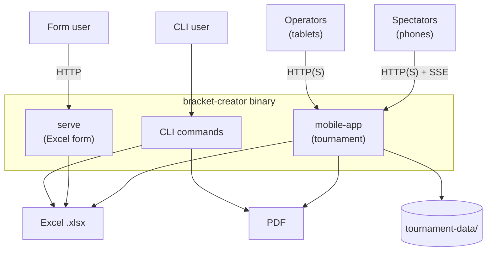
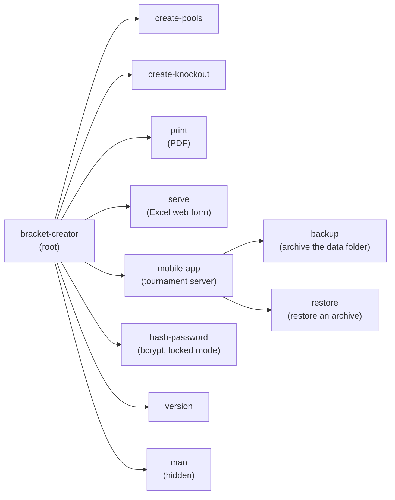
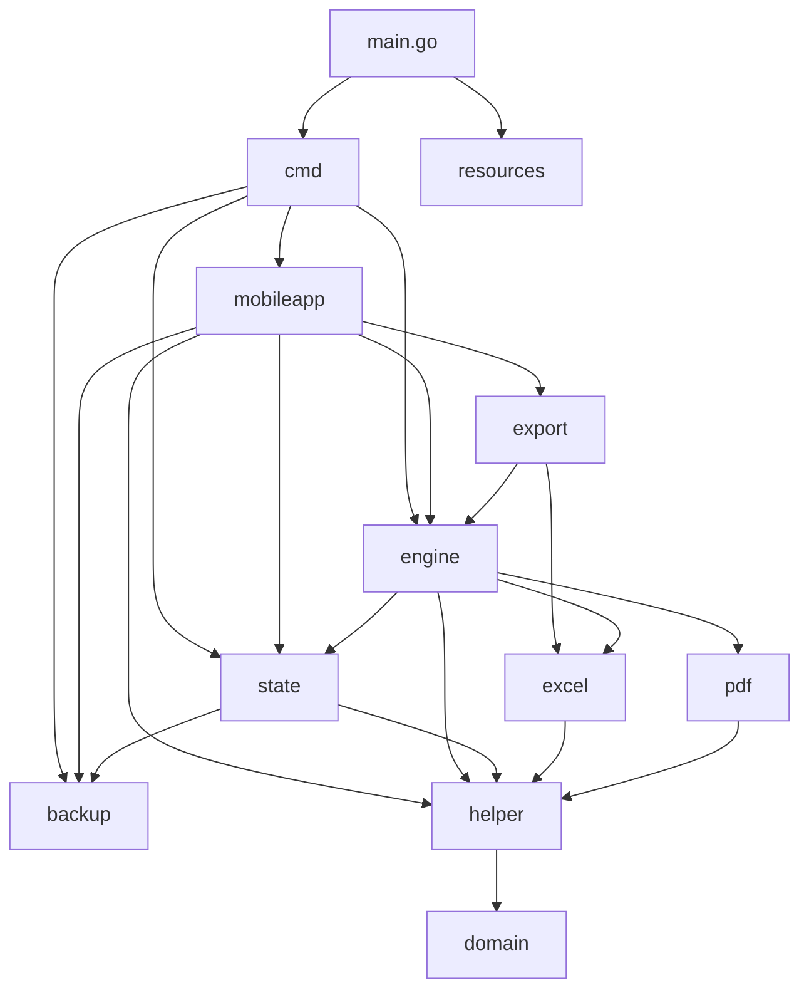
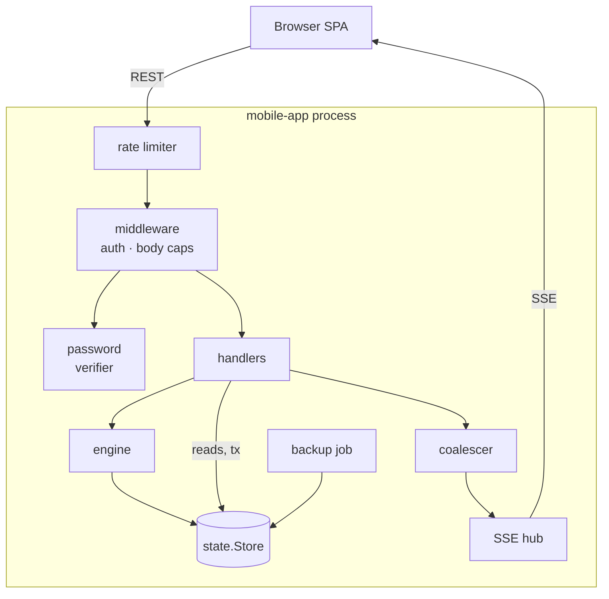
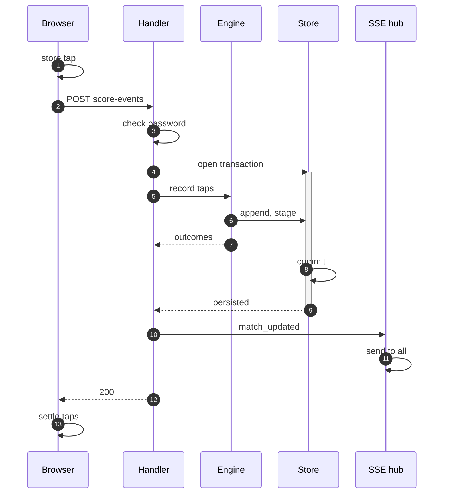
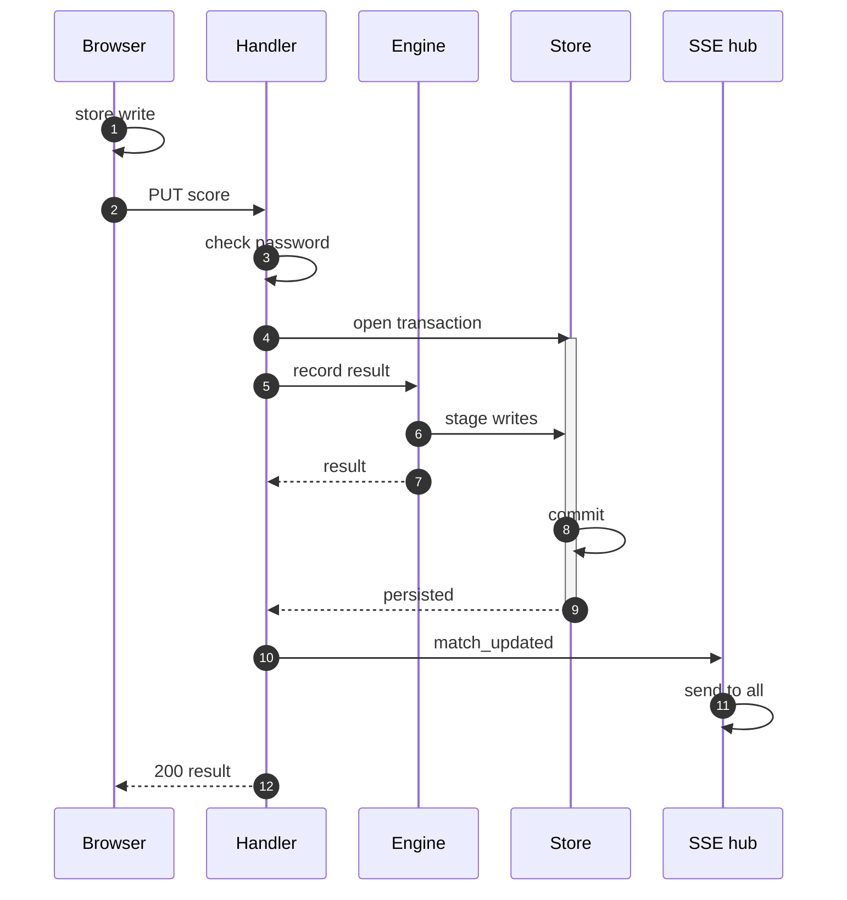
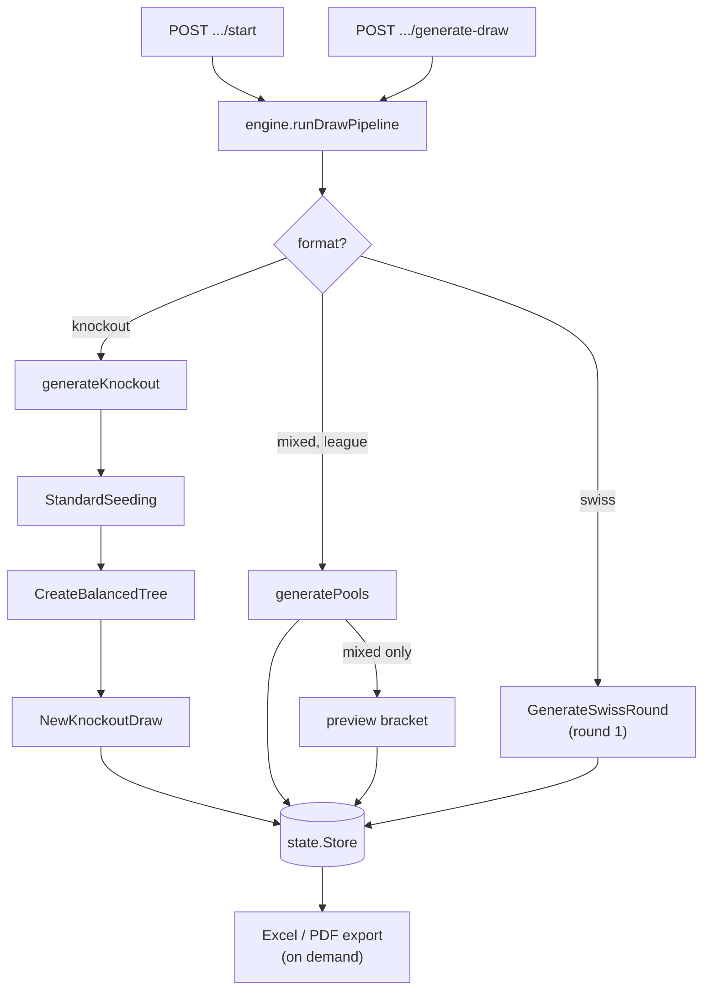
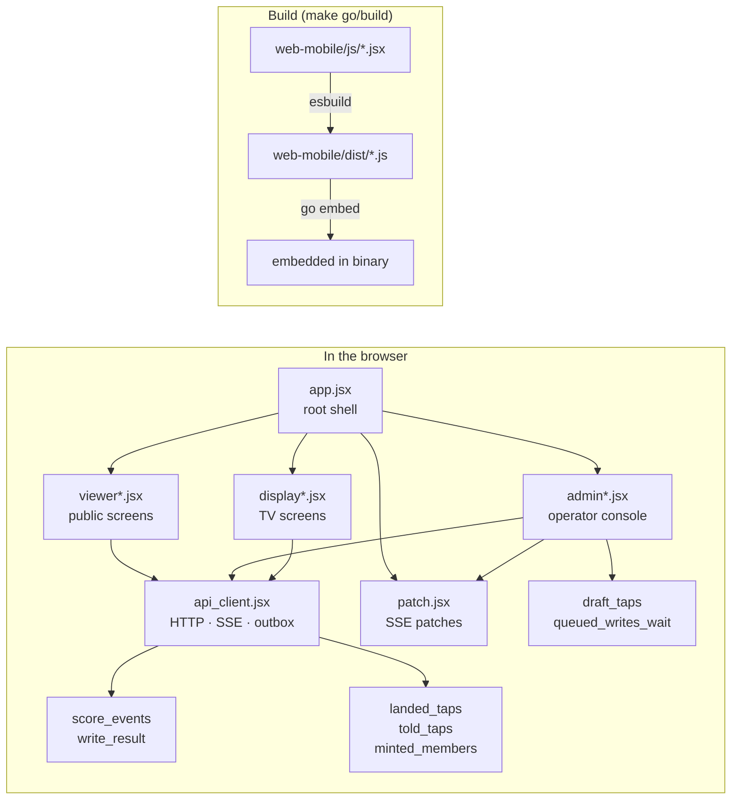

# Software architecture

How the bracket-creator codebase is organised: a single Go binary that is both a **CLI**
(Excel bracket generator) and a **tournament web app** (the `mobile-app` server), plus a
Preact frontend compiled into the binary.

> Related: [Network architecture](network-architecture.md) · [Infrastructure architecture](infrastructure-architecture.md)

## 1. System context

The CLI commands are `create-pools`, `create-knockout` and `print`; the Excel output is the
formula-linked bracket workbook, and from the tournament app also a results workbook; the PDF
exports are tags, names and trees; `tournament-data/` holds the live state as Markdown and CSV
files. Operators are organisers and shiaijo operators on a tablet or desktop; spectators
include the competitors, on their phones.

The same binary ships the CLI, the legacy one-shot Excel web form (`serve`), and the
real-time tournament app (`mobile-app`). All web assets are embedded at build time, so there is
nothing to install beyond the binary itself. Besides its live state, the tournament app exports
a competition's results as an Excel workbook and prints PDFs on demand.

The binary serves plain HTTP ("HTTP(S)" in the diagram). When the app is reachable beyond a trusted venue network, HTTPS
comes from a reverse proxy in front of it (refer to
[Infrastructure architecture](infrastructure-architecture.md)).

## 2. Command surface (Cobra CLI)

Most commands (`create-pools`, `create-knockout`, `print`, `serve`, `mobile-app` and its
`backup` and `restore` subcommands) are an options struct with a `run()` method (`cmd/*.go`);
`version`, `man` and `hash-password` are plain Cobra commands. `man` generates the manual
pages and is hidden from the help output. `backup` and `restore` work on the data folder
directly, with the server stopped. `create-pools` and `create-knockout` share
`cmd/shared.go`. `main.go` embeds the web assets and calls `cmd.ExecuteWithResources(res)`.

## 3. Package layers

Each arrow is an import. The packages form these layers, top to bottom: entry (`main.go`, `cmd`,
`resources`), presentation (`mobileapp`), orchestration (`export`, `engine`),
persistence and output (`state`, `backup`, `excel`, `pdf`), and the core logic and models
(`helper`, `domain`). Every package except `main.go` and `cmd` lives under `internal/`. The
diagram shows the main imports; besides these, `cmd` also imports `helper`, `excel`, `pdf` and `resources`,
`mobileapp` imports `pdf` and `resources`, `export` imports `state` and `helper`, `main.go` imports `helper` and `resources`, `internal/cmd/version` (the build's version stamp)
is imported by `cmd`, `mobileapp` and `backup`, and every
package that works with competitors imports `domain`. Every arrow points down a layer:
`internal/helper` sits below persistence because `state`, `excel` and `pdf` all import it,
and it imports only `domain`.

`main.go` embeds `web/{index.html, images, css, js}` (the `serve` form) and
`web-mobile/{index.html, images, css, dist, vendor}`
(the tournament app; `dist/` is the compiled frontend, refer to [Frontend](#7-frontend-preact-spa)).

**Dual domain model (in transition).** `internal/helper` implements the real algorithms.
Its types carry Excel coordinates (`sheetName`, `cell`) tightly coupled to output generation.
`internal/domain` holds clean models being phased in gradually. Don't confuse the two.

| Package | Responsibility |
|---|---|
| `cmd` | Cobra commands (most an options struct with `run()`) |
| `internal/mobileapp` | Gin HTTP handlers, SSE hub, auth middleware, rate limiter, scheduled backups, `safeGo` |
| `internal/engine` | Drives `helper` generation from a `state.Competition`; handles scoring, eligibility, kachinuki, schedule estimate, the competition calendar's placement and the re-timing of a drawn competition's matches (`pausesOnDay` owns which pauses apply on a day and `dayBreaks` is its view of the ones that stop matches; `countForEstimate` owns the participant count an estimate uses) |
| `internal/export` | Builds a results-populated Excel workbook from live tournament-app state (`GET /api/competitions/:id/export-results`) |
| `internal/state` | File-backed store (`tournament.md`, `competitions/<id>/config.md`, `participants.csv`). Transactions + write-ahead log, per-competition locks |
| `internal/backup` | Reads and writes tournament backup zip archives and their manifest; used by the `mobile-app backup` and `restore` commands, the backup routes and the scheduled backup |
| `internal/excel` | Excel lifecycle + `NewFileFromScratch` |
| `internal/pdf` | PDF exports (LibreOffice-backed) |
| `internal/helper` | CSV parsing, pool/match generation, binary-tree brackets, seeding, Excel rendering |
| `internal/domain` | Clean models + canonical decision/lineup rules |
| `internal/resources` | Embedded web-asset management |

## 4. The `mobile-app` server at runtime

| Box | File (`internal/mobileapp/`) | Role |
|---|---|---|
| rate limiter | `ratelimit.go` | Global and per-IP request limits on the API |
| middleware | `middleware.go` | `X-Tournament-Password` auth, body caps |
| password verifier | `auth_source.go` | `PasswordVerifier`: file mode (plaintext compare) or locked mode (bcrypt) |
| handlers | `handlers_*.go` | The REST routes, grouped below |
| coalescer | `broadcast_coalescer.go` | Sends a match's `match_updated` pushes; a running match's at most 4 a second |
| SSE hub | `hub.go` | Seq stamping, replay ring, resync, heartbeat |
| backup job | `scheduled_backup.go` | Hourly check, a copy a day when the tournament changed |

The page itself (the compiled SPA, its CSS and vendored libraries) is served from the assets
embedded in the binary (`internal/resources`). Every goroutine a handler spawns goes through
`safego.go`.

The handler files fall into these groups:

- **Competitions and draws:** competition, swiss, league and league tie-break, competition times, calendar, schedule and draft estimate.
- **Matches and scoring:** match, score events, decision, daihyosen, eligibility, match history.
- **Teams and people:** participants, registration, lineup, team members.
- **Public surfaces:** viewer, display, time, version, auth config.
- **Tournament and files:** tournament, announcements, backup and restore, export, print, import, branding, sponsors, reset.

Handlers call the engine for anything rule-bound, and also use the store directly: the viewer
endpoints read from it, and the score handlers open the transaction themselves ([Write path](#5-write-path-recording-a-score-acid-broadcast)).
A single match's `match_updated` pushes pass through the broadcast coalescer, which sends a
running match's at most once every 250 ms and always sends the latest stored match; a finish, a
decision or any other change to the match is sent at once. Competition-wide refreshes and the
other events go to the hub directly. The scheduled backup job runs beside the
handlers: it checks on startup and then every hour, and writes a copy to the data folder's
`backups/` directory when the newest one is at least a day old and the tournament has changed.

Server hardening (constants in `cmd/mobile_app.go`): `ReadHeaderTimeout 10s`, `ReadTimeout 30s`,
`IdleTimeout 120s`, `MaxHeaderBytes 1 MB`, **`WriteTimeout 0`** (SSE streams are infinite;
per-request cancellation runs through the request context). Graceful shutdown 30s with
`Hub.Close` wired through `RegisterOnShutdown`. Every handler-spawned goroutine uses `safeGo`
(Gin Recovery only catches the request goroutine).

## 5. Write path: recording a score (ACID + broadcast)

A scoring tap and a finishing write take different doors into the same engine. A tap is an
event: the browser stores it in its outbox at once, and the outbox sends it to the match's
score events endpoint. The handler opens one transaction on the store; inside it the engine
appends the taps to the match's event log, replays the log in the order the taps were made,
and stages the match the replay produces and a history line. The store then commits all of it
at once.

1. The tap is stored in the outbox and the board shows it at once.
2. The outbox sends a batch of taps: `POST /api/competitions/:id/matches/:mid/score-events`.
3. The auth middleware verifies `X-Tournament-Password` before the handler (`handlers_score_events.go`) runs.
4. The handler opens `WithTransaction` on the competition.
5. Inside it, the handler calls `engine.RecordScoreEventsTx(stx, ...)`.
6. The engine appends the taps to `events/{matchId}.jsonl` and stages the replayed match and a history line.
7. The engine returns one outcome per tap, and any gaps.
8. The store commits: WAL, `fsync` and atomic rename.
9. The transaction returns once everything is on disk.
10. Only then does the handler broadcast `match_updated`.
11. The hub sends the event to every connected client, this one included, with its seq as the SSE id.
12. The answer carries the outcome of each tap and the match as stored.
13. The outbox clears the taps that landed, and sends again the ones stamped out of range (`clock_skew`) and the gaps.

A finish, a correction and the other whole writes use their own routes, such as the one below
(a decision and a reopen have theirs, `POST /decision` and `POST /reopen`).
They are outbox entries too, and they enter the same event log as a baseline, so a tap and a
whole write are ordered against each other by the time each was made.

1. The write is stored in the outbox and answered pending at once; it is sent after the match's earlier entries.
2. The outbox sends `PUT /api/competitions/:id/matches/:mid/score`.
3. The auth middleware verifies `X-Tournament-Password` before the handler (`handlers_match.go`) runs.
4. The handler opens `WithTransaction` on the competition.
5. Inside it, the handler calls `engine.RecordMatchResultWithIneligibilityTx(stx, ...)`.
6. The engine stages its writes as intents.
7. The engine returns the result and any eligibility status.
8. The store commits: WAL, `fsync` and atomic rename.
9. The transaction returns once everything is on disk.
10. Only then does the handler broadcast `match_updated`.
11. The hub sends the event to every connected client, this one included, with its seq as the SSE id.
12. The answer carries the result.

Core invariant: **persist then broadcast**. A write is durable
(`fsync` + atomic rename, WAL for multi-file changes) before the 200 and before any SSE
fan-out. Scoring is ACID. A legitimate operator change is never dropped.

### The outbox

Every scoring tap and every rule-bound write is stored in the browser's `localStorage` before
anything is sent, so a score never lives only in the memory of a page. The stored outbox is
shared by every tab of the app on the device: each tab merges its own entries into it and takes
up the entries another tab stored. Entries are sent per owner (a match, a team, a competitor, a
competition, a court call or the tournament settings) strictly in the order they were made, and
retried until they land; consecutive taps go as one batch.

The outbox lives in `api_client.jsx`. The writes that go through it are:

- scoring taps (points, fouls, overtime, flags and the other score events);
- score writes (start, record bout, finish, correction), decisions, reopen, send back to the queue, queue it and reopen;
- court moves and time changes;
- representative bout added or removed, kachinuki bout removed;
- starting lineups saved, match lineups saved or removed, team members added, renamed or cleared;
- reinstatement of a competitor and a pool rank order;
- check-ins, single and bulk;
- court calls announced, withdrawn or cleared;
- tournament settings and fighting-spirit awards.

Other setup edits (the password, competition settings, the roster, the draw) are direct calls.
Refer to [Client resilience on flaky Wi-Fi](network-architecture.md#4-client-resilience-on-flaky-wi-fi)
for how entries are ordered, retried, parked and reported.

## 6. Bracket generation (engine → helper)

The draw can be made two ways: `POST /api/competitions/:id/generate-draw` makes it and leaves
the competition draw-ready for review, and `POST /api/competitions/:id/start` on a competition
still in setup makes it and starts at once. A start on a draw-ready competition keeps the draw
it has. Both draws run `runDrawPipeline` (`internal/engine/competition.go`), which picks one
of four paths by format:

- **Knockout:** direct elimination. `generateKnockout` (`internal/engine/bracket.go`) calls three `internal/helper` steps: `StandardSeeding` (`seed.go`) places the competitors, `CreateBalancedTree` (`tree.go`) builds the binary tree and `NewKnockoutDraw` (`draw.go`) cuts it into per-shiaijo regions and pages, aiming for at most `MaxPlayersPerTree` (16) competitors on each tree page.
- **Mixed (pools + knockout):** tree-aware pool descent (`BuildPoolPhaseTreeAwareWithMode`) places seeds first, then spreads dojos across the bracket's nodes; the fill-bracket sizing uses its own builder. A preview bracket with pool-origin placeholders is written as well (`generatePoolPreviewBracket`), so the elimination stage is visible at draw time.
- **League:** a single pool, everyone fights everyone, through the same pool generation.
- **Swiss:** only round 1 is paired at the draw (`GenerateSwissRound`); later rounds are generated as the event goes on, and there is no tree.

## 7. Frontend (Preact SPA)

`app.jsx` is the root shell: it reads the route and switches between the public viewer, the
operator console and the display surface. Every surface talks to the server through
`api_client.jsx`, which also consumes the SSE stream and owns the outbox (refer to
[The outbox](#the-outbox)). The root shell and the operator console apply each SSE patch to the
competition data they hold through `patch.jsx` (`applyPatch`), which also detects a gap in the
event sequence (`checkSeqGap`) and triggers a resync. The modules around the outbox:

- `score_events.jsx`: the score event kinds and the replay that puts a device's pending taps on top of the server's match, the browser twin of the server's fold and replay.
- `write_result.jsx`: decides whether a score write landed, and if not, whether the state on screen can still become true.
- `draft_taps.jsx` (used by the score editors): turns a draft held in an editor into the taps that would have made it, when another device starts the match.
- `queued_writes_wait.jsx` (used by the draw and move screens): waits for a competition's queued writes of a kind (check-ins before a draw, a time change before a move) before going on.
- `landed_taps.jsx`, `told_taps.jsx` and `minted_members.jsx` (used by `api_client.jsx`): what the device knows of its own taps that landed, of the taps it already told the operator were not applied, and of the team member ids it made.

The operator console is a tablet/desktop surface; the viewer is mobile-first. Refer to
[Network architecture](network-architecture.md) for the client's **outbox, SSE resume, and
reconnect resilience**.

## Key design rules

Refer to [`DESIGN.md`](https://github.com/gitrgoliveira/bracket-creator/blob/main/DESIGN.md) for the full visual design system.

- **Persist before broadcast**; scoring is ACID; never drop a legitimate operator change.
- **Use layout/sheet constants** (`internal/helper/constants.go`), never string literals.
- **`errcheck` is enforced** in production code: propagate or log, never `_ =`.
- **Aka (Red) / Shiro (White) are positional**, distinguished by treatment, not hue alone.
