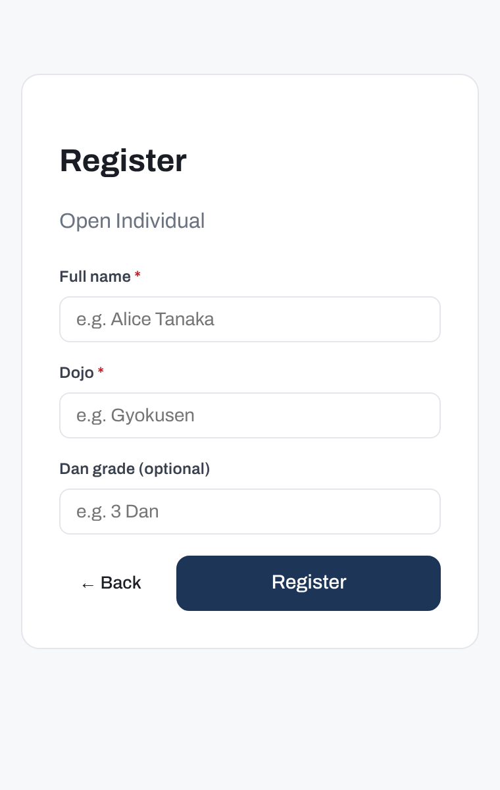
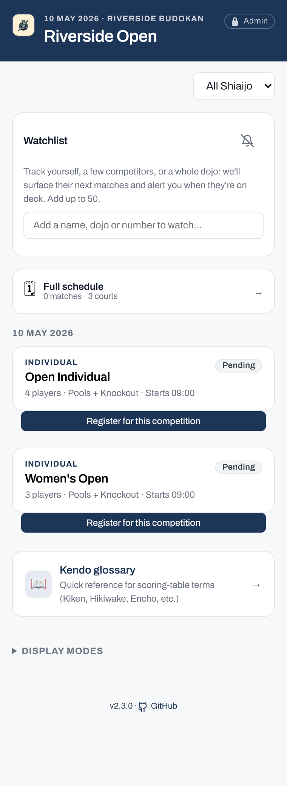

# Take part in a self-run tournament

A self-run tournament lets competitors and table helpers run and score their own matches with no admin password. The organiser turns this on when creating the tournament. For the full rules of self-run and officiated modes, refer to [Operating modes](../organisers/operating-modes.md).

The steps on this page apply only to a self-run tournament. In an officiated tournament, an operator carries out these actions for you.

## Register yourself

When the tournament is self-run, a public self-registration page is open for individual competitions while they are still in setup, before the organiser generates the draw. Open the registration page on your own device and enter your details to join a competition.

<figure class="bc-fig" markdown="span">
  { .bc-phone }
  <figcaption>The public self-registration form: name, dojo, optional dan grade.</figcaption>
</figure>

!!! note
    Self-registration is not available for team competitions; the organiser adds the team roster directly. In an officiated tournament, the registration page is not available at all, and the organiser adds you to the competition directly.

If the form says someone with your name is already registered, your name and dojo are already on the list and you are done. A namesake from another dojo registers normally. If you are a different person with the same name at the same dojo, ask the organiser to add you.

## Check-in

Self-run mode has no check-in. There is nothing to mark on the day: the draw includes everyone on the roster, so make sure your name is on it before the organiser generates the draw.

## Report your own score

You can record your match result directly from the public viewer, without the admin password. A result you enter is tagged as self-reported; a result entered by an operator is tagged as admin.

Only everyday match outcomes are available to self-reporters. Decisions that require an official ruling remain with the operator, and so do destructive actions such as deleting a competition or discarding a draw. For a full list of outcomes and what they mean, refer to [Recording decisions](../court-operators/recording-decisions.md).

When a knockout team match finishes level, you can add the representative bout ([daihyosen](../court-operators/recording-decisions.md#daihyosen)) from the score sheet, score it like any other bout, and finish the match on the winner it decides. A kachinuki match has no representative bout: a tied pairing that must produce a result is settled by encho on that same bout (refer to [Scoring a kachinuki encounter](../organisers/team-tournaments.md#scoring-a-kachinuki-encounter)). A representative bout added by mistake can be removed while it is still unscored, until the match finishes; after that, only the organiser can add or remove one. The score sheet does not offer a judges' decision (hantei): that stays with the organiser, on the representative bout as on every other bout. When the organiser records one, the score sheet shows the representative bout as decided and you cannot change it, but you can still finish the match on that decision.

In a team match you can also name each bout's fighters on the score sheet: pick a team member from the list, or type their name. The names are saved with the match. Once the match has finished, ask the organiser to correct a name. The score sheet can bring a team up to twice its team size plus two members; to add more, or to name anyone once the competition has finished, ask the organiser.

## If your result cannot be sent

If your device cannot send a result you entered, because there is no connection or the server keeps refusing it, the app keeps it on the device and sends it when it can. While that is so, a count of unsent results appears in the bottom-left corner of the public page, but nothing is shown while a result is simply being sent. Tap the count to see what is held and whether each item is waiting for the connection or being refused. An item the server keeps refusing has a Discard button: after you confirm, that item alone is discarded, so you can check the match and enter the result again if it is still needed. An item that is only waiting for the connection cannot be discarded; it is sent automatically when the connection returns.

## Follow your matches and standings

To track your progress, view the draw, and see standings, refer to [Following a tournament](../spectators/following.md).

<figure class="bc-fig" markdown="span">
  { .bc-phone }
  <figcaption>The public home in self-run mode: each open competition carries a Register button.</figcaption>
</figure>
