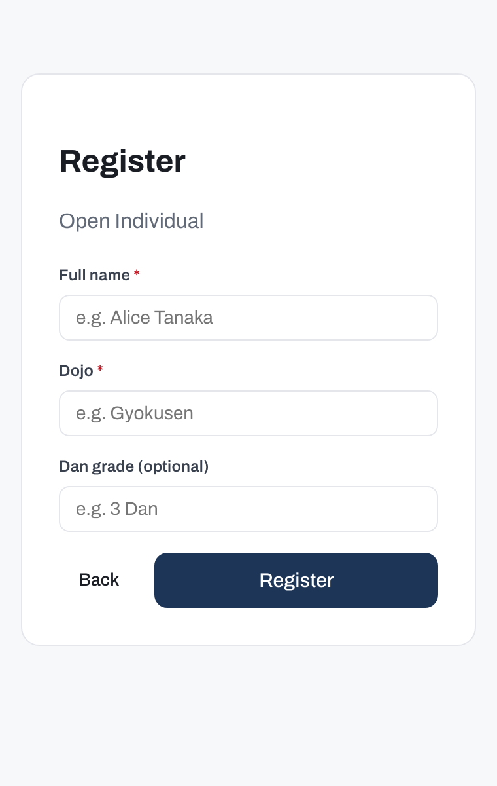
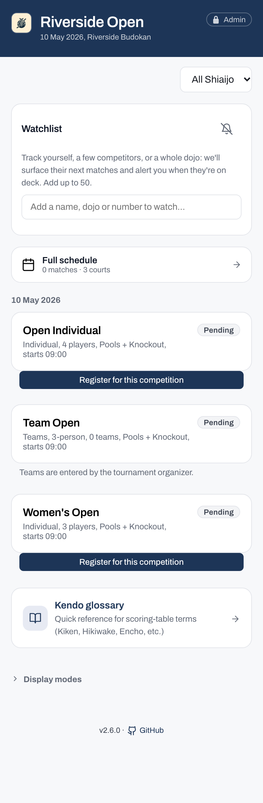

# Take part in a self-run tournament

A self-run tournament lets competitors and table helpers run and score their own matches with no admin password. The organiser turns this on when creating the tournament. For the full rules of self-run and officiated modes, refer to [Operating modes](../organisers/operating-modes.md).

The steps on this page apply only to a self-run tournament. In an officiated tournament, an operator carries out these actions for you.

## Register yourself

When the tournament is self-run, a public self-registration page is open for individual competitions while they are still in setup, before the organiser generates the draw. Open the registration page on your own device and enter your details to join a competition.

<figure class="bc-fig" markdown="span">
  { .bc-phone }
  <figcaption>The public self-registration form: name, dojo, optional dan grade.</figcaption>
</figure>

!!! note
    Self-registration is not available for team competitions; the organiser adds the team roster directly. While a team competition is still in setup, its card on the public home has no Register button and says "Teams are entered by the tournament organizer." instead. If you open the registration link of a team competition anyway, the page says the same and asks you to ask the organiser to add your team. In an officiated tournament, the registration page is not available at all, and the organiser adds you to the competition directly.

If the form says someone with your name is already registered, your name and dojo are already on the list and you are done. A namesake from another dojo registers normally. If you are a different person with the same name at the same dojo, ask the organiser to add you.

## Names on the public pages

A self-run tournament always shows competitor names on the public pages, because you and the other competitors run the matches from them. An organiser cannot hide names in a self-run tournament, and a competition that was set to hide them shows names for as long as the tournament is self-run. Refer to [Operating modes](../organisers/operating-modes.md).

## Check-in

Self-run mode has no check-in. There is nothing to mark on the day: the draw includes everyone on the roster, so make sure your name is on it before the organiser generates the draw.

## Report your own score

You can record your match result directly from the public viewer, without the admin password. A result you enter is tagged as self-reported; a result entered by an operator is tagged as admin.

Only everyday match outcomes are available to self-reporters. Decisions that require an official ruling remain with the operator, and so do destructive actions such as deleting a competition or discarding a draw. For a full list of outcomes and what they mean, refer to [Recording decisions](../court-operators/recording-decisions.md).

When a knockout team match finishes level, you can add the representative bout ([daihyosen](../court-operators/recording-decisions.md#daihyosen)) from the score sheet, score it like any other bout, and finish the match on the winner it decides. A kachinuki match has no representative bout: a tied pairing that must produce a result is settled by encho on that same bout (refer to [Scoring a kachinuki encounter](../organisers/team-tournaments.md#scoring-a-kachinuki-encounter)). A representative bout added by mistake can be removed while it is still unscored, until the match finishes; after that, only the organiser can add or remove one. The score sheet does not offer a judges' decision (hantei): that stays with the organiser, on the representative bout as on every other bout. When the organiser records one, the score sheet shows the representative bout as decided and you cannot change it, but you can still finish the match on that decision.

In a team match you can also name each bout's fighters on the score sheet: pick a team member from the list, or type their name. The names are saved with the match. Once the match has finished, ask the organiser to correct a name. The score sheet can bring a team up to twice its team size plus two members; to add more, or to name anyone once the competition has finished, ask the organiser.

## If your result cannot be sent

If your device cannot send a result you entered, because there is no connection or the server keeps refusing it, the app keeps it on the device and sends it when it can. While that is so, a count of unsent results appears in the bottom-left corner of the public page, but nothing is shown while a result is simply being sent. Tap the count to see what is held and whether each item is waiting for the connection or being refused. An item the server keeps refusing has a Discard button: after you confirm, that item alone is discarded, so you can check the match and enter the result again if it is still needed. An item that is only waiting for the connection cannot be discarded; it is sent automatically when the connection returns.

While a finished result is waiting on your phone, the match card says so: "Result entered on this phone, not sent yet. It is sent when the connection returns." The card does not offer **Report result** then, so you cannot enter the same result a second time over your own. If the server has been refusing it, the line says that the server has not accepted it and that the phone is still trying. Once the result has been sent, or discarded, the card goes back to what the server holds.

## If your result is refused

The server can refuse a result you entered, for example because someone on another device finished the same match first. The server keeps the first result recorded, so yours is not applied. A refusal is told once, in a message at the bottom of the screen that names the match and gives the reason, for instance that the match result has already been reported and the organiser can correct it. The message is also shown when your phone was offline when you entered the result and the refusal only comes back once the connection returns. Any scoring taps you made in the same match are not listed separately: the one message covers the match. The refused result does not stay on the device, so it leaves the list of unsent results and nothing in it needs discarding. Check the match card to see the result that stands, and ask the organiser if it needs correcting.

## Follow your matches and standings

To track your progress, view the draw, and see standings, refer to [Following a tournament](../spectators/following.md).

<figure class="bc-fig" markdown="span">
  { .bc-phone }
  <figcaption>The public home in self-run mode: each open individual competition carries a Register button, and a team competition says the organiser enters teams.</figcaption>
</figure>
