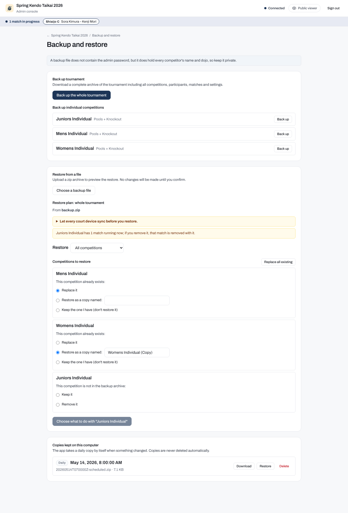
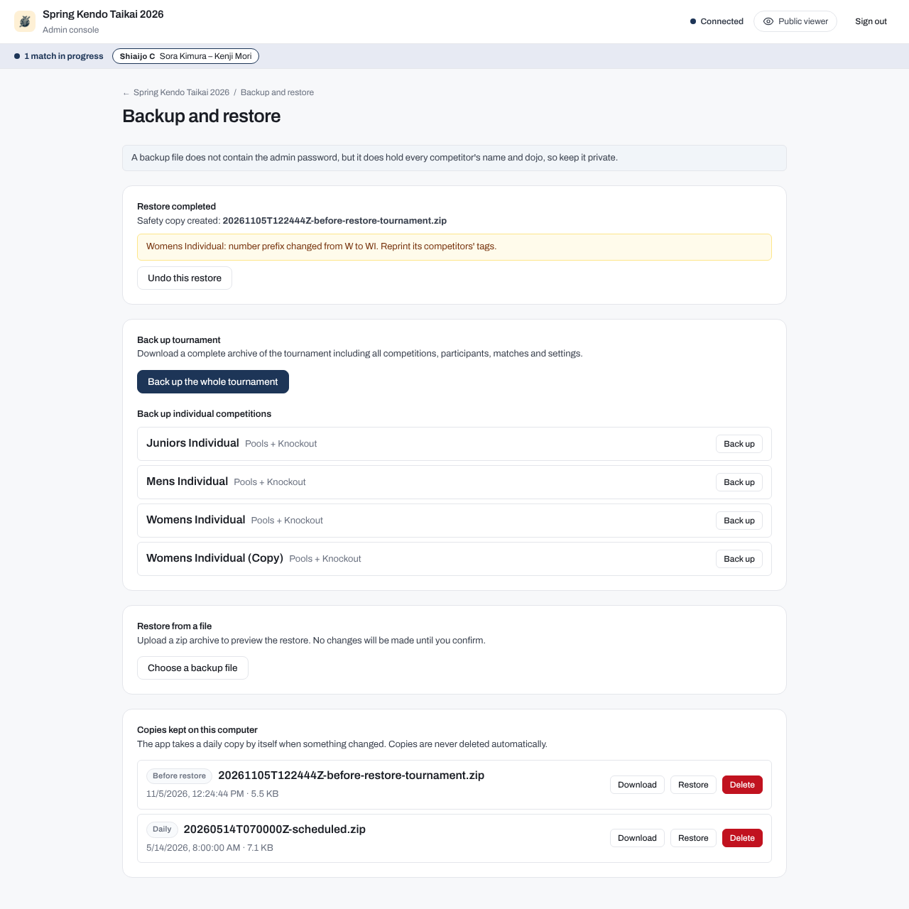

# Backup and restore

A backup is a zip archive of the whole tournament or of one competition. Restoring one puts that data back, after a mistake, a failed computer or an accidental change, and a restore can itself be undone. Taking a backup does not interrupt running matches.

## The backup routine

The app saves every change to disk as it happens, but a backup archive is a copy you can carry to another computer or return to after a wrong correction. Take one at these points:

1. **Before the event begins**: take a full backup once your rosters, pools, and brackets are set up.
2. **After each round completes**: take a backup when pool play finishes, and after major knockout rounds.
3. **Before any risky correction**: take a backup before re-opening a completed match, changing a scoreline, or editing pool standings.

You can back up the entire tournament at once, or back up any single competition on its own.

## Automatic daily copies

While it runs, the server takes a backup of the entire tournament on its own once every 24 hours:

- A daily copy is created only if something has changed since the newest daily copy. Backups you download and safety copies do not count. Repeated identical saves, date-only refreshes, or actions that change no data do not trigger a backup.
- Daily copies are saved inside the `backups/` folder within your tournament data directory.
- The app never deletes backup files automatically. Every copy remains on disk until you choose to delete it.

## Privacy of backup files

A backup archive does not contain the admin password. The password field is stripped whenever a backup is created, so restoring a backup will never overwrite your admin password with an old one.

A tournament restore keeps the admin password you already have. Into a data folder that has no password yet, a restore needs one: on the command line you pass `--password`.

A backup file does contain every competitor's full name, dojo, match record, and tournament results. Keep your backup files private and do not share them on public channels.

## How to create a backup

1. In the admin console, click **Backup and restore** on the dashboard.
2. To save the entire event, click **Back up the whole tournament**. Your browser downloads a zip file containing all competitions, participants, matches, tournament settings, logos, and sponsor images.
3. To save a single competition, scroll to **Back up individual competitions** and click **Back up** next to that competition. Your browser downloads a zip file containing only that competition.

## Restoring from a file

You can restore data from a file on your computer, or from one of the copies kept on the server machine:

1. Under **Restore from a file**, pick your backup zip file with the file chooser. Alternatively, scroll down to **Copies kept on this computer** and click **Restore** next to any saved copy.
2. The app inspects the archive and calculates a **Restore Plan**. This is a dry run: nothing on disk changes yet.
3. Review the plan warnings and make your choices for each competition.
4. Click **Restore**.
5. Enter the admin password in the confirmation dialog to proceed.



### Restoring one competition from a tournament backup

If you have a whole-tournament backup file but only want to restore one competition from it, you do not need to restore everything else.

In the restore plan, each competition listed under the backup archive includes a **Restore only this one** button. Clicking this button runs the preview again for that single competition. The other competitions in your data folder and your tournament-wide settings are left as they are.

### The choices you must make

When restoring, the plan presents you with decisions depending on what is currently in your data folder:

- **For a competition that already exists in the folder**:
    - **Replace "<name>"**: overwrites the current competition with the one from the backup.
    - **Restore as a copy named [ ]**: keeps your current competition intact and restores the backup copy under a new name. You must enter a name for the new copy.
- **For a competition that exists in the folder but is missing from the backup file** (when restoring a whole tournament):
    - **Keep "<name>"**: leaves the competition in your tournament folder as it is.
    - **Remove "<name>"**: deletes the competition from your tournament folder.

Nothing is preselected. The **Restore** button remains disabled until you make a choice for every competition that requires one.

### What is restored and what is not

When you restore a backup:

- **What comes back**: Competitor lists, pools, brackets, recorded scores, decisions, match histories, lineups, team members, overrides, and tournament settings.
- **Announcements are not restored**: Announcements live only in temporary server memory and expire on their own. They are never saved in backup files.
- **Offline court devices**: Let every court device sync before you restore. If a court table device recorded scores while offline and reconnects after a restore:
    - If the device's recorded change is newer than the restored match record, the server applies the change.
    - If the restored record already has that match marked as finished, the late change is preserved in the match's audit history instead of altering the result.
    - If the restored tournament no longer holds that match (for example, if the competition was removed or was not yet drawn in the backup), the late change is refused.
- **Tournament mode change warning**: If a tournament restore changes the operating mode (for example, from officiated mode to self-run mode), the plan displays a warning because the mode affects who is allowed to enter scores.
- **Missing shiaijo warning**: If a restored competition uses a shiaijo or court that does not exist in the restored tournament settings, the plan warns you that the court is missing, so add it back in the tournament settings or move those matches to another court.
- **Number prefix collisions**: If a restored competition uses a competitor number prefix that is already taken by a competition you kept, the app assigns a new prefix automatically. A warning will tell you to reprint tags for that competition.
- **Running matches**: If a competition being replaced or removed has matches in progress on court, the plan warns you. The page lets the restore go ahead, and those matches return to the state stored in the backup. On the command line, the same restore is refused unless you pass `--allow-running`.
- **Do not upload images during a restore**: Do not upload tournament logos or sponsor images while a restore is running. Branding and sponsor folders are swapped as part of the restore process, so an upload in progress could fail or be overwritten.

## Safety copies and undoing a restore

Just before the app replaces or removes any files during a restore, it automatically takes a safety copy of the data that is about to change. This safety copy is saved in the `backups/` folder with a filename that contains `before-restore`, for example `20261104T031552Z-before-restore-tournament.zip`.

When the restore completes, the page displays a confirmation card with an **Undo this restore** button:



Clicking **Undo this restore** prompts for the admin password and immediately puts back the data from the safety copy:

- Competitions that were replaced return to their pre-restore state.
- Competitions that were removed are brought back.
- Competitions that were created or restored as copies are removed.
- Competitions that were kept remain untouched.

Because an undo is itself a restore, the app takes a new safety copy before undoing, meaning an undo can itself be reversed if necessary.

If you later want to restore an older `before-restore` file from the **Copies kept on this computer** list, clicking **Restore** on that row opens the regular restore planner and asks all the normal choices. Only the immediate **Undo this restore** button shown right after a restore executes the automatic undo workflow.

## Copies kept on this computer

The **Copies kept on this computer** section lists all backup archives saved inside the data directory's `backups/` folder:

- **Daily**: automatic copies taken every 24 hours when changes occurred.
- **Before restore**: safety copies taken immediately before a restore operation.

Each copy displays its creation timestamp and file size, and provides three actions:

- **Download**: downloads the backup zip file to your local computer.
- **Restore**: opens the file in the restore planner to review choices and restore.
- **Delete**: prompts for the admin password and permanently removes the backup file from the server disk.

## Using the command line when the server is stopped

If the server machine fails to boot the web application, or if you need to restore data onto a new computer without starting the web server first, you can use the command-line interface.

Always stop the `mobile-app` server before running command-line backup or restore commands. The command-line tool reads and writes the tournament files directly on disk and cannot coordinate with a running server.

### Command-line backup

To back up an entire tournament folder:

```bash
bracket-creator mobile-app backup --folder ./tournament-data --out ./backup-2026.zip
```

To back up a single competition by its ID:

```bash
bracket-creator mobile-app backup --folder ./tournament-data --competition mens-individual --out ./mens.zip
```

### Command-line restore

To restore a tournament archive, specify your choices for every competition that requires one:

```bash
bracket-creator mobile-app restore ./backup-2026.zip \
  --folder ./tournament-data \
  --replace mens-individual \
  --copy juniors-individual="Juniors Individual (Copy)" \
  --keep open-championship
```

The restore command supports the following flags:

| Flag | Description |
|---|---|
| `--folder`, `-f` | Tournament data folder path (default: `.` or `$TOURNAMENT_DATA_DIR`) |
| `--only ID` | Restore only this competition ID from the archive |
| `--replace ID` | Replace an existing competition with the one from the backup |
| `--copy ID=NAME` | Restore an existing competition as a copy under a new name |
| `--keep ID` | Keep an existing competition that is not in the backup archive |
| `--remove ID` | Remove an existing competition that is not in the backup archive |
| `--undo` | Undo a previous restore using its `before-restore` safety copy |
| `--password PW` | Admin password to write into `tournament.md` (required when restoring into an empty folder in file mode) |
| `--lock-password` | Treat password as locked mode via `TOURNAMENT_PASSWORD_HASH`, so `--password` is not required |
| `--allow-running` | Allow the restore even if matches are currently marked as running |

If you run `mobile-app restore` without specifying decisions for competitions that require them, the command does not make any changes. Instead, it prints the required choices so you can re-run with the appropriate `--replace`, `--copy`, `--keep`, or `--remove` flags.

For full command details, refer to the [mobile-app command reference](../commands/mobile-app.md).
