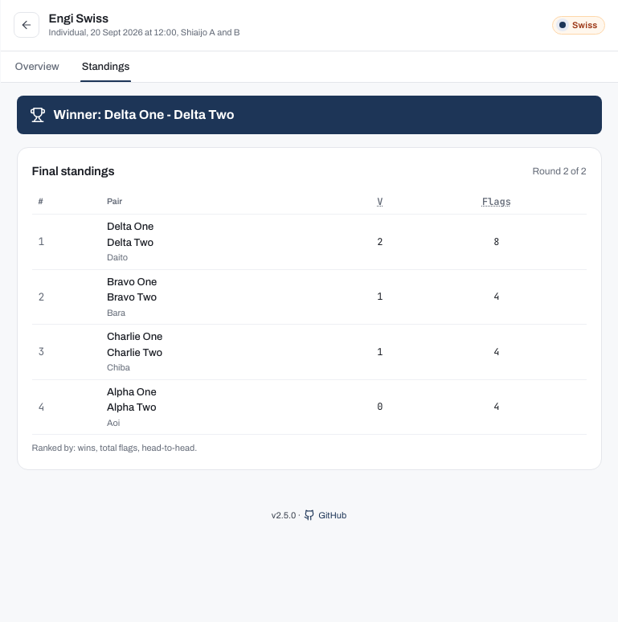

# Engi (kata) competitions

Engi is a kata competition. A panel of referees each raise a flag for the side
they judge superior. A side is usually a pair: two competitors perform a set of
choreographed forms together, as in naginata engi-kyogi, kendo kata and jodo. A
side can also be one competitor, for a kata performed alone, such as iaido.
Pick **Single competitors** and every side in the competition is one person. It
is scored entirely differently from a combat (shiai) bout: there are no ippon,
no time on the clock, and no draws.

## Turn it on

Tick **Engi (kata competition)** on the **Add competition** form or on an
individual competition's **Settings** tab to switch its score editor to flag counting. It is offered for individual
competitions only and works with every format (knockout, pools then knockout,
league and Swiss). It is locked once the draw is generated.

When Engi is ticked, **Competitors per side** appears under it with two
choices:

- **Single competitors** is one person per side, for a solo kata such as
  iaido.
- **Two competitors (pairs)** is two people per side.

Neither is picked until you choose, and the competition cannot be created or saved until you pick
one. An Engi competition created before this choice existed holds pairs, and
shows **Two competitors (pairs)** picked. The choice is locked with Engi once
the draw is generated. To change it before the competition starts, discard the
draw first. Once the competition has started it cannot be changed.

Rows you have already entered are not changed when you change the choice. The
**Participants** page lists any row that does not fit it, so you can edit it.
This includes one-name rows that a pair competition created before this choice
existed took at the registration desk or on the public sign-up form. The desk and the form did
not check names then. Such rows do not stop the draw, but applying a pasted list
that contains any is refused.

Engi is its own setting, independent of **Naginata competition**. Ticking
**Naginata competition** does two things:

- It adds the Sune ippon button, which engi bouts never use.
- It unticks **Award two joint 3rd places**.

The **Award two joint 3rd places** setting decides whether the division awards two joint 3rd places or a single
one decided by a bronze match. Refer to
[Third-place match](naginata.md#third-place-match). A naginata engi-kyogi
division usually ticks **Naginata competition** as well, for the single 3rd
place. For any other kata, set **Award two joint 3rd places** to your event's
convention.

!!! note "Quick-score and overrides are off for Engi"
    Because every Engi result comes from the flag editor, the kendo shortcuts,
    quick-score, manual winner overrides, kiken, fusenpai, and daihyosen are
    disabled for Engi competitions.

## Add Engi pairs

With **Two competitors (pairs)** picked, an Engi competitor is a pair: two
people from the same dojo or team, scored together as one unit.
There are no individual bouts inside a pair. Enter each pair as a single
participant row with the shared dojo. Combine both member names in the name field, joined by a
dash with a space on each side (` - `).
A row without both names is refused:

```
Name 1 - Name 2, Dojo
```

When the competition uses zekken names, the zekken column holds the pair's
combined zekken the same way:

```
Name 1 - Name 2, ZEKKEN1 - ZEKKEN2, Dojo
```

The two names display stacked on one side of the match. The pair counts as
one entry in the draw and one line in the standings.

## Add single competitors

With **Single competitors** picked, enter each competitor as an ordinary row,
one name and a dojo, the same as an individual competition:

```
Name, Dojo
```

With zekken names on, the zekken column holds the competitor's own zekken.

Every place that takes a name checks it against this setting:

- The paste box and CSV import.
- The Add and Edit forms.
- The registration desk.
- The public sign-up form.

A pair typed as `Name 1 - Name 2` is refused. The message depends on when and
where:

- Before the draw, it tells you to pick **Two competitors (pairs)** in Settings.
- After the draw, and on the public sign-up form, it asks for one name.

A pair competition
refuses a row with only one name. A hyphen inside a name, such as `Jean-Paul
Martin`, is fine. A row you edit and leave with its name unchanged is saved
without this check. A row that no longer fits can therefore still have its dojo or
grade corrected.

Everything else works as it does for pairs: flag scoring, the standings, the
tie rules, Swiss and the Excel workbooks. On screen, the name column of the
standings tables is headed **Player** instead of **Pair**, and each side shows
one name instead of two.

## Score with flags

The score editor becomes a flag counter with one column per side, Shiro (white)
on the left and Aka (red) on the right:

- Use the **+** and **−** buttons under each side, or the keyboard. **`a`** adds a flag
  to **Aka** and **`s`** adds a flag to **Shiro** (either key works with or without
  Shift). **`Backspace`** undoes the last flag you added, and **`Enter`** saves.
- A bout's flags must total 1, 3, or 5. The panel is always an odd size, so
  there is always a majority and a bout can never end in a draw. The editor
  marks any other total and does not let you save it.
- The side with more flags wins the bout.
- **Save result** takes two taps, as **Finish** does in the kendo editor. The
  first tap changes the button to **Tap again to save**, and the second tap
  saves. On the court console the button reads **Finish + Start Next**
  when another match of this competition waits on the court, and plain **Finish**
  when none does. The first tap changes it to **Tap again to finish and start
  next**, or **Tap again to finish** when no match waits.
  A quick double tap only does the first.
  **`Enter`** saves at once.

## Standings

In Engi pools, leagues, and Swiss competitions, sides (pairs, or single
competitors with **Single competitors** picked) are ranked by wins first, then by
the flags they accumulated:

1. Total wins.
2. Total flags accumulated across all bouts, as the tie-break when wins are equal.

Both the winning and the losing side's flags count toward that side's own tally.
A side that loses by three flags to two still keeps its two flags.

## Ties between competitors

Engi pools and leagues follow the same tie rule as ippon-scored pools and leagues. Two
competitors (pairs, or single competitors with **Single competitors** picked)
that are level on wins and on flags are tied. The tie rule says which ties
get a tie-break bout:

- **League**: a tie for 1st or 2nd place always gets a tie-break bout. A tie for
  3rd place gets one only when **Award two joint 3rd places** is off. With it on,
  the sides share 3rd. Ticking **Naginata competition** turns it off, so a
  naginata engi-kyogi division usually has it off. A tie for 4th place or lower
  shares its place.
- **Pools**: a tie gets a bout only when it decides who goes through or where
  the sides are seated. Any other tie shares its place.

The tie-break bout opens in the same flag editor as any Engi bout, and the side
with more flags wins it. Because a bout's flags always total 1, 3, or 5, a
tie-break between two sides can never end level. If three or more sides are
level and the round goes in a circle, the Pools tab (League in a league) offers
another round or lots.
This works exactly as for kendo competitors, and the lots are drawn and entered by you.
Refer to [Recording decisions](../court-operators/recording-decisions.md#individual-competitors-another-round-or-lots).
Name order never decides a place that counts.

Quick-score, kiken, fusenpai, and daihyosen stay off for Engi, so a tie-break
bout is always scored by flags. With kiken and fusenpai off, the app records no
withdrawal for an Engi side, so a tie-break whose two sides both withdrew does
not arise.

## Swiss standings

Swiss does not follow the tie rule. A Swiss ranking still tied after wins and
flags is settled by:

1. Head-to-head: when two sides are tied on wins and flags, the side that won
   their direct bout ranks higher.
2. Name order (alphabetical by the pair's first listed member, or by the
   competitor's name with **Single competitors** picked), when wins, flags and
   head-to-head are all equal.

The screenshot below shows a pair competition. In a competition with **Single
competitors** picked the name column is headed **Player** and each row holds one
name.



## Excel exports

Both Excel downloads on the competition page (refer to
[Export and print](run-tournament.md#export-and-print)) understand Engi:

- Each side is a single competitor throughout both workbooks. The data sheet
  lists the name under **Player Name** with the dojo; for a pair that is the
  combined pair name with the shared dojo. Every sheet that shows the side (pool
  draw, match grids, standings, bracket pages, and the printable name sheets)
  shows a pair's members together on one line as `Member 1 - Member 2`. It shows a
  solo competitor's one name.
- Pool standings in both workbooks use the Engi columns: **W** (wins),
  **Flags** (total flags), and **Rank**. Losses are not recorded because
  ranking is determined by wins then accumulated own-side flags. The kendo
  points columns do not appear.
- The results workbook records each side's referee flag count in the score
  cells instead of ippon letters. A bout recorded without flags leaves the
  score cells blank with the decision marked in the centre column.
