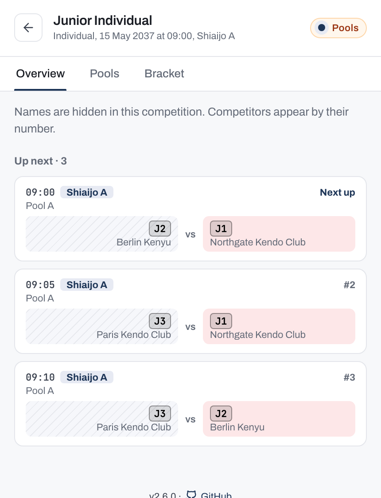
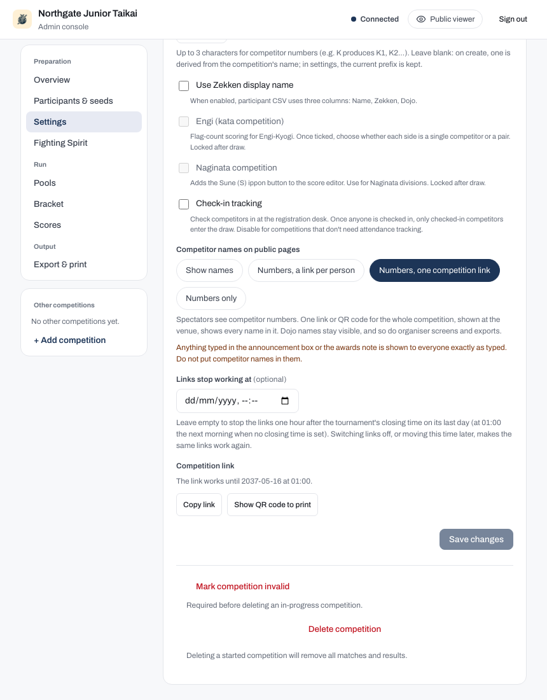
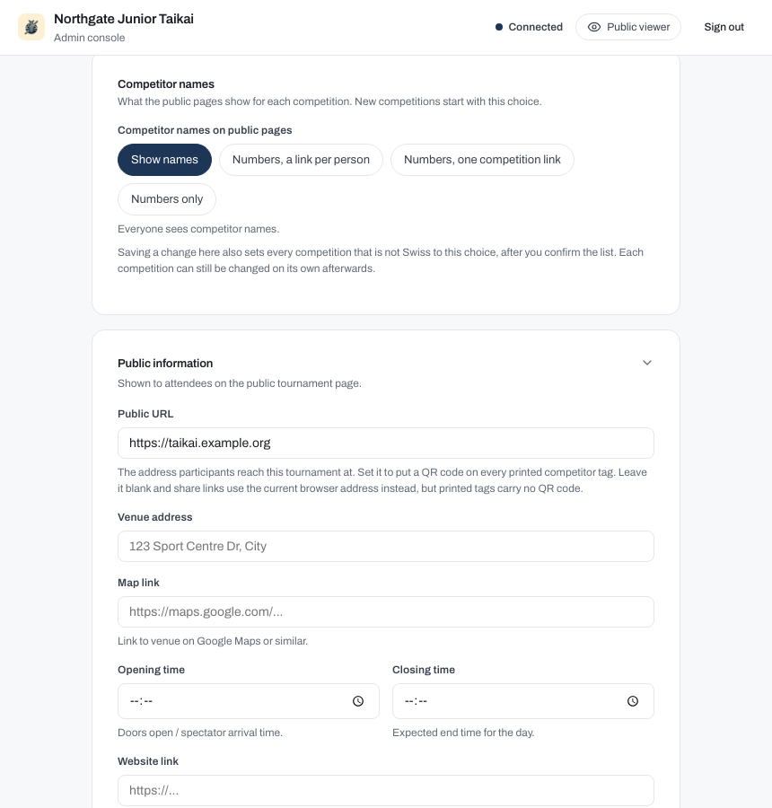
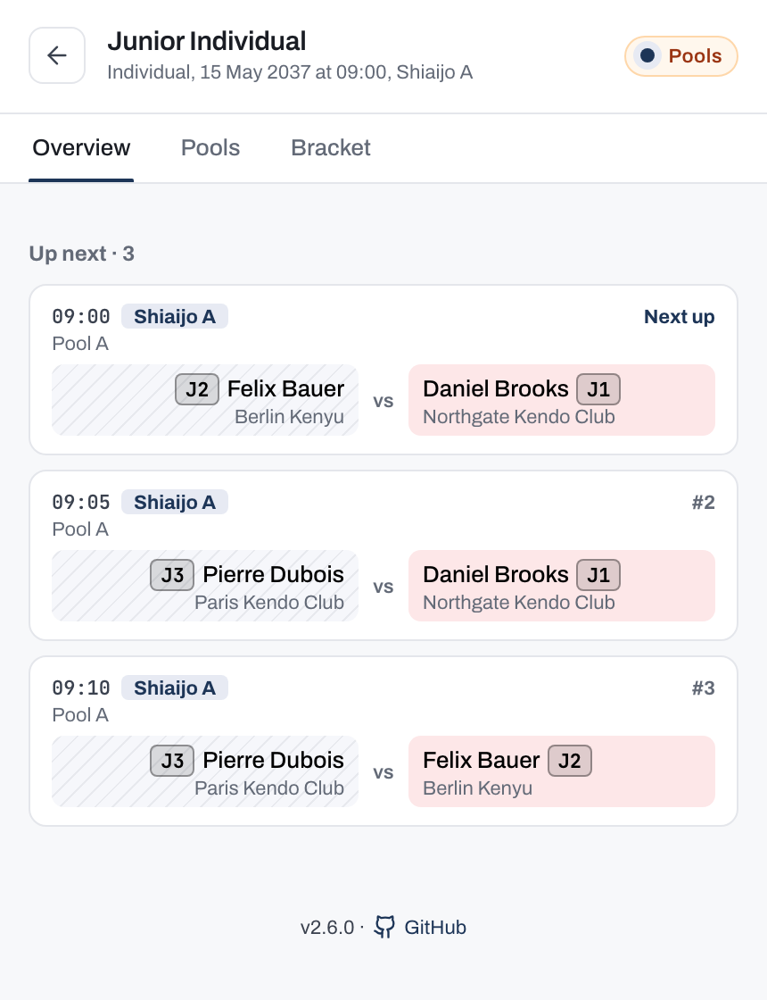

# Hide competitor names from the public

Some events do not want spectators to read every competitor's name on a phone or a court display. The **Competitor names on public pages** setting replaces each name with the competitor's number on everything the public sees, and lets you hand out links that show the names to the people who should see them.

## What the public sees

Public pages are the spectator view, the court displays, the stream overlay and the live updates behind them. With names hidden:

- Every competitor reads as their number (for example K12). A competitor the draw has not numbered yet reads as "?". So does every competitor of a draw you have not published yet: the numbers come from the draw, and a hidden draw shows none of them. Refer to [Keep the draw from the public until it is ready](run-tournament.md#keep-the-draw-from-the-public-until-it-is-ready).
- Team names stay visible. The names of the team members are hidden, and each member reads as a label built from the team's number.
- Dojo names stay visible.
- Your own screens, the exports and the stored files never change. You see every name while you are signed in.

Anything you type in the announcement box or the awards note is shown exactly as typed. Do not put competitor names in them.

## Choose what the public sees

Set the choice for one competition in its **Settings**, or for the whole tournament in the tournament details, where it is the starting choice for new competitions.

| Choice | What spectators see | How names are shown |
| --- | --- | --- |
| Show names | Names | Nothing to do |
| Numbers, a link per person | Numbers | Each competitor's own link shows that competitor's name only. A team's link shows that team's members |
| Numbers, one competition link | Numbers | One link for the whole competition shows every name |
| Numbers only | Numbers | There is no link. Only the signed-in organiser sees names |

Only one kind of link is active at a time. Saving a change to the tournament's starting choice also sets every competition to it, after you confirm the list of competitions it will change. Each competition can still be changed on its own afterwards.

## Hand out the links

Links appear once you have saved a choice that has them.

- **A link per person.** Each competitor's link is the QR code on their printed tag (from **Export**). You can also open the **Participants** tab and press **Reveal link** next to a name. The link shows as a QR code on your screen: turn the screen towards the competitor so they can scan it. The app's log records each time a competitor's link is shown, with the competition and the device's address.
- **One competition link.** Open the competition's **Settings**. Under **Competition link**, press **Copy link**, or **Show QR code to print** to put the code on a sheet at the venue.

A person's link belongs to their place in the competition, not to their name. If you replace a competitor with a substitute in the **Participants** tab, the substitute takes over the same link, so the link already given to the first competitor now shows the substitute's name. Hand the substitute their own copy and tell the first competitor their link has changed hands.

Set a **Public URL** in the tournament details first. Without it, the printed tags carry no QR code and the competition's **Settings** do not offer one, and a link you show or copy points at the address of the device you are using, which other phones may not be able to open. The app warns you when it shows or copies a link without one.

A competitor who opens their link sees the competition with their own name shown. The phone keeps the link, so the name stays shown on that phone. A link that has stopped working, or one for a competition whose links you switched off, says so and offers the competition by numbers.

## When the links stop working

Links stop revealing names at the time in **Links stop working at**. Leave it empty and they stop one hour after the tournament's closing time on its last day, or at 01:00 the next morning when no closing time is set. That default needs the tournament's date: if the date has been cleared, the links reveal no names until you set the date or fill in **Links stop working at**. Moving the time later makes the same links work again, so a link you printed is never lost. Switching the links off and on again brings back the links you switched off, but not a link that has already expired; for that, move the time later.

## What this does not cover

- **Self-run tournaments.** The competitors run their own matches from the public pages, so a self-run tournament always shows names whatever a competition says. The setting is not offered there.
- **Swiss competitions.** A Swiss draw gives competitors no numbers to show, so hiding names is not available for them yet. A tournament-wide choice leaves Swiss competitions as they are.
- **Backups.** A backup archive holds what is needed to work out the links. Keep it as private as the tournament password. Refer to [Backup and restore](backup-and-restore.md).
