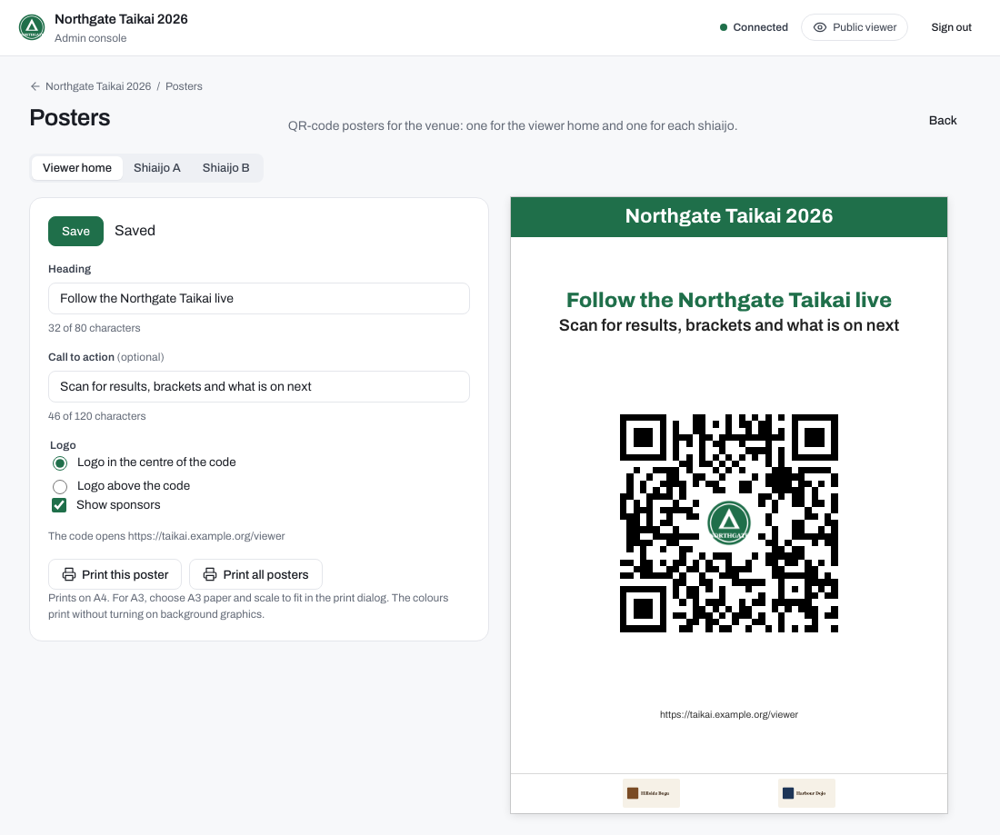
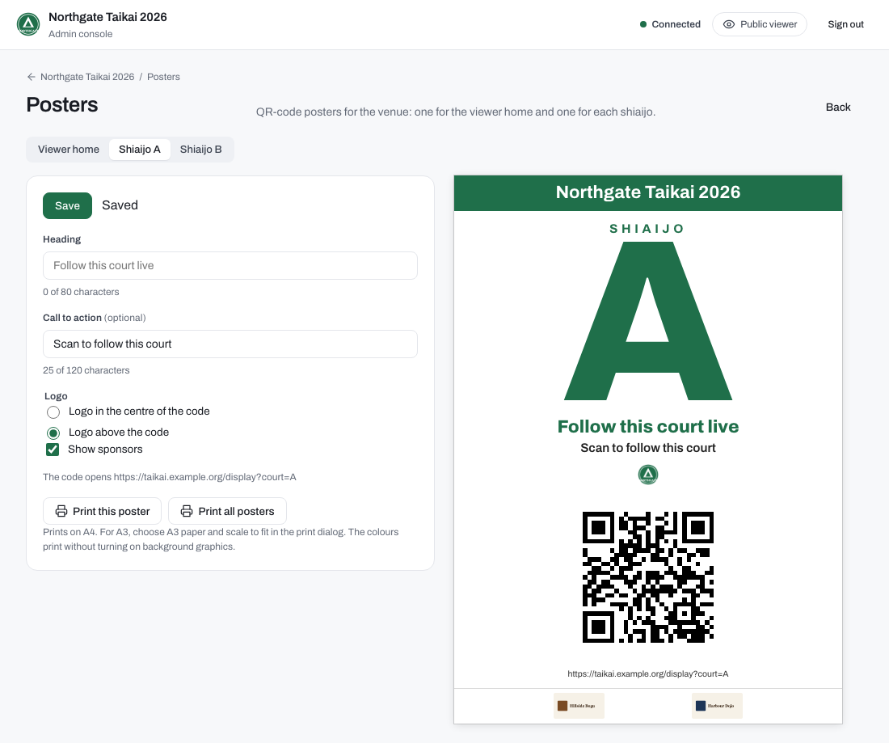

# Print QR-code posters for the venue

Posters let spectators open the live results from their own phone. Print the **viewer home** poster for the entrance and one poster for each shiai-jo, put them on the wall, and anyone who scans a code lands on the right page with no link to type.

Each poster carries a large QR code, the tournament name on a coloured band, a heading, and the address the code opens, printed small underneath so someone can type it if scanning does not work. A shiai-jo poster also shows the court letter in very large type, so it can be read from across the hall.

## Open the posters

Click **Posters** on the dashboard, beside **Backup and restore**. The page works before any competition exists, because the viewer-home poster does not need one. The list at the top of the page holds **Viewer home** and then one poster per shiai-jo, in the order of the tournament's courts.

<figure class="bc-fig" markdown="span">
  
  <figcaption>The Posters page: the choices on the left and the poster as it prints on the right.</figcaption>
</figure>

## Choose what a poster says

Pick a poster from the list. The preview beside the choices changes as you type, before you save anything.

- **Heading**: the line above the code. Leave it empty to use the standard words ("Follow the tournament live" on the viewer-home poster, "Follow this court live" on a shiai-jo poster). The box shows the standard words in grey while it is empty. A heading holds up to 80 characters.
- **Call to action**: an optional second line under the heading, for example "Scan for live results". Leave it empty and nothing prints. It holds up to 120 characters.
- **Logo**: shown only when the tournament has a logo (set it on **Edit details**, under [Branding and sponsors](run-tournament.md#branding-and-sponsors)). Choose **Logo in the centre of the code**, or **Logo above the code**. The code stays readable with a logo in its centre because the poster uses the code's strongest error correction. A very long address does not leave room for that, so the centre choice is switched off and a sentence under the choices says why. The logo then goes above the code, and a shorter public address brings the centre choice back.
- **Show sponsors**: shown only when the tournament has sponsors. Untick it to leave the sponsor strip off this poster. Sponsors print along the foot of the poster, evenly spaced.

Each poster keeps its own choices, so the viewer-home poster and the poster for each shiai-jo can say different things.

<figure class="bc-fig" markdown="span">
  
  <figcaption>A shiai-jo poster: the court letter is the largest thing on the page, with the logo above the code.</figcaption>
</figure>

## Save your choices

Nothing is sent until you click **Save**. The line beside the button reads **Unsaved changes** while what you see differs from what is stored, **Saving** while the save is on its way, and **Saved** once it has landed. Saving shares the choices with every device, so the posters look the same wherever you open the page.

- Click **Print this poster** or **Print all posters** at any time: it prints what is on screen, saved or not. Printing never saves.
- If you leave the page with unsaved changes, the app asks **Leave Posters anyway?**. Choose **Keep entries** to stay and save, or **Discard entries** to leave.
- If another device changed the tournament settings while you were typing, the page says "Not saved: the tournament settings were changed on another device. Your poster text is still here." Your text stays on screen. Click **Save again** to save it over the current settings.

## What a code opens

The viewer-home poster opens the public viewer home. A shiai-jo poster opens that court's scoreboard display, the same page a TV at the court shows (refer to [Scoreboards and court displays](../spectators/following.md#scoreboards-and-court-displays)). The address under each code shows exactly where it goes.

A code never carries a link that reveals competitor names. If a competition [hides competitor names](hide-competitor-names.md), a spectator who scans a poster sees what any other spectator sees.

## Set the public address first

The codes open the tournament's **Public URL**. Set it on **Edit details** (refer to [Tournament details](run-tournament.md#tournament-details-and-the-public-info-page)), using the address people can reach from their own phones.

If no public address is set, and the page is open at an address only this device can reach, such as `localhost` or a network address on this venue's network, the page shows a warning above the poster list. The codes would open that address, which phones outside the venue network cannot reach. The warning shows on screen only and never prints, and its button takes you to the tournament details. You can still print: the poster prints the address it would use.

## Print the posters

Click **Print this poster** for the poster in the preview, or **Print all posters** for the viewer-home poster followed by every shiai-jo poster, one per sheet. The browser's own print dialog opens.

- **A4 portrait** is the poster's size. Each poster fits one sheet, and no blank sheet is added at the end.
- **A3**: choose A3 paper in the dialog and set the scale to fit the page. The poster scales as a whole, so nothing moves.
- **Colours**: the coloured band prints in colour. You do not need to turn on **Background graphics** in the print dialog.
- To keep a copy as a file, choose **Save as PDF** as the printer.

Print one poster on paper first and scan it with a phone before you print the whole set, to check the logo and the address.

## When the address does not fit a code

A code holds a limited amount of text. A public address too long for any code cannot be drawn, so the poster shows a warning in place of the code, and the address line still prints. A shorter public address in the tournament details fixes it.
