# Run a tournament on the day

This page is the operational hub for tournament day: start the tournament app, manage competitions, score matches, and export results. If you have not set up your tournament data yet, follow the quickstart at [First tournament](../start-here/first-tournament.md) before continuing here.

## Start the server

Run the following command from your terminal:

```bash
bracket-creator mobile-app --folder ./tournament-data
```

Then open `http://localhost:8080` in a browser. The server binds to `localhost` by default, so other devices cannot reach it yet. To let helpers on the same network connect, start the server with `--bind 0.0.0.0` (or a specific LAN interface), then share your machine's LAN address, for example, `http://192.168.1.10:8080`.

The following flags and environment variables control the server:

| Flag | Short | Env var | Default | Description |
|---|---|---|---|---|
| `--folder` | `-f` | `TOURNAMENT_DATA_DIR` | `.` | Path to the data folder |
| `--port` | `-p` | `PORT` | `8080` | HTTP port to listen on |
| `--bind` | `-b` | `BIND_ADDRESS` | `localhost` | Network address to bind |

An explicit flag always takes precedence over the matching environment variable.

The `make` targets let you launch quickly without typing flags:

```bash
make run-mobile                            # Default port 8080, ./tournament-data folder
PORT=8082 make run-mobile                  # Different port
TOURNAMENT_DATA_DIR=/path make run-mobile  # Different data folder
```

Two environment variables tune the API rate limiter for large events:

| Env var | Default | Description |
|---|---|---|
| `API_RATE_LIMIT` | `5000` | Sustained requests per second |
| `API_RATE_LIMIT_BURST` | `10000` | Peak burst size |

!!! tip
    For events with hundreds of simultaneous spectators, consider raising both rate-limit values before the tournament starts.

## The admin console

Click **Admin** in the navigation bar and enter the admin password. The rules for who can access which features depend on your tournament's operating mode. Refer to [Operating modes](operating-modes.md) for the full access-control rules.

Some organiser actions are sent directly and are not held for later: uploading files, adding a walk-up competitor, editing a participant or a seed, saving a competition's settings, changing the admin password, deleting a competition (which asks you to type the admin password to confirm), and generating a draw, starting or completing a competition. If the connection is down when you tap one of these, the app says "No answer: the connection dropped. The change may or may not have been saved. Check, then try again if it is missing.", so check the participant list, seed or settings you changed once the connection is back, and repeat the action only if the change is missing. Scores, lineups, check-in, announcements and court calls, tournament settings and fighting-spirit awards are held on the device and sent when the connection returns instead. A password change waits for tournament settings saves still held on this device; **Change the password now** asks you to confirm first.

## Dashboard

The dashboard lists all competitions for the tournament. Each card shows the competition type, participant count, bracket format, and current status. Click a card to manage that competition.

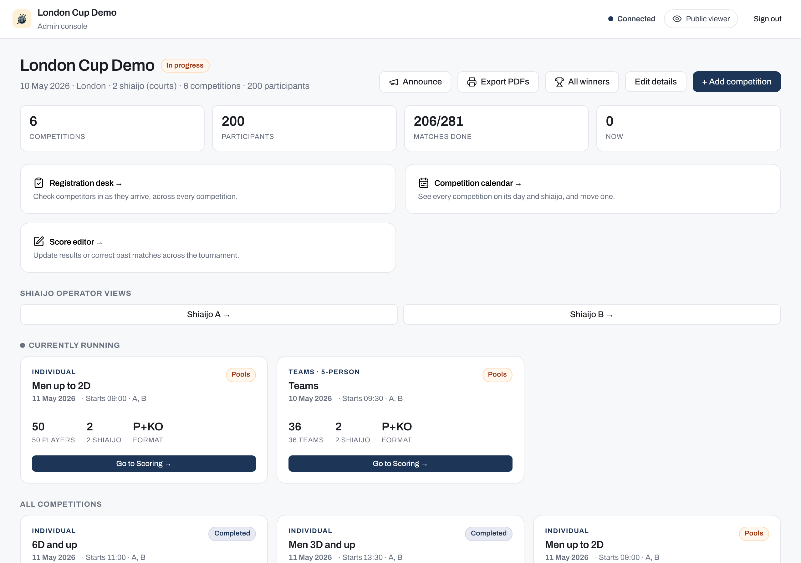

## Backup and restore

Click **Backup and restore** on the dashboard to save or restore tournament data. Take a backup before the event starts, after each round finishes, and before a risky correction. You can download an archive of the entire tournament or an individual competition, review restore plans before applying changes, and undo a restore if needed. The server also takes daily backup copies automatically when data changes.

Refer to [Backup and restore](backup-and-restore.md) for the complete guide on taking archives, making restore choices, and managing safety copies.

## Tournament details and the public info page

Open **Edit details** from the dashboard to fill in the public information your attendees see:

- Venue address and a map link
- Opening and closing times
- A website link and an awards note
- Free-text info notes (rules, transportation, access details)
- Contact entries

Set the **Public URL** field to the externally reachable address of your app (for example, `https://my-tournament.example.com`). Setting this field enables QR codes on competitor tags and makes every shareable link work. The public URL also populates the public info page in the viewer and on spectator display screens.

Save closes the form at once. If the details were saved on another device after you opened them, the save is refused when it reaches the server, and an alert says "Tournament settings were not saved: they were changed on another device. Open them and save again." The app then shows the current details. If you have opened **Edit details** again by then, the form says "Not saved: the tournament details changed somewhere else after you opened this page (another screen or device). Reload to see the current details, then make your change again.", keeps what you typed, and **Reload** shows the current details.

!!! note
    For guidance on making the app reachable over the internet, refer to [Hosting](../install/hosting.md).

## Branding and sponsors

The same **Edit details** page also has branding and sponsor fields, below tournament details. All fields are optional; the default kendo theme applies when nothing is configured.

- **Logo**: upload an image file shown on the viewer and the admin screens, and on the lobby display when **Show the logo on the lobby display** is ticked on this page. Removing the logo keeps that setting, so the logo returns to the lobby once you upload another.
- **Accent colours**: set a primary accent colour and, if you want one, a soft background tint; the viewer and display screens adopt them across the whole site. Leave the tint alone and it is derived from the primary, so one colour choice re-tints every surface, including the running-match rings and focus halos.
- **Sponsors**: upload full-width images that appear on the public viewer page only. Sponsor images do not appear on the TV lobby boards or scoring displays.

## Announcements

Click **Announce** from the dashboard to broadcast a short message to every viewer. Choose a duration of 5, 10, 15, or 30 minutes; the message clears itself automatically when the time expires. It appears as an overlay on the viewer and display screens. Spectators who allow browser notifications can receive it in the background.

Posting the same text again while it is still showing replaces the banner rather than adding a second one: viewers see one message, and its time starts again from the full duration.

A court call, made with **Call to court** on the court console, is announced the same way. It disappears once the match starts, or is closed with a decision such as a fusensho, from any device, as long as the court console that made the call is still open, even if another console called the same match again meanwhile. If that console was closed or reloaded meanwhile, the call stays up until its five minutes run out.

An announcement, a court call, a dismissal (the × beside an active announcement) or **Clear all** made while the connection is down is held on the device and sent when the connection returns, so there is no need to click **Send announcement** or **Call to court** again. If a held announcement or call is over by the time it arrives, the page that made it, if still open, says "That announcement did not go out: its N minutes ran out before it reached the server." ("court call" for a court call, whose time is always 5 minutes), and you can send it again. A held call counts its time from the moment it was made; one with a little time left when it arrives shows for at least a minute so players can read it. A call you withdrew while it was still held is never shown. Calling the same match twice while offline still shows one banner.

## Registration desk

Open **Registration desk** from the dashboard to access the check-in surface for the welcome table. Check-in exists only for competitions with **Check-in tracking** turned on in their Settings, and this desk is the one place to do it: it lists every competitor across those competitions so a registration helper can mark participants present as they arrive. A competition with the setting off does not appear here, and its Ordering & seeding panel carries no check-in controls either. A self-run tournament has no check-in, so the dashboard offers no Registration desk there. Refer to the [Check-in workflow](#check-in-workflow).

## Set up a competition

A competition moves through three phases:

1. **Setup**: configure participants, seeding, and optional check-in.
2. **Draw preview** (`draw-ready`): review the generated pools, bracket, or first Swiss round. The roster is locked during this phase.
3. **Match play**: Pools + Knockout, League, and Swiss competitions all start in `pools` status, which is the shared name for the phase their matches run in rather than a claim that each one has pools. Knockout-only competitions start in `knockout`.

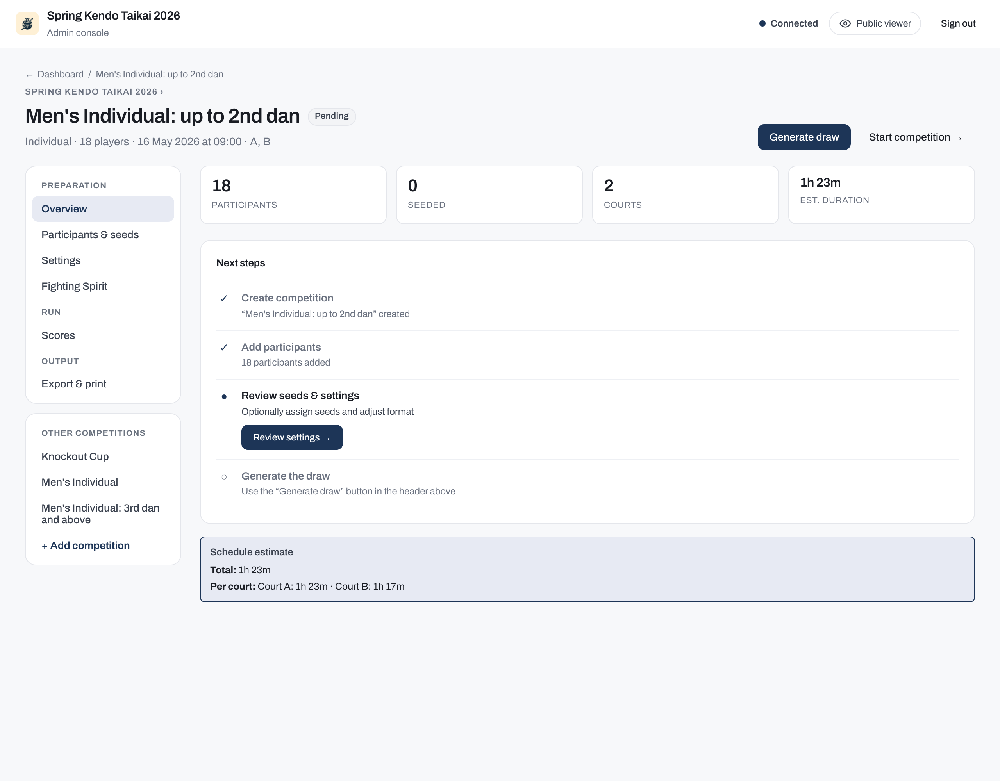

### Changing a competition's settings

The **Settings** tab offers the same controls as the form you used to create the
competition, so anything you chose at creation you can revisit later. That
includes **Competition type** (individual or team), **Format**, and
**Round-robin shape**.

Three rules govern when a setting stops being editable:

- **Once the draw is generated**, the settings that shape the output lock.
  Discard the draw to change them, then generate it again.
- **Once the competition has started**, the format and the competition type are
  fixed for good. Both decide how matches are generated and scored, and results
  already exist by then, so neither can be changed after the fact.
- **Once participants are loaded**, the competition type locks separately and
  earlier than everything else. Individual and team rosters are not
  interchangeable. To switch, clear the paste box in the **Participant list**
  panel and click **Apply changes**, as described in
  [Adding participants](#adding-participants).

Changing the format clears the settings that only apply to the format you left
behind. Switching a **Pools + Knockout** competition to a **League**, for
example, drops **Players per pool**, **Winners per pool**, and **Knockout
qualifiers**, because a league has no pool phase to size.

Nothing is cleared while you are still deciding. When you pick a different
format, a note appears under the control listing each setting the save will
clear, with its current value, so you can see the cost before you commit.
Switching back to the original format keeps them.

On a drawn competition, a **Date** or **Start time** change moves its matches. Refer to [Moving a competition on the calendar](#moving-a-competition-on-the-calendar) for how it waits for time changes still held on this device.

### Assigning shiai-jo

The competition **Settings** page has an **Assigned shiai-jo (courts)** field listing every shiai-jo in the venue. Pick the ones this competition runs on; the number you pick is how many of its matches can run at the same time.

Assign **1, 2, 4, 8 or 16 shiai-jo**. The knockout draw gives each shiai-jo its own block of the bracket and the blocks merge in pairs, so the count has to halve cleanly all the way down. Being even is not enough on its own: six blocks pair off into three, and three cannot pair off again, so 6 and 10 are refused just as 3, 5 and 7 are. When you pick a count the rule does not allow, the settings page names the counts to use instead, and it always offers 1. A single shiai-jo is always allowed. Where a competition sends two or more qualifiers up from each pool, its bracket splits into two half-blocks that act as partner shiai-jo, so the draw has the same shape as a two-shiai-jo one. Where each pool sends up a single competitor, nothing crosses between shiai-jo, and the bracket is left whole. 16 is the highest, and it is also the most shiai-jo a tournament can have, so no shiai-jo you can add is one a competition could not be given. Refer to [The knockout draw](knockout-draw.md#how-many-shiai-jo-a-competition-can-use) for the full explanation.

**This is a rule about each competition, never about your venue.** A hall with three shiai-jo is completely normal, and nothing asks you to change it. What it means is that each competition there runs on 1 or 2 of the three, not that the third stands idle: run the seniors on 2 shiai-jo and the juniors on the remaining 1 at the same time, and all three are busy. A five shiai-jo hall works the same way, with one competition on 4 and another on 1, or two competitions of 2 alongside a third on 1.

A competition also cannot end up with a count the rule does not allow by inheriting one. If you create a competition without choosing its shiai-jo, it starts from the venue's list, and that inherited list is checked in exactly the same way, so on a three shiai-jo venue you are asked to pick 1 or 2 rather than being handed all three.

The rule applies only to the formats that produce a knockout bracket, which are **Knockout only** and **Pools + Knockout**. League and Swiss competitions have no bracket to merge, so they can use any number of shiai-jo the tournament has.

#### If you assign more shiai-jo than the competition has pools

The draw never uses more shiai-jo than the competition has pools, because a shiai-jo with no pool of its own would own an empty block of the bracket. When you assign more than that, nothing is refused and no warning is shown: the draw steps down to the largest allowed count that fits and is generated on that. A competition with seven pools assigned eight shiai-jo runs on four. The count you assign is therefore not always the count you get.

The step-down applies to the whole competition, not only to the knockout, and the blocks are handed to the assigned shiai-jo in order. Assign A to H to a seven-pool competition, and it runs entirely on A, B, C and D. The pools split 2 / 2 / 2 / 1 across those four, and every knockout match from the first round to the final is on them as well. Open the Shiaijo operator view for E, F, G or H and it reads "No matches on this court".

So assign a count the competition can fill, and give the rest to another competition running alongside it. If you want eight shiai-jo busy, the competition needs at least eight pools.

#### If a competition already has a count the rule does not allow

You can meet this after an upgrade, because the rule is newer than the data folder. A competition set up on 3, 5 or 6 shiai-jo before the rule existed keeps that allocation on disk, and so does one whose data folder was edited by hand.

Such a competition is not broken. It loads, and its matches and results are intact. It appears to spectators as usual, and its Settings page stays fully editable, so renaming it or changing anything else on that page still saves normally. The page carries a standing warning naming the counts to use instead.

What you cannot do is draw or start it. **Generate draw** and **Start competition** are disabled with the reason shown, and the app refuses the same action from anywhere else, until you reassign its shiai-jo to 1, 2, 4, 8 or 16.

### Knockout qualifiers

For a **Pools + Knockout** competition with **Pool size is a** set to **minimum**, a **Knockout qualifiers** control appears alongside **Players per pool** and **Winners per pool**, on both the competition create form and its Settings page. It offers three options: **Standard** (every pool sends the same number of qualifiers), **Oversized send +1**, and **Fit the knockout**. Refer to [How many qualify from each pool](knockout-draw.md#how-many-qualify-from-each-pool) for what each one does, with worked examples.

Selecting either of the two non-standard options sets **Winners per pool** to 1 and disables the field, because both require it. Switching back to Standard makes the field editable again. Below the options, a preview line updates as you adjust pool size and roster, reading something like "34 pools -> 36 qualifiers -> 64-slot knockout (28 byes)" for whichever option is selected. On the create form the preview is a placeholder until the competition has participants; on the Settings page it previews against the real roster, and is locked once the competition reaches `draw-ready`, alongside the rest of the pool configuration.

### Adding participants

The participant setup view has two panels.

The **Participant list** panel (labelled **Team list** for team competitions) contains a line-numbered paste box. Paste newline-separated rows in one of these formats:

- Without display name: `Name, Dojo[, Dan grade]`
- With display name (zekken): `Name, Zekken display name, Dojo[, Dan grade]`

Click **Paste clipboard** to read a tab-separated selection from the clipboard and convert it automatically. Click **Apply changes** to save the list; the box clears once the list is saved. The box is for a new or replacement list, not a copy of the saved roster: applying while a roster already exists asks you to confirm, because the new list replaces the current one. A competitor or team matched to one already on the roster, by name and dojo, keeps their id and seed; for a team, their team members and lineups are kept too. Anyone not in the new list is removed, and, while the competition is still in setup, a removed team's members and lineups are deleted with it.

Applying the list gives every competitor a participant id. The id is not shown on the row; the **Overview** names any competitor still without one. Competitor numbers come later: every competition numbers its competitors when the draw is generated, pool by pool for a pooled competition or down the bracket for a knockout-only one, and nothing is shown before that. Refer to [Competitor numbers](pool-draw.md#competitor-numbers). A competition saved by an earlier version of the app whose list has no ids shows a notice on its **Overview** naming the competitors: apply the list once to assign them. The draw does not run until every competitor has an id.

Two more notices can appear on the **Overview** for the same reason, once a competition has drawn. The app tries to repair these automatically, behind the scenes, the next time it reads the competition's data. Saving the participant list again lets it try once more. It matches a pool member to a participant by name and dojo together, or by name alone when the row records no dojo and only one competitor has that name. It matches a match side by name alone, because a match row only records a name. A notice remains only for a row it could not match this way:

- A notice naming pool members with no id. The app could not match that member to a participant on the current roster (for example, the roster changed after the draw was made). That competitor shows no competitor number. Regenerate the draw, while it is still draw-ready, to fix it.
- A notice naming pool matches with no id on a side or a winner. The app could not match that side automatically, most often because two competitors share the same name. That match is not counted in the standings. Re-entering the result assigns a missing winner id. Regenerating the draw, while it is still draw-ready, restores a missing side id.

Both notices are advisory, not blocking: the competition keeps running, and nothing you have already recorded is lost.

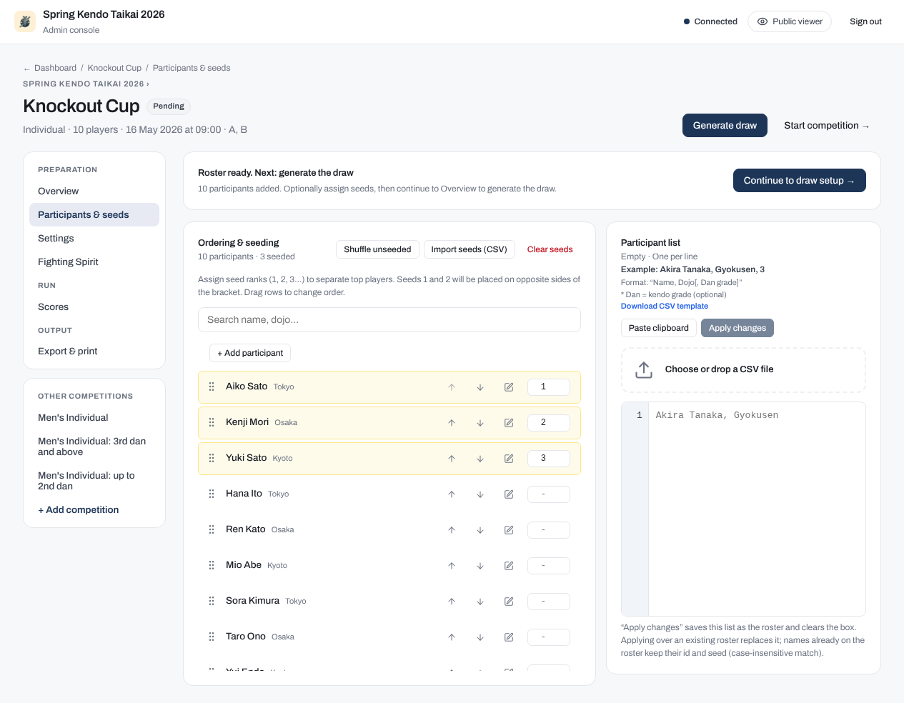

The **Ordering & seeding** panel shows the working roster, one competitor per row: the competitor number once a draw exists, the name and the dojo. Before the draw the rows are in roster order, which you can change; once the draw has numbered the competitors the rows are listed in number order, with anyone the draw left out at the end. From here you can:

- Drag rows to assign seeds, or type a rank number directly.
- Click **Shuffle unseeded** to randomise unranked positions.
- Click **Import seeds (CSV)** to load a seed file, or **Clear seeds** to remove all ranks.

The order you rank the seeds in is used, not just the set of seeded competitors. Seeds 1 and 3 land in one half of the knockout draw, and seeds 2 and 4 land in the other, each in its own quarter. A seeded pool's winner is first in line for any bye in its shiai-jo's block. Fewer than four seeds, including none at all, is a normal configuration. Refer to [Seeding in the knockout draw](knockout-draw.md#seeding).

Ranks must run from 1 with none missing. You can enter them in any order, and each is saved as you type it, so a partly-entered seeding is expected. While it has a hole in it, the panel names the ranks still to set, and the **Generate draw** and **Start competition** buttons are disabled. Fill in the missing ranks, or click **Clear seeds** to start again.

#### Editing a single competitor

Click the pencil icon on any row to open the edit modal for that competitor. You can change the name, dojo, dan grade, and display name during setup and while the draw is pending; a change made after the draw is generated is carried into the draw (pools and bracket) for you. Once the competition has started the pencil is no longer shown.

### Check-in workflow

Enable **Check-in tracking** in **Settings** for the competition. Competitors are checked in at the [Registration desk](#registration-desk), which works across every competition; the Ordering & seeding panel carries no check-in controls. Self-run mode has no check-in: the setting is not offered and the draw includes every participant on the roster ([operating modes](operating-modes.md)).

The check-in rule is opt-in: when you click **Generate draw**, if at least one participant is checked in, only checked-in participants join the draw and unchecked participants are excluded (their seeds are dropped). If nobody is checked in, everyone is included.

#### Checking in while the connection is down

The desk keeps working when the venue connection drops. A tap on a competitor, or on **Check in all**, shows on the row at once and is held on the device; it is sent in the order you tapped when the connection returns. The bar at the top of every admin page counts what is still held, as it does for scores.

Two desks can check in the same competitor. If one desk checked someone in and another desk then took the check-in back, the later tap wins. When the losing tap reaches the server after the later one, that desk is told in one line, for example "Aiko Tanaka was changed on another desk: now not checked in.", and its row shows the result that stands; otherwise its row updates.

**Generate draw** waits for check-ins this device still holds, so the draw is made from the roster this device shows. Check-ins still held on a separate desk device are not counted, so check that the desk shows nothing held first. While any are held, the screen reads, for example, "Waiting for 3 check-ins to be sent. The draw is made once they arrive." The draw is made on its own when the last one arrives. Two buttons are offered meanwhile: **Cancel** leaves the competition in setup, and **Generate now anyway** makes the draw at once. Its confirmation says that the competitors whose check-ins have not arrived are left out of the draw. When the server holds no check-in for the competition, it says instead: "The server holds no check-in for this competition, so a draw made now includes every competitor." The same wait applies to **Start competition** on a competition that is still in setup and to **Start all** on the dashboard; on both, the button reads **Start now anyway**. If the connection stays down, reconnect, or choose **Generate now anyway**. An item the server keeps refusing is named on the waiting screen with **Discard**.

### Draw preview

Click **Generate draw** to produce the bracket. The competition enters `draw-ready` status and shows an interactive preview:

- **Pools + Knockout** competitions show pool assignments.
- Knockout competitions show the bracket tree.
- Swiss competitions show round 1.

If a seeding rule could not be honoured, a banner above the preview reads **Seeding: the draw could not honour every rule** and lists what gave way. The draw still stands; refer to [Seeding](knockout-draw.md#seeding) for which rule gives way first.

You can still toggle individual check-in status during `draw-ready`, but roster edits (add, remove, reorder) are locked.

When the preview looks correct, click **Start competition** to move to match play. To make roster changes instead, click **Discard draw** to delete the draft and return to setup.

A draw-ready competition is already listed on the shiai-jo operator views, since its matches exist. Scoring one of those matches starts the competition on the spot, exactly as **Start competition** would, so a court that begins play never has to wait for the desk.

<!-- Raw HTML is copied verbatim by MkDocs (only markdown image paths get
     rewritten), so this src must be relative to the BUILT page URL
     (/user-guide/organisers/run-tournament/): three levels up, not two. -->
<figure class="bc-fig">
  <video controls loop muted playsinline preload="metadata" width="900" height="580" aria-label="Generating the draw: the pools preview appears after clicking Generate draw.">
    <source src="../../../screenshots/draw-generation.webm" type="video/webm">
  </video>
  <figcaption>Generating the draw. Press play to watch.</figcaption>
</figure>

## Pools and bracket

The **Pools** tab shows standings for every pool. Ranks are computed automatically from match results. Operators do not edit them by hand, with one exception: chusen (drawing lots), the last-resort tie-break for a consequential pool tie that its tie-break bouts cannot settle. Refer to [Recording decisions](../court-operators/recording-decisions.md). When a daihyosen settles a tie that determines pool advancement, the winning side carries a **DH** badge in the standings.

When two or more competitors are level on every ranking criterion, the app schedules tie-break bouts between them if the best-placed of them finishes within the pool's qualifying places, because finishing place decides where a qualifier lands in the bracket. Those places are **Winners per pool**, plus the extra place an oversized pool sends under **Oversized send +1**, plus the second place of each pool that **Fit the knockout** drafts to fill the bracket, so a tie over such an extra place gets a bout too. A tie wholly below the qualifying places gets no bout and shares its place. The pool's qualifiers are seated in the bracket only once the bouts are scored. Until the bouts are scored, the tied competitors share one place, shown as **=2nd** for a tie over second place. A tie that runs across the advancing line leaves none of them with the advancing mark, while a tie inside the advancing places, such as two competitors level for first, reads **=1st** and keeps it. Once the bouts are scored, each takes their own place. A team pool settles a tie with a daihyosen instead, and if that round still leaves teams level, the pool waits for chusen. In an individual pool, each tied pair fights once. If that round goes in a circle and leaves them level, the pool waits, and the Pools tab offers **Run another tie-breaker round** or **Draw lots instead**; refer to [Individual competitors: another round, or lots](../court-operators/recording-decisions.md#individual-competitors-another-round-or-lots). A tie-break bout can be saved as a draw, but a draw settles nothing: the pool stays tied and the knockout places it decides stay empty. The Pools tab then names the bout and offers **Fight it again**, which clears the draw and puts the bout back on its shiai-jo, or **Open bout**, to decide it by encho or hantei. A drawn daihyosen also stops holding the pool once you record a chusen for its teams, because the lots then decide the place.

Pool finishers move into the knockout bracket on their own: as soon as a pool's last match is scored, its qualifiers are seeded into their bracket slots. Those knockout matches can be scored without waiting for the other pools. Once the last pool is seeded, the competition moves to the knockout phase. The bracket updates in real time as results come in. A pool result corrected later still moves its qualifiers in the bracket; refer to [Correct a pool result after the knockout has started](../court-operators/scoring-a-match.md#correct-a-pool-result-after-the-knockout-has-started).

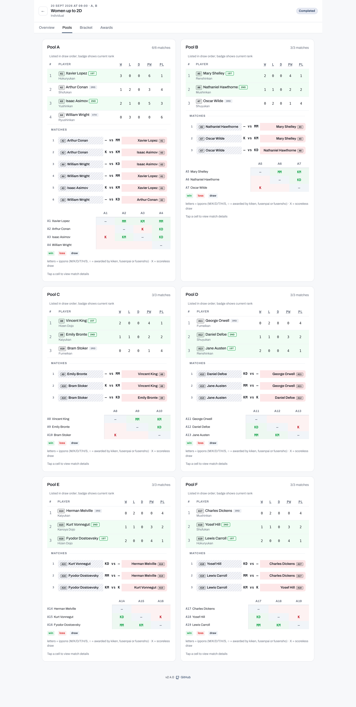


For the four competition formats and the Swiss round-by-round flow, refer to [Formats](formats.md).

For team lineups and team scoring rules, refer to [Team tournaments](team-tournaments.md).

For how to enter scores and navigate between matches, refer to [Score a match](../court-operators/scoring-a-match.md).

For kiken, fusenpai, daihyosen, and other special decisions, refer to [Recording decisions](../court-operators/recording-decisions.md).

For naginata and Engi-kyogi divisions, refer to [Naginata](naginata.md).

## Results and awards

The public viewer shows a competition's podium when it finishes, and a provisional ranking while it is still in progress.

A knockout or pools-then-knockout competition finishes when you tap **Complete competition** on its page. The button appears once every bracket match, the bronze match included when there is one, has been played, and completing cannot be undone. A league finishes by itself after its last match and any tie-breakers. In a team league, when a tie left after every ranking criterion falls inside the tie-break band (the top 3 places by default, or the top 4), you first run a tie-breaker or accept shared ranks, and **Undo shared ranks** takes an acceptance back; any other tie is left as a shared rank with no decision (refer to [Ties in a league](team-tournaments.md#ties-in-a-league)). A finished league can still be corrected: the app warns first, and if the correction leaves a new tie at a podium place the league goes back to match play. A Swiss competition has no **Complete competition** button. After its last round, its organiser page shows a **Competition complete** notice and a link to the final standings, which the public viewer also shows.

The **Award two joint 3rd places** setting, on the competition's Settings tab, controls whether a competition awards two joint 3rd places or decides a single one with a bronze match. It is on by default (the standard kendo convention) and applies to knockout, pools-then-knockout, and league competitions. It is not shown for Swiss, which has no bracket and no bronze match. Naginata competitions default the setting off (a single 3rd, decided by a bronze match). You can turn it back on for a naginata competition too, and you can turn it off for a kendo competition that needs a single 3rd, for example a selection event with one bronze medal. Refer to [Naginata](naginata.md#third-place-match) for the bronze match itself.

- **Knockout** (default: joint 3rds on): 1st place, 2nd place, and two equal 3rd places. There is no bronze match; both semi-final losers share third.
- **Knockout with joint 3rds off**: a single 3rd place is decided by a bronze match.
- **Pools + Knockout** (still in its pool phase): the viewer shows a provisional cross-pool ranking until the knockout decides the final places.

Operators see an all-competition winners view from the dashboard. You can also record optional **fighting-spirit** (敢闘賞) awards as free text; these appear on the viewer for all spectators. Saving awards is an organiser action, so it needs the admin password in self-run mode too; refer to [Operating modes](operating-modes.md#self-run-mode). If the awards were saved on another device after you opened them, your save is refused: the list says "Not saved: the awards changed somewhere else after you opened this list (another screen or device). Reload to see the current awards, then make your change again.", keeps what you typed, and **Reload** shows the current awards. If the list is closed by the time a held save is refused, an alert says "The fighting-spirit awards were not saved: they were changed on another device. Open them and save again."

**League competitions** derive the podium from final standings. In an individual league, any tie within the top three places triggers a short ippon-shobu tie-breaker automatically, so the competition never closes with an unearned tie. A league tie-breaker needs a winner: if it is level, record encho, then decide by hantei, because a draw is refused. If a round of tie-breakers goes in a circle, the Pools tab offers **Run another tie-breaker round** or **Draw lots instead**, and the lots are drawn and entered by you. Engi kata competitions never hold supplementary bouts; they rank by wins, then accumulated flags (refer to [Naginata](naginata.md#standings)). The one exception is 3rd place: with **Award two joint 3rd places** enabled, competitors tied entirely for third share the position instead, with no decider. In a team league, the operator chooses whether to run a tie-breaker or accept shared ranks for a tie inside the tie-break band, and can undo that acceptance; refer to [Ties in a league](team-tournaments.md#ties-in-a-league).

Set the **Award two joint 3rd places** option during setup, before you generate the draw. Once the draw exists, the option is locked; discard the draw to change it.

## Export and print

### Excel

Two Excel downloads are available from the competition page:

- **Download results (.xlsx)**: a workbook with played scores, pool standings, winners, and decisions filled in. Covers pools, league, and knockout formats. Swiss competitions have no static bracket; follow the current standings instead.
- **Download blank template (.xlsx)**: an empty bracket workbook with linked formulas for hand scoring at events without a network connection.

### PDF

PDF exports (competitor tags, name sheets, and bracket trees) are available to admins only. Rendering requires LibreOffice:

- Use the `ghcr.io/gitrgoliveira/bracket-creator-mobile-pdf:latest` container image, which includes LibreOffice.
- Or install LibreOffice on the host and ensure `soffice` is on the system path.

The lean container image omits LibreOffice and returns a clear message when a PDF is requested.

When the **Public URL** is set and competitors have assigned numbers, each printed tag includes a QR code that opens the viewer and adds that competitor to the scanner's watchlist. Refer to [Hosting](../install/hosting.md) for guidance on setting the public URL.

## Data format

Tournament state is stored as plain files inside the data folder you specified with `--folder`. You can hand-edit these files between rounds when a correction is needed. Take a [backup](#backup-and-restore) first, so a wrong edit can be restored:

- `tournament.md`: YAML front-matter with the tournament name, date, venue, court count, and the admin password.
- `competitions/<id>/config.md`: YAML front-matter with competition kind, format, pool settings, and courts.
- `competitions/<id>/participants.csv`: one participant per line with name, optional display name (zekken), dojo, and optional dan grade.

Do not hand-edit the match logs, during play or between rounds. `competitions/<id>/events/` holds one append-only score log per match, every tap and every finish or correction made to it, and the app replays that log to work out the match's score, so a line changed by hand can change a score, and a line the app cannot read makes it refuse taps for that match until the file is repaired. `competitions/<id>/history/` holds the audit trail of each match, which the **History** button in the score editors shows. Both are written together with the match, and both go with their competition when it is deleted or its draw is discarded.

The `backups/` folder holds the app's own backup copies and `.restore/` is used while a restore runs; leave both to the app, and manage the copies from the **Backup and restore** page.

Refer to [Data model](../../architecture/data-model.md) for every file in the folder and what each holds.

!!! warning
    Edit data files only between rounds, not while the server is actively processing match results. Concurrent writes can produce inconsistent state.

## Tournament schedule

Open **Tournament schedule** from the dashboard to configure timing for each competition. Set start times and the time per match, typed as minutes and seconds (for example `2:30`), then click **Auto-schedule competition** to distribute all pool matches across the assigned shiai-jo automatically. The view shows an estimated end time per court based on match duration and the number of assigned matches.

Each competition can also set its own pool and knockout match durations on its **Settings** page. Type them as minutes and seconds, for example `2:30`. A whole number on its own is read as minutes, so `3` means three minutes. Leave a duration blank to use the default of 3:00. Clearing a duration you had set resets it to that default. Durations must fall between 1:00 and 60:00; a value outside that range is refused rather than quietly adjusted, because match duration drives the whole schedule.

A competition created before durations were measured in seconds is converted the first time it is opened, and its saved value carries over unchanged. Only a value above 60:00 is capped, which no realistic match setting reaches.

Changing a match duration never invalidates a generated draw. Pools, brackets and seedings are unaffected, so you can retime a competition after generating its draw without regenerating anything.

### The estimate on the competition Overview

The competition **Overview** has an **Est. duration** tile, for example *about 4h 08m*, with *Finishes about 13:38* under it. A strip below the tiles lists the time for each shiai-jo and the [pauses](#pauses) the estimate worked around. A pause the schedule skips, because it has no start time or no length yet, is named there too with the reason, and so is a pause that matches go on through. If the finish falls after midnight, the tile says so.

While the competition is in setup, the estimate uses the [expected number](#expected-participants-and-the-estimate-on-a-new-competition) until more people have registered than that, and the tile says so, for example *For 40 expected participants (12 registered)*. When the competition uses check-in, that line counts people who have checked in and says *checked in* instead of *registered*. A competition in setup with no expected number, or with at least as many registrations as expected, shows no count. Once the draw is made, the finish comes from the match times the draw gave, and the tile reads *For the 18 participants in the draw*.

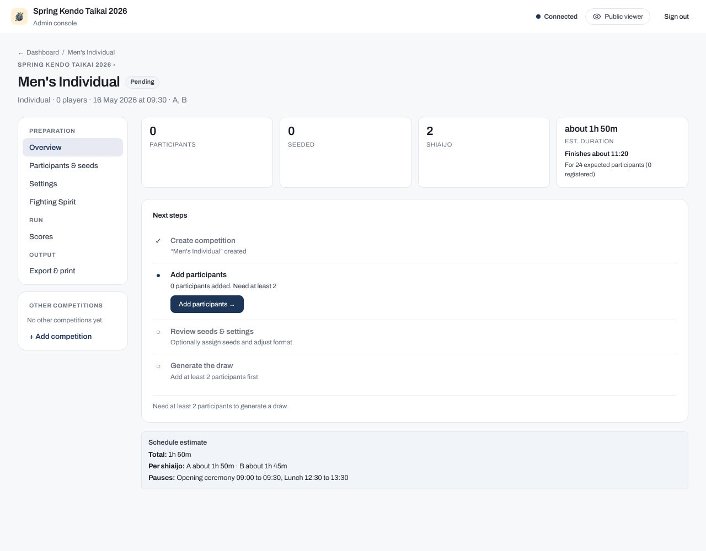

For a kachinuki (winner stays on) competition the number of bouts is not fixed, so the estimate is a range rather than a single figure. The tile is headed **Average est. duration** and a line under it reads, for example, *Best 2h 09m to worst 4h 28m*. Best is a clean sweep where one fighter wins every bout, worst is the longest run where each bout retires one fighter, and the average sits between them. Use the worst figure for planning the day and the average for a realistic finish time.

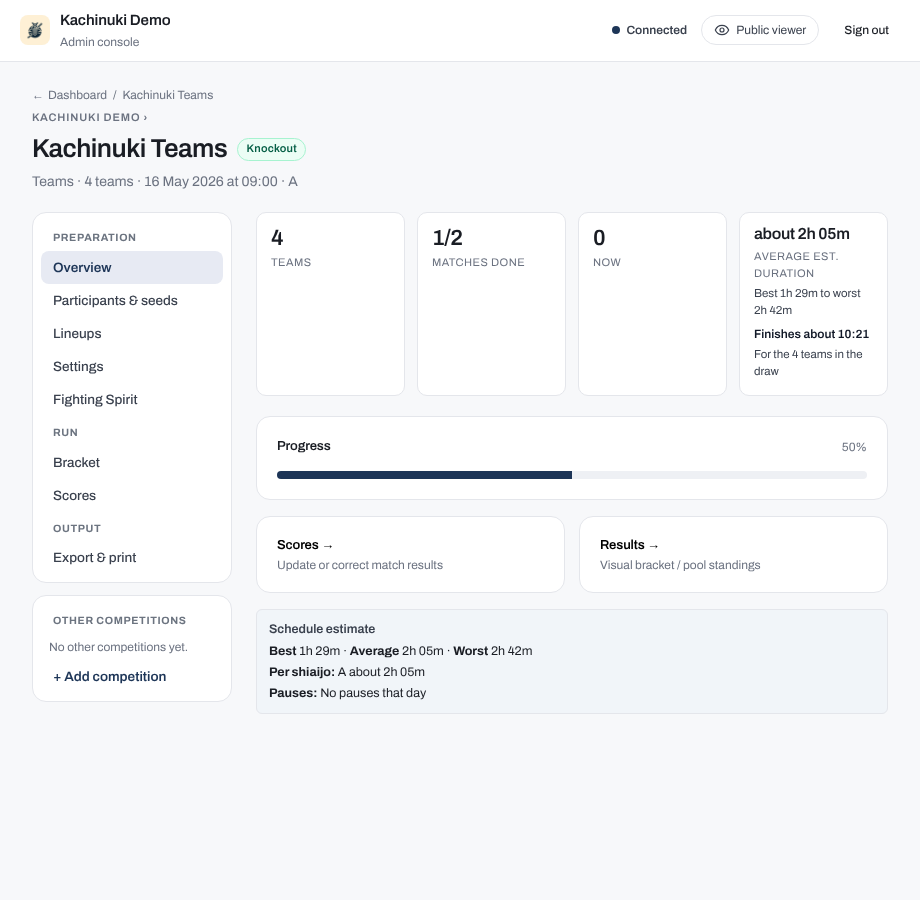

### Pauses

The **Schedule blocks** card on the tournament setup page lists the times when no matches are fought, such as lunch or an opening or closing ceremony. Click **+ Add a pause** to add one, up to 20 pauses. Each pause has:

- **Pause name**, for example `Lunch` or `Closing ceremony`.
- **Starts at**, a clock time such as `12:00`. An opening or closing ceremony is a pause too, with a start time of its own. Give a closing ceremony the time you expect the last match to end. A pause with no start time is saved, but matches will not stop for it until you give it one.
- **Length**, how long the pause lasts.
- **On**, which day it applies to, or **Every day**. This choice appears only for a tournament that lasts more than one day, or for a pause on a day the tournament no longer has. A new or changed pause must be on a day the tournament has: saving one past the last day is refused with a message naming the pause. A pause left on a day the tournament no longer has, because you shortened it, stays as it was, and matches do not stop for it.
- **Matches stop for this pause**, ticked for a new pause. Untick it for a pause that the matches go on through, for example a grading held in another hall while the matches carry on. The calendar still draws that pause on its day, lighter and marked *matches go on*, but no match time, estimate or calendar move works around it.

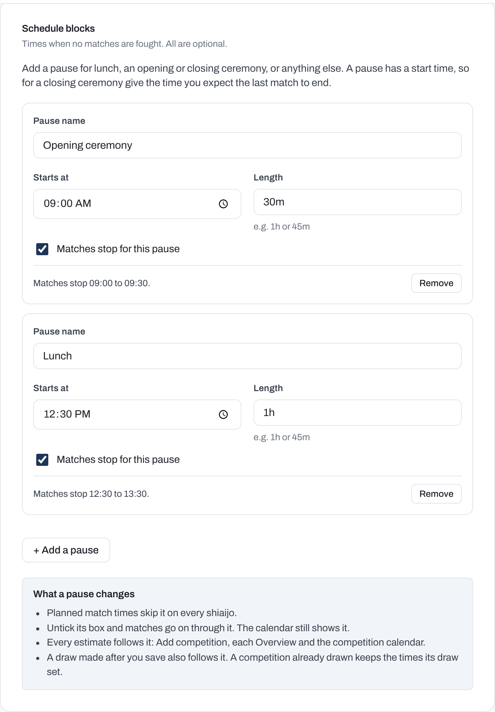

Every estimate and every new schedule works around the pauses whose **Matches stop for this pause** box is ticked. A match whose start time falls inside a pause moves to the end of that pause. A match that starts just before a pause is not shortened or moved, so it may run into the pause. Pauses that overlap count as one longer pause, and the row says so. A pause that ends after midnight is marked as such. The row of a pause the schedule skips says why, for example *Matches will not stop for this pause: give it a start time.* A competition that is already drawn keeps its match times when you add or change a pause, and the card names the competitions affected. To re-time one of them, use **Auto-schedule competition**, or [move the competition](#moving-a-competition-on-the-calendar), which re-times its matches too.

A tournament saved by an earlier version is converted when the server starts, and a restored backup that still carries the old settings is converted as the restore finishes. Its lunch break becomes a **Lunch** pause at 12:00 on every day. Its opening ceremony becomes an **Opening ceremony** pause on each day that has a competition, starting at the earliest start time of that day's competitions (09:00 for a competition with no start time). Its closing ceremony becomes a **Closing ceremony** pause with no start time, which the schedule ignores until you give it one under **Schedule blocks**. A length the app cannot read, such as `45 min`, gives a pause with no length, named with what you typed, for example *Opening ceremony (45 min)*: matches do not stop for it until you give it a length such as `45m` under **Schedule blocks**, and you can rename it then. Competitions that are already drawn keep their match times. An estimate counts a closing ceremony only once that pause has a time, and every competition that starts during the opening ceremony waits for it to end.

If the settings of one of the competitions cannot be read, the conversion waits. The lunch pause still applies, but the opening and closing ceremonies are not listed under **Schedule blocks** and no match waits for them. The [competition calendar](#competition-calendar) names that competition. Repair its `config.md` file, then restart the server, and the conversion runs again.

### Expected participants and the estimate on a new competition

The **Add competition** form has an **Expected participants** field (**Expected teams** for a team competition). Enter how many you expect to register, so you can plan the day before the entries are in. It accepts a whole number from 0 to 1024. Every estimate uses your number until more people than that have registered; if fewer register, it still uses your number, so lower it to use the registrations. When the competition uses check-in, the estimate compares your number with the people who have checked in. The number is kept with the competition and you can change it in the competition's **Settings**, where a line under the field says which count the estimates use now. Once the draw is made, the estimate uses the participants in the draw and your number no longer matters.

While you fill in the form, a live estimate below the fields shows about how long the competition will take and when it finishes, using the format, the number of shiai-jo, the match durations and the tournament's pauses. It appears once the form has an expected number above 0 and a start time, and updates as you change the fields. If the finish falls after midnight, the estimate says so and suggests an earlier start or more shiai-jo. Once the draw is made, the finish comes from the draw itself and no longer from the estimate.

If you pick more shiai-jo than the entry can use at once, a warning says so, for example *With 2 participants only 1 match can run at a time, so a second shiaijo would stand empty. Use 1 shiaijo.* Its **Change shiaijo** button takes you to the shiai-jo field. The warning does not stop you creating the competition. If the estimate cannot be worked out, the form says why and that you can still create the competition, for example *Could not work out an estimate right now. You can still create the competition.*, with a **Try again** button.

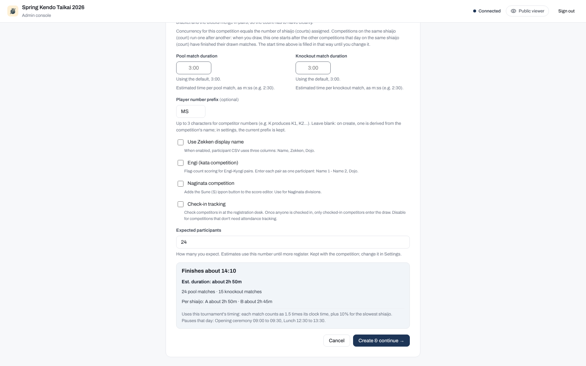

A kachinuki team competition shows the range it could end in, and the past-midnight warning appears when the latest finish in that range is after midnight.

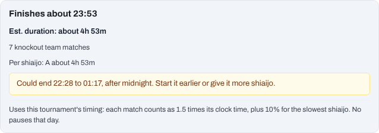

### Competition calendar

Open **Competition calendar** from the dashboard to see every competition on its day and shiai-jo, from its start time to its expected finish. A competition that is already drawn takes its times from the draw; one that is not drawn yet uses the estimate. Click a competition to open it.

Until the tournament has a date, the calendar shows *Set the tournament date first.* in place of the days. Click **Edit tournament** and fill in **Start date (Day 1)** and **Number of days**.

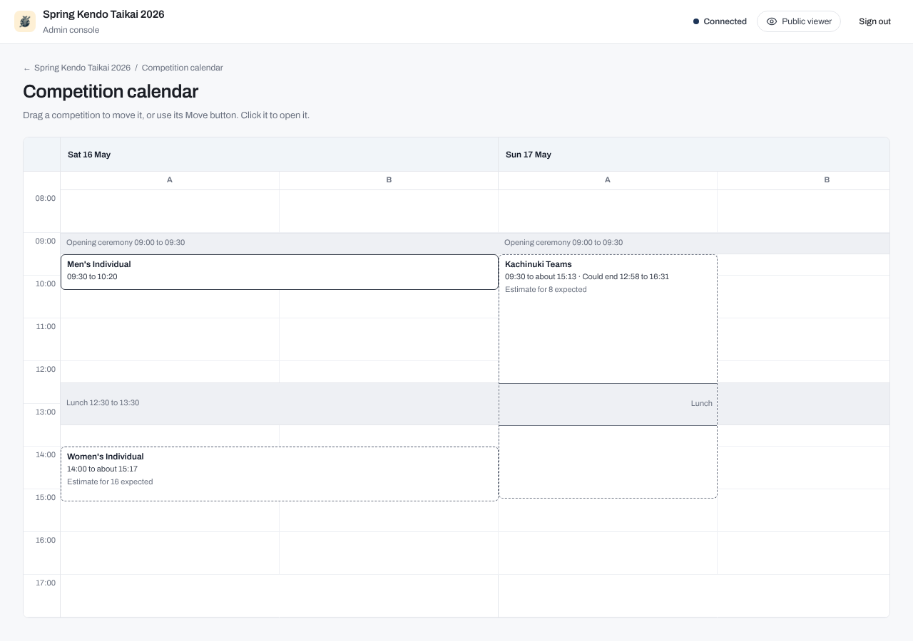

When two competitions on the same shiai-jo overlap, both are marked, and an overlap on a day that is not on screen is listed above the calendar with a button to show that day.

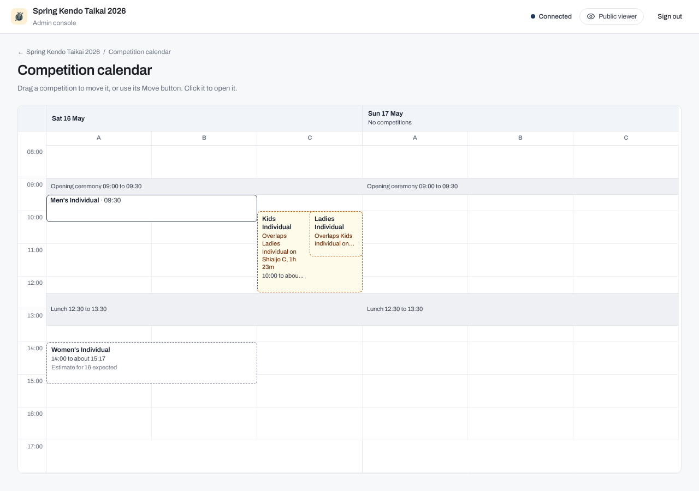

The calendar can also show the following:

- **Not on the calendar**, a tray of competitions that cannot be placed yet, for example because one needs a start time or a date, or its date is outside the tournament. Each one names the reason, so open the competition's **Settings** to fix it. A line above the calendar tells you how many there are and has a **Show them** button that scrolls to the tray.
- **No real length.** A competition with no participants yet and no expected number is drawn as a dotted block with a **?** and the words *No participants yet: length unknown*. The tray counts these too. Set **Expected participants** in its **Settings** to give it a length.
- **Settings that could not be read.** A competition whose settings file cannot be read is left off the calendar, and the notice gives its id so you can check that competition's `config.md` file rather than think it was never created.
- **A pause the schedule skips**, in a line such as *Matches will not stop for Lunch: it has no start time.* The other reasons are that it has no length, that its start time could not be read, or that its day is outside the tournament. **Edit tournament** opens the tournament setup page, where the pause is listed under **Schedule blocks**, so you can correct it.

### Moving a competition on the calendar

Drag a competition's block to another day or start time. On a touch screen, press and hold the block first, then drag; let go without dragging and the Move dialog opens. On a computer or a tablet you can also use the block's **Move** button, or press **M** while the block is focused. A phone shows no Move buttons: tap a block to open its competition. Every block is drawn at its real start and end, so a short one may show only its name, and on a tablet a block too short for its Move button has none. A move that makes two competitions overlap on a shiai-jo is warned about, not refused. A competition that is running or completed cannot be moved, and its block says so. A drawn competition also cannot move to a start that would carry matches past midnight.

Pause times are drawn as bands across each day. A pause that the matches go on through is drawn lighter, and its band ends with *matches go on*. The time span in a block reads, for example, *09:30 to about 13:38* for an estimate or *14:15 to 16:02* for a draw. A block built from an expected number says so (*Estimate for 24 expected*).

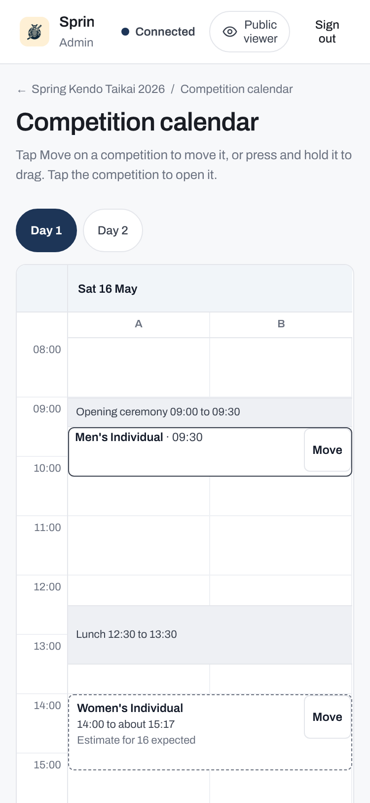

The Move dialog lets you pick the day, the start time and the shiai-jo. Starts snap to 5 minutes, and a start that falls inside a pause moves to the end of that pause.

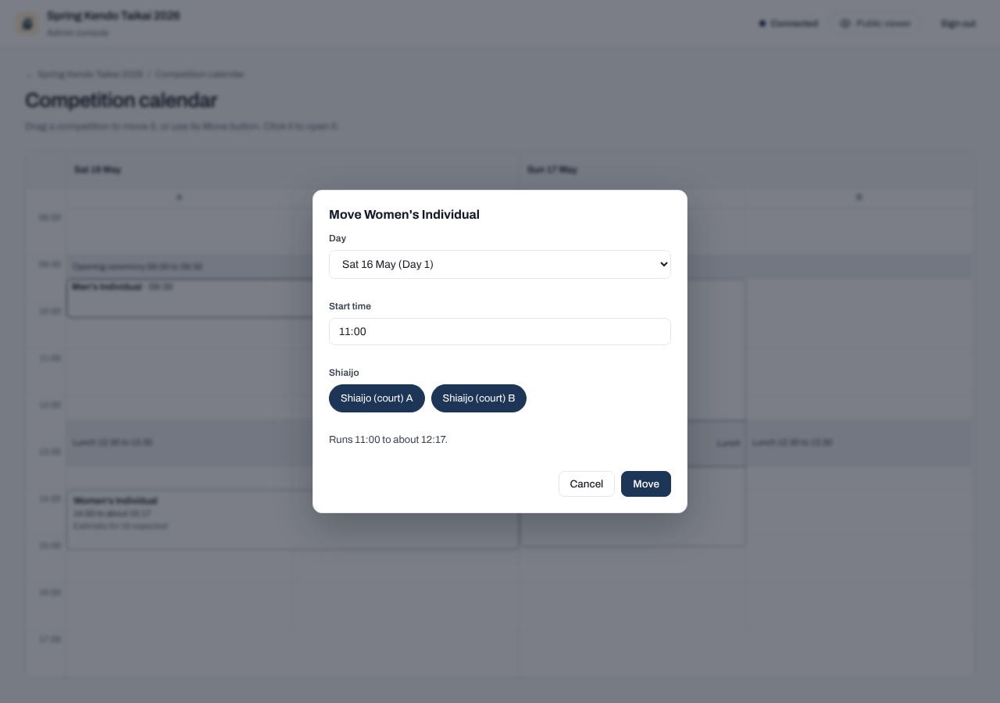

A competition that is already drawn moves by day and start time only, and keeps its shiai-jo. Its matches move with it: each match gets the time the draw would give it at the new day and start, in the same order, and nothing else about the pools, the bracket or the competitor numbers changes. Before you confirm, the message shows each shiai-jo's old and new times. If its matches at their new times would overlap another competition on a shared shiai-jo, the Move dialog names that competition and the shiai-jo, as it does for a competition not drawn yet; you can still move it. If some matches no longer have the times a fresh draw would give them (a time you set by hand, a pause you added or changed, or another competition you moved), the message says so and those matches get new times too. If no match would change its time, the move is saved without asking. The competition and its matches are saved together, or not at all. Changing the **Date** or **Start time** in the competition's **Settings** does the same, with the same message before you save.

A drawn competition's move also waits for match time changes still held on this device, so none lands on the old day. Dragging a block on the calendar does not wait: it says "Not moved yet: 2 time changes made on this device are still being sent. Open Move to wait for them, or to move it now anyway.", and the **Move** dialog offers the wait. In the dialog, a screen titled "Waiting before the move" reads, for example, "Waiting for 2 time changes to be sent. The move is made once they arrive.", with **Cancel** and **Move now anyway**. The move is made on its own when the last one arrives. **Move now anyway** asks you to confirm first, because a time changed before the move may land on the old day.

A drawn competition cannot move, on the calendar or from its **Settings**, to a start where some of its matches would run past midnight, because a match time cannot show the next day. The message says *At that start some matches would run past midnight, which a match time cannot show. Choose an earlier start. Nothing was changed.* It also cannot move onto a day where another competition plans a shared shiai-jo until after midnight; the message names that shiai-jo and competition. A drawn league whose stored match order no longer follows the draw's pattern, for example after you moved one of its matches to another shiai-jo, cannot be re-timed either: the message says its match order could not be read back. In each case nothing is moved.

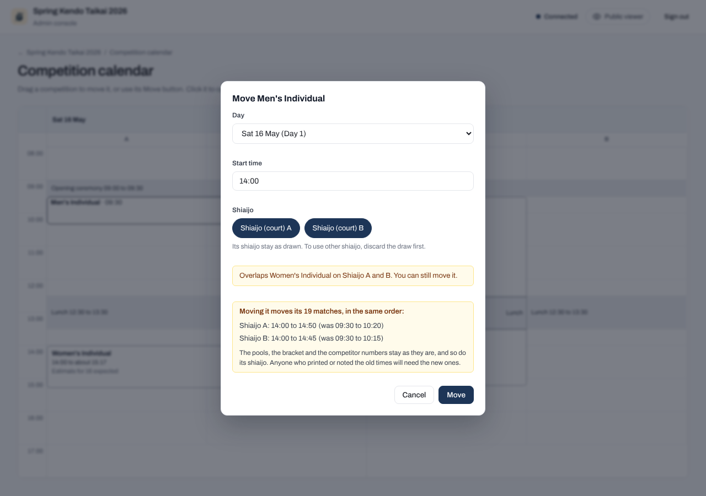

After a move, a message names where the competition moved from and to, and a line saying it was moved just now, with an **Undo** button, stays above the calendar until you move something else or leave the page. Undo puts the settings back and, for a drawn competition, every match back to its exact earlier time. If anything changed in the meantime, such as a match time you edited, Undo says *Changed since the move; Undo not applied.* and changes nothing.

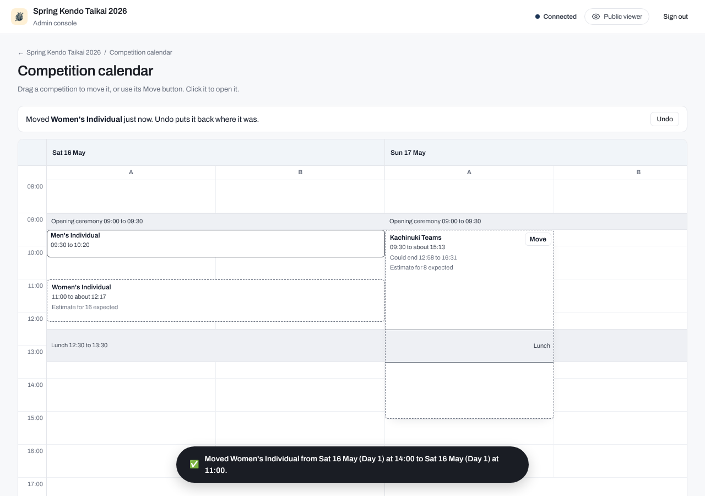

If someone else changed the competition after the calendar loaded (another screen, another device or its **Settings** page), the move is refused with *This competition changed, reload it.* and nothing is moved. The **Settings** page does the same: if the competition changed somewhere else after you opened it, **Save** is refused, the message lists what you had changed, and you click **Reload** to see the current settings and make your change again.

### Sharing a shiai-jo between competitions

Several competitions may be assigned the same shiai-jo. By default they run one after another, not on top of each other: when you draw a competition, its first match on a shared shiai-jo is placed no earlier than the planned end of the last match on that shiai-jo of every other competition on the same day that is already drawn there and starts at the same time or earlier. If two competitions have the same start time, the one drawn second goes after the one drawn first. Only competitions on the same day count. A tie-break or representative bout added later, and a later Swiss round, are placed after the planned end of the last match the competition already has on that shiai-jo (a match you moved to a later time included), so they do not land on top of it or of the other competition.

Scheduled times are clock times within one day. If another competition on a shared shiai-jo is planned to run until midnight or later, the draw is refused with a message naming the shiai-jo and that competition: move this competition to another shiai-jo or day, or re-time the other one with **Auto-schedule competition**.

The Create competition form fills in the start time for you: it is set to the latest planned end of the other same-day competitions that share one of the shiai-jo you pick (using the plan of the ones already drawn, and an estimate for those not yet drawn). If none shares a shiai-jo, it stays at 09:00. Change the start time yourself and your value stays; changing the shiai-jo or date before you touch the start time recalculates it. The hint under the shiai-jo field repeats this: competitions on the same shiai-jo run one after another, and the start time is filled in that way until you change it.

A few limits apply: a competition drawn before an earlier-starting one is not moved; a later phase (for example the knockout after the pools) is only placed after competitions that start no later than its own, so an earlier-starting competition's knockout that is drawn after a later competition has taken the shiai-jo follows its own pool phase and can overlap the later one. A start time you set by hand can still overlap another competition; the schedule warns about an overlap when you create or save settings.

To re-time a competition, use **Auto-schedule competition** on the **Tournament schedule**. It is not held back by the other competitions, so use it after drawing in an unusual order, or to interleave competitions on one shiai-jo on purpose. It distributes that competition's matches across its shiai-jo by its own settings.

On the spectator views, there is [one "Next up" bout per shiai-jo](../spectators/following.md#next-up-on-each-shiai-jo) across all competitions sharing that court.

At the table, note that after a match finishes, the court console stays on the competition you are scoring (it never switches competition or court by itself), while the public screens may name the next match by printed time, which can belong to another competition sharing the shiai-jo. This is rare by default because shared shiai-jo are staggered; it happens when you interleave on purpose with Auto-schedule.

### When a shiai-jo runs ahead or behind

Planned start times stored for matches are never rewritten by the app. When a shiai-jo drifts 5 or more minutes ahead of or behind its plan, public screens, the court console, and TV boards display a projected start time like "~10:52" instead. Refer to [Projected start times](../spectators/following.md#projected-start-times) for details on where these times appear.

On the **Tournament schedule**, the **Court pace** panel tracks today's drift for every shiai-jo across all competitions running on it, the same estimate the public screens show. It shows whether each court is "On track" or "N m behind/ahead", along with the first waiting bout's projected start time. The schedule rows and the **Scores** tab keep showing the original planned times so you can edit the schedule accurately. To change the plan itself, use **Auto-schedule competition** or edit individual match times on the schedule.

The projected time has a few practical limits:

- It is an estimate, not a promise.
- Correcting the shiai-jo's last finished bout re-stamps that bout and can move the estimate.
- A bout that starts late after the shiai-jo stood idle shows the next bout at the current time (for example ~10:52 at 10:52) until the running bout ends.
- A bout that cannot be fought because a competitor withdrew keeps its planned time and does not move the estimate for the bouts after it.
- It takes the time from the tournament server, so it relies only on each device being set to the venue's time zone.

### Moving matches between shiai-jo

A match can be moved to another shiai-jo from the schedule page (by using its court picker, or by dragging the match to another court's column), as well as from the **Scores** tab row's court picker, the **Bracket** tab's running-match panel picker, or the court console, which has no court picker for the match running there.

Moving a running match asks for confirmation first: once confirmed, the match stops running, keeps its score, and goes first in the new shiai-jo's queue, ready to be started again there. Moving a waiting match places it last in that shiai-jo's queue. The place is set through the match's scheduled time: one minute before the earliest waiting match there for first (or the same time, when that is 00:00), and one minute after the latest for last (or the same time, when that is 23:59). A match whose own time is already ahead of, or behind, all of them keeps it. Only waiting matches whose two competitors are known count: a knockout match still waiting for the matches that feed it does not. A pool bout always stays ahead of its own competition's knockout, which moves later to follow the pools, though never past 23:59. Where none of the waiting matches on that shiai-jo has a time, a waiting match moved there loses its time and joins them at the end of the queue, while a running match keeps its time and goes ahead of them. A finished match keeps its result and time and only changes shiai-jo. If a waiting match is moved back, it is placed last on the old shiai-jo rather than returning to its previous slot; use the up and down arrows on the court console or edit the match's time on the schedule page to reorder it. A running match moved by mistake can be started again on the new shiai-jo, or moved back (it is waiting by then, so it goes last) and started from the queue. A move that reaches the server after the match was started on another device is refused with the reason; [Score a match](../court-operators/scoring-a-match.md) covers the refusals and the History line a move leaves.
