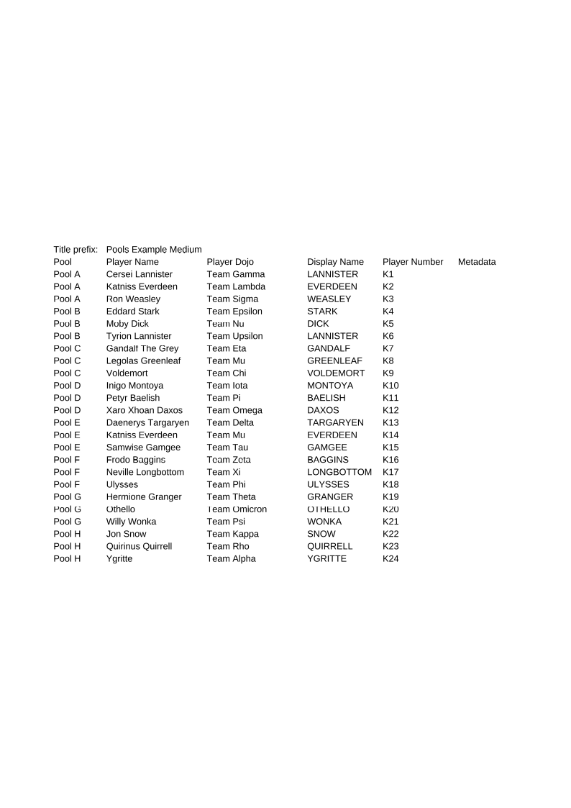
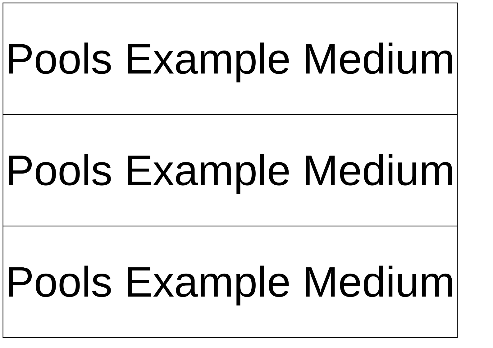
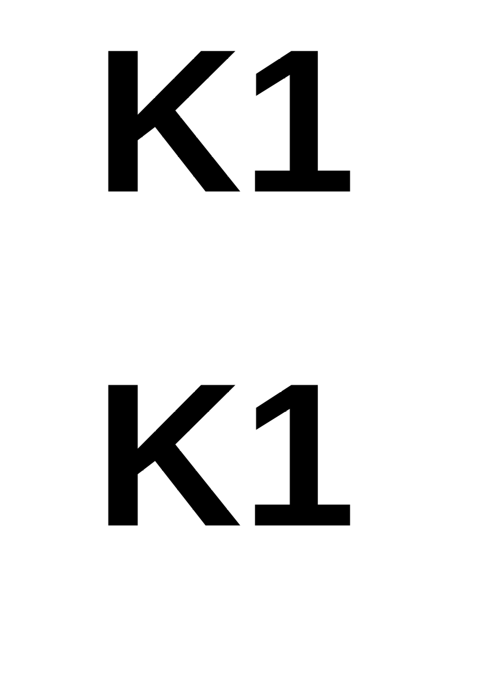
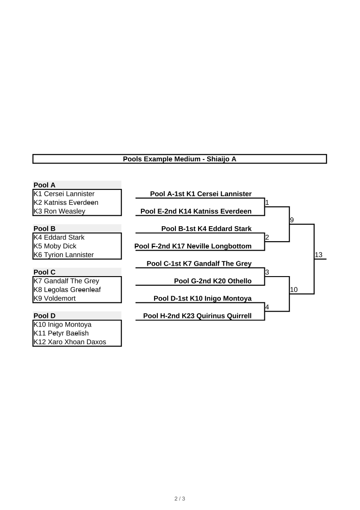
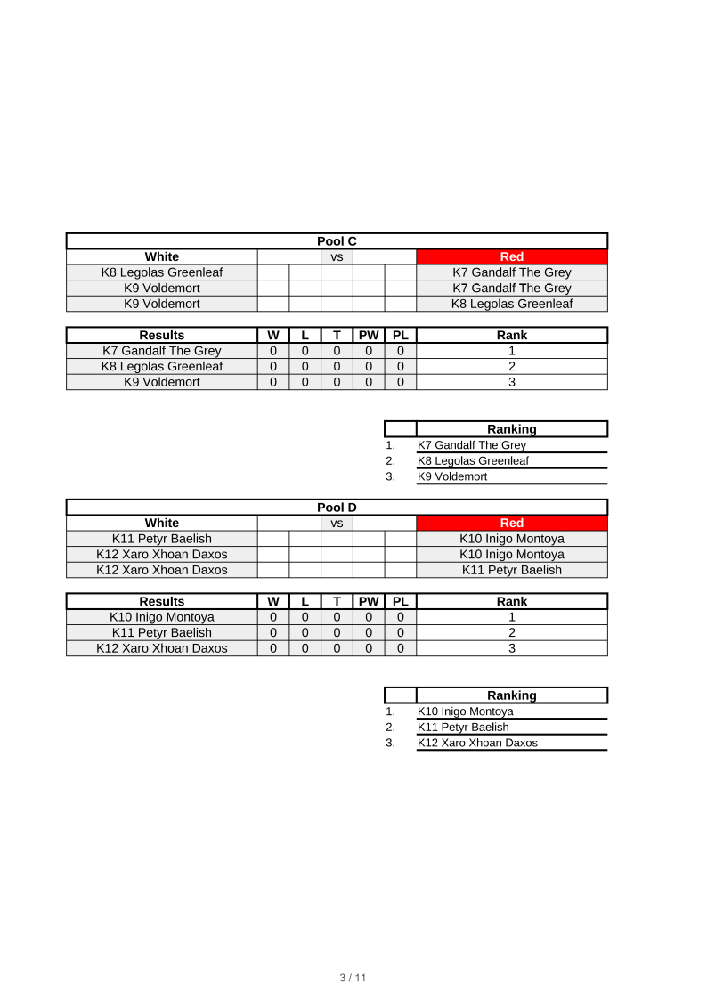
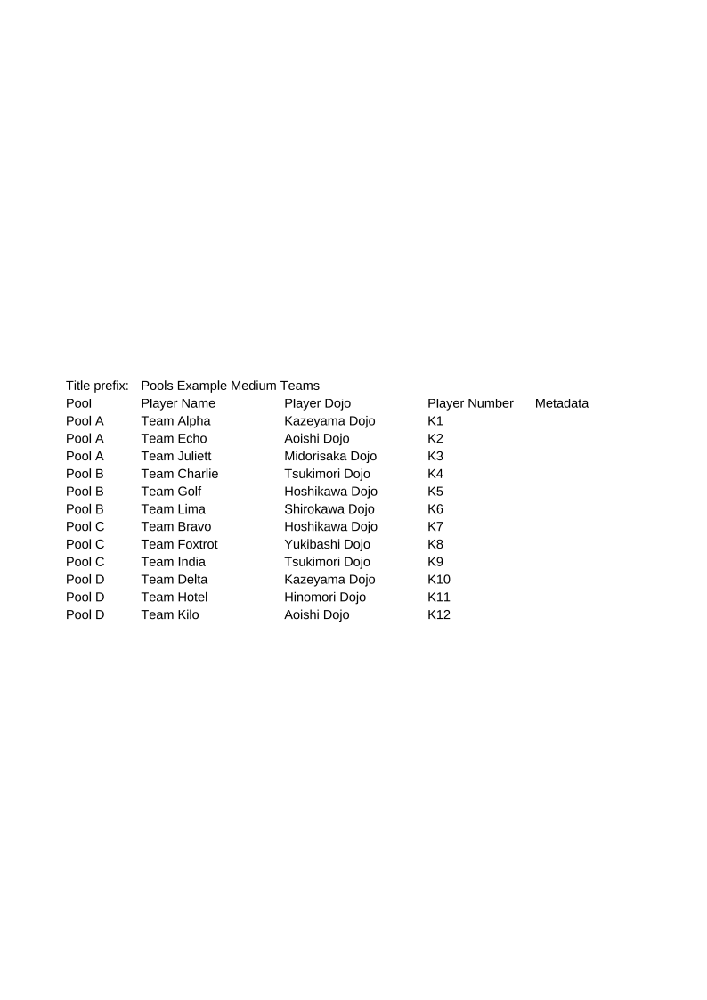
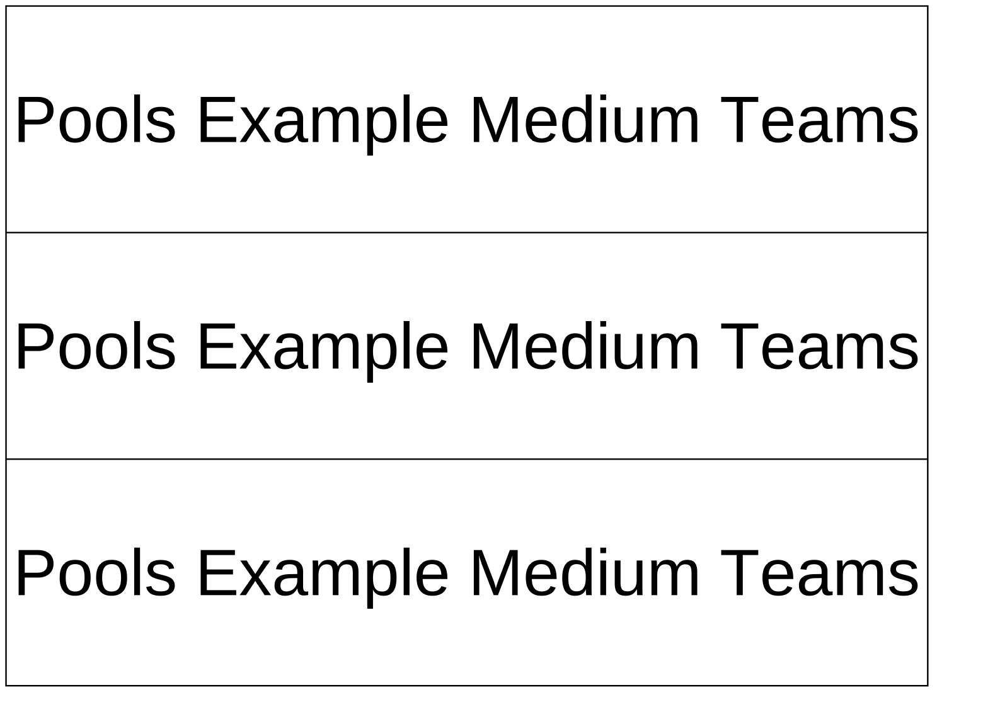
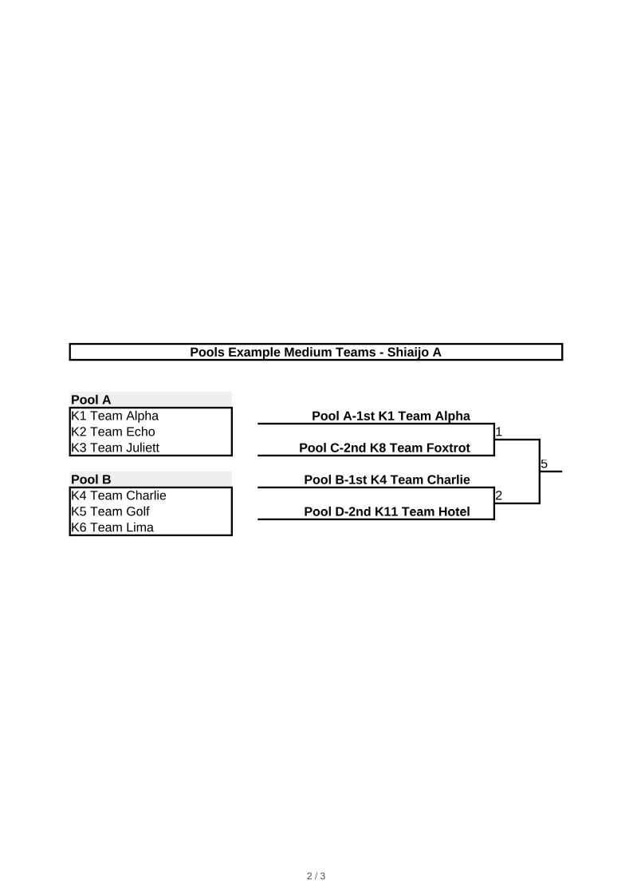
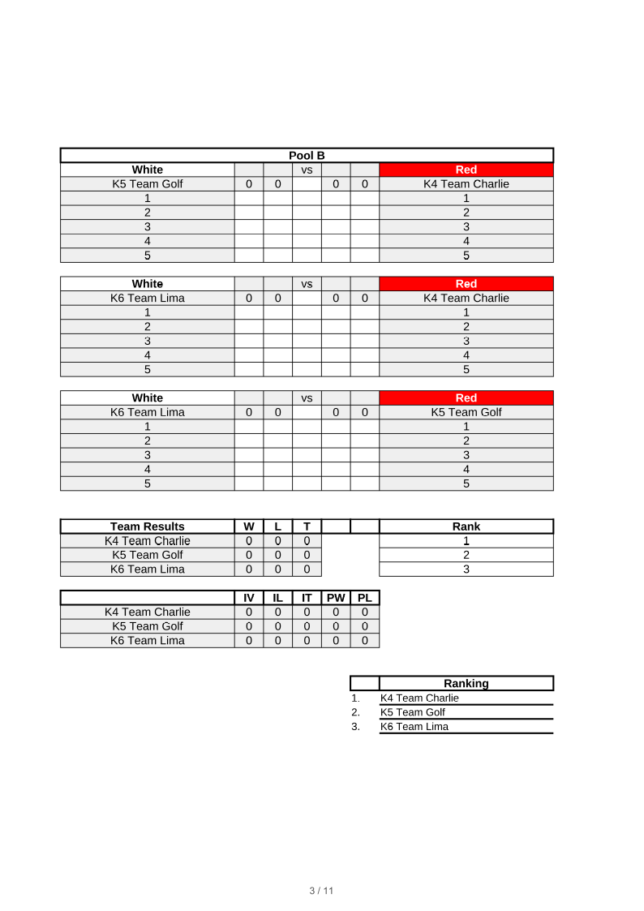

# Sample printouts

These are the PDFs printed for two example competitions, so you can see what each one looks like before you print your own. **Export PDFs** in the tournament app and the [`print`](../commands/print.md) command print the same sheets. Select a picture to open the whole PDF.

Each picture shows one page; the text above it says what the rest of that PDF holds.

## Individual competition

24 competitors in pools of three, the first two of each pool going through to a knockout, on two shiai-jo. Printed from the example workbook [pools-example-medium.xlsx](https://github.com/gitrgoliveira/bracket-creator/blob/main/pools-example-medium.xlsx).

### Registration sheet

The list of competitors with their pool, name, dojo, zekken name and number. A4.

[{ width="360" }](../../samples/pools-example-medium/print_registration.pdf)

### Name sheets

A3 landscape. After a title page, each shiai-jo's sheets open with this page: the competition's name three times, to cut out and put on the scoreboard. The pages after it hold the competitors' numbers and names, three to a page.

[{ width="480" }](../../samples/pools-example-medium/print_names_to_print.pdf)

### Competitor tags

Each competitor's number, printed large, one page for each competitor. A4. A tag also carries a QR code when the tournament's public URL is set; this sample has none.

[{ width="360" }](../../samples/pools-example-medium/print_tags.pdf)

### Pools and trees

A booklet for competitors and coaches: the pool draw, then each shiai-jo's knockout tree with the pools beside it. A4.

[{ width="360" }](../../samples/pools-example-medium/print_pools_and_trees.pdf)

### Full bracket

Everything the tables need to run the day on paper. A4. It holds:

- the pool draw
- every pool's matches with a results table
- every knockout match
- the trees

[{ width="360" }](../../samples/pools-example-medium/print_full_bracket.pdf)

## Team competition

12 teams of five in pools of three, the first two of each pool going through to a knockout, on two shiai-jo. Printed from the example workbook [pools-example-medium-teams.xlsx](https://github.com/gitrgoliveira/bracket-creator/blob/main/pools-example-medium-teams.xlsx). There are no competitor tags: tags are printed for individual competitors only. With `print`, a workbook counts as a team one when its name contains `team` or it is named with `--team-file`.

### Registration sheet

The list of teams with their pool, dojo and number. A4.

[{ width="360" }](../../samples/pools-example-medium-teams/print_registration.pdf)

### Name sheets

A3 landscape, with the competition's name three times after the title page, like the individual competition's. The pages after it hold the teams' numbers and names.

[{ width="480" }](../../samples/pools-example-medium-teams/print_names_to_print.pdf)

### Pools and trees

The pool draw, then each shiai-jo's knockout tree with its pools beside it. A4.

[{ width="360" }](../../samples/pools-example-medium-teams/print_pools_and_trees.pdf)

### Full bracket

A4. It holds:

- the pool draw
- every team match, with a numbered row for each of its five bouts
- every knockout match
- the trees

[{ width="360" }](../../samples/pools-example-medium-teams/print_full_bracket.pdf)
