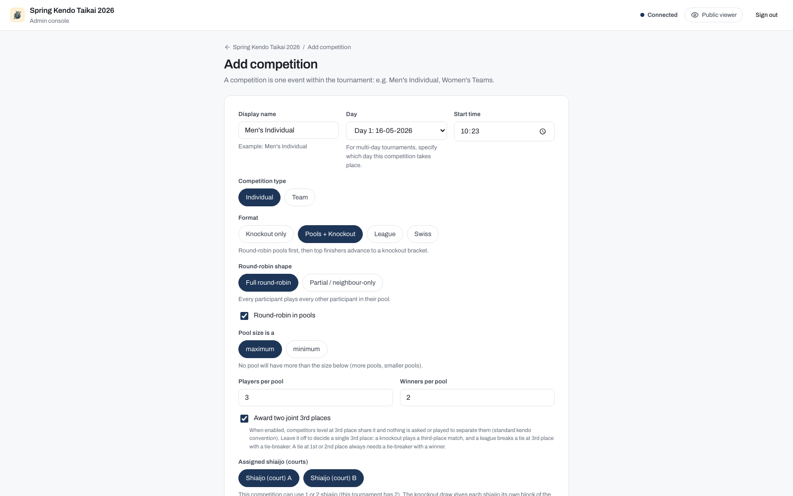
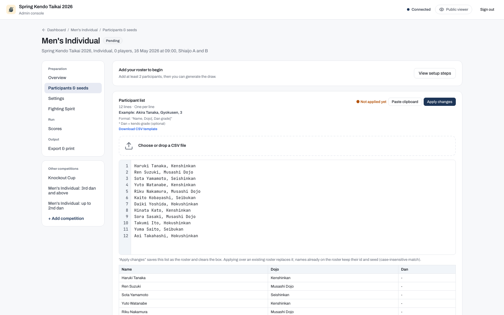
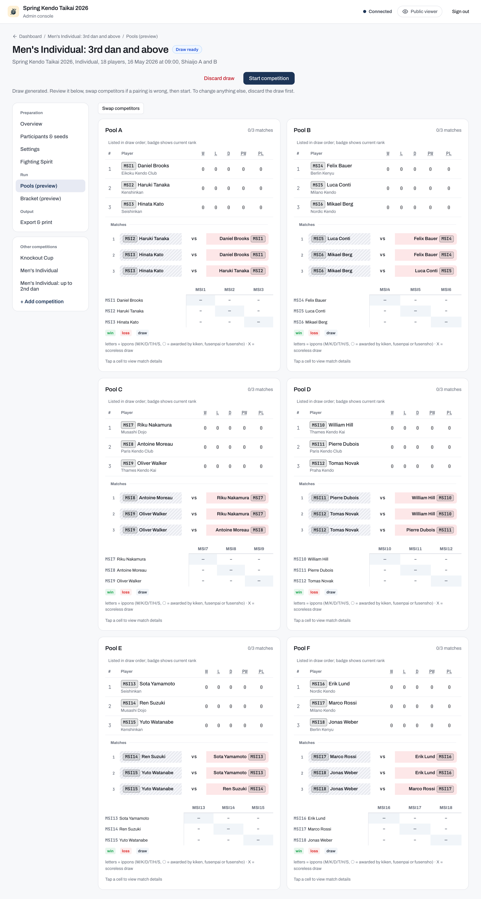
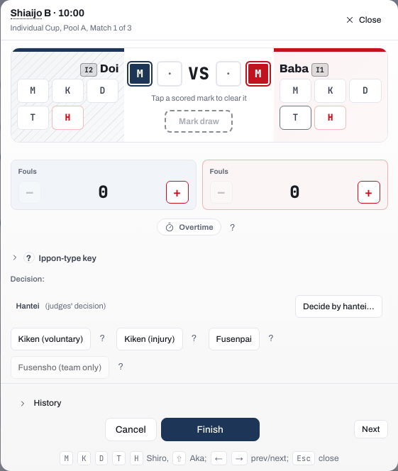

# Your first tournament

This page walks you through the fastest path from a running server to real-time results on a screen. Each step links to the full reference for that topic.

## 1. Install and start the server

Install the binary by following [Installation](../install/install.md), then start the tournament app:

```bash
bracket-creator mobile-app --folder ./tournament-data --bind 0.0.0.0
```

`--bind 0.0.0.0` lets the other devices in the hall (a scoreboard screen, a phone) reach the app; without it only this computer can. The operating system may ask whether to allow incoming connections for bracket-creator: allow them, or the other devices cannot connect. Refer to [Start the server](../organisers/run-tournament.md#start-the-server) for the server's flags, and to [Security notes](../organisers/operating-modes.md#security-notes) for what opening the app to the hall network means for the admin password.

Open `http://localhost:8080` in a browser on the same computer. When the data folder is empty, the app prompts you to create a tournament. Fill in the name, date, venue, number of shiai-jo, and the admin password. Before you set the password, read [Operating modes](../organisers/operating-modes.md) to choose between officiated and self-run.

## 2. Create a competition

From the dashboard, click **+ Add competition**. Choose Individual or Team, then pick a format: **Knockout only**, **Pools + Knockout**, **League**, or **Swiss**. Refer to [Formats](../organisers/formats.md) for a description of each format and when to use it.

The number of shiai-jo you entered in [Install and start the server](#1-install-and-start-the-server) is your venue's total. It can be anything from 1 to 16. Each competition is then assigned some of them. A competition that ends in a knockout must be assigned 1, 2, 4, 8 or 16, because its bracket splits into one block per shiai-jo, and those blocks merge in pairs. So a hall with three shiai-jo runs each competition on 1 or 2, and can run two competitions at once to use all three. Refer to [Assigning shiai-jo](../organisers/run-tournament.md#assigning-shiai-jo).



## 3. Add competitors

Open the competition setup and paste a newline-separated roster into the participant panel, then click **Apply changes**. The [Run a tournament](../organisers/run-tournament.md) guide covers import options and roster management in full.



## 4. Generate the draw and start

Click **Generate draw** to build the pools and bracket. Review the preview, then click **Start competition**. Matches now appear to scorers and to the public viewer page.



## 5. Enter a score

Go to the **Scores** tab, open a match, and record the result. Refer to [Scoring a match](../court-operators/scoring-a-match.md) for the full scoring workflow, including points, decisions, and team bouts.



!!! tip
    Open `http://<laptop address>:8080` on a second screen (a scoreboard TV or a phone on the same network) with no password, for example `http://192.168.1.10:8080`. The laptop's address is the IP address shown in its Wi-Fi or network settings (or printed by `ipconfig` on Windows and `ip addr` on Linux). Standings and brackets update in real time as a scorer records each result. Refer to [Following a tournament](../spectators/following.md) for the full viewer experience.

## If you print your brackets instead

Steps 1 to 5 run the whole tournament in the app. To work from printed brackets and an Excel file instead, with no app on the day:

1. **Collect participants**: one name per line in a CSV file ([input format](../organisers/input-format.md))
2. **Generate the bracket**: run `create-pools` or `create-knockout` ([commands](../commands/create-pools.md))
3. **Optionally seed** top competitors so they land in separate pools/sides of the bracket ([seeding](../commands/create-pools.md#seeding))
4. **Print**: the Excel file is laid out to print cleanly on A4/A3

On the day you need:

- **A3 printer**: for team/competitor name sheets
- **A4 printer**: for the bracket trees
- **Scoreboards, whiteboard markers, scissors, tasuki**: for keeping score at the courts and marking competitors

### Keep courts in sync

If you have multiple shiai-jo and run on printed brackets, upload the Excel file to Google Drive (or similar) so every table works from the same document.

## Next steps

For the complete organiser workflow, including pools, seeding, and competition settings, refer to [Run a tournament](../organisers/run-tournament.md). Before the event, take a backup of the whole tournament: refer to [Backup and restore](../organisers/backup-and-restore.md). The tournament app, the Legacy Web UI and the command line all ship in the one binary. To generate print-ready brackets without the tournament app, refer to [Legacy Web UI](../organisers/web-ui.md) (in the browser, no CSV editing needed) and the [create-pools](../commands/create-pools.md) and [create-knockout](../commands/create-knockout.md) commands.
